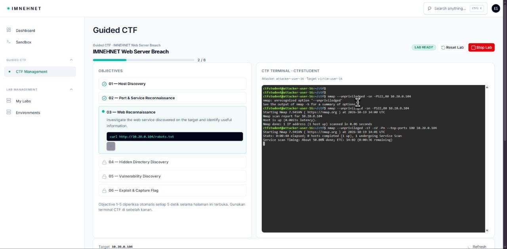
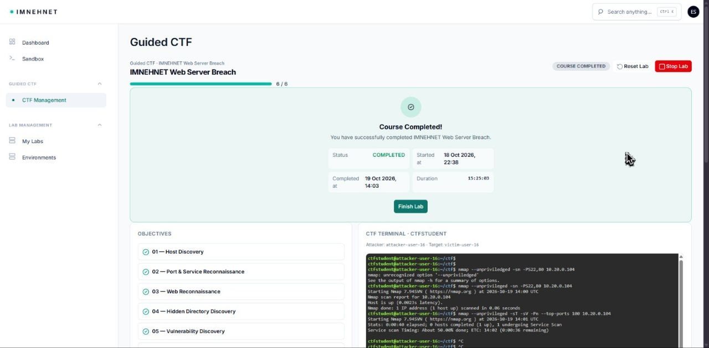

# Milestone: Guided CTF End-to-End Smoke Test Berhasil

**Tanggal keberhasilan:** Senin, 19 Oktober 2026  
**Hasil:** PASS  
**Skenario:** `IMNEHNET Web Server Breach`

## Ringkasan

Pada 19 Oktober 2026, tim IMNEHNET berhasil menyelesaikan smoke test end-to-end pertama yang terdokumentasi untuk alur Guided CTF. Bukti portal menunjukkan lab berstatus `LAB READY`, progres berjalan dari `2/6`, dan seluruh enam objective akhirnya mencapai `6/6` dengan status `COURSE COMPLETED`.

Waktu yang ditampilkan portal:

- Mulai: 18 Oktober 2026 pukul 22:38.
- Selesai: 19 Oktober 2026 pukul 14:03.
- Durasi: `15:25:03`.

## Alur yang Terbukti

1. Guided CTF `IMNEHNET Web Server Breach` dapat dibuka.
2. Portal menampilkan pasangan environment attacker dan target.
3. Terminal CTF dapat digunakan untuk reconnaissance terhadap target lab.
4. Objective dapat maju secara berurutan dari discovery sampai exploit/capture flag.
5. Portal mencatat penyelesaian keenam objective dan menampilkan status course selesai.

Objective yang ditampilkan:

1. Host Discovery
2. Port & Service Reconnaissance
3. Web Reconnaissance
4. Hidden Directory Discovery
5. Vulnerability Discovery
6. Exploit & Capture Flag

## Bukti

### Progres 2/6

### Course completed 6/6

## Batas Klaim

Milestone ini membuktikan keberhasilan alur Guided CTF yang terlihat pada bukti di atas. Bukti ini tidak dengan sendirinya menyatakan bahwa seluruh operasi lifecycle portal, micro-segmentation, monitoring Wazuh, pengujian multi-user, performa, atau skalabilitas platform telah lulus.

Dua screenshot portal yang diarsipkan tidak memuat password. Screenshot percakapan yang menampilkan kredensial plaintext sengaja tidak dimasukkan ke repository.
