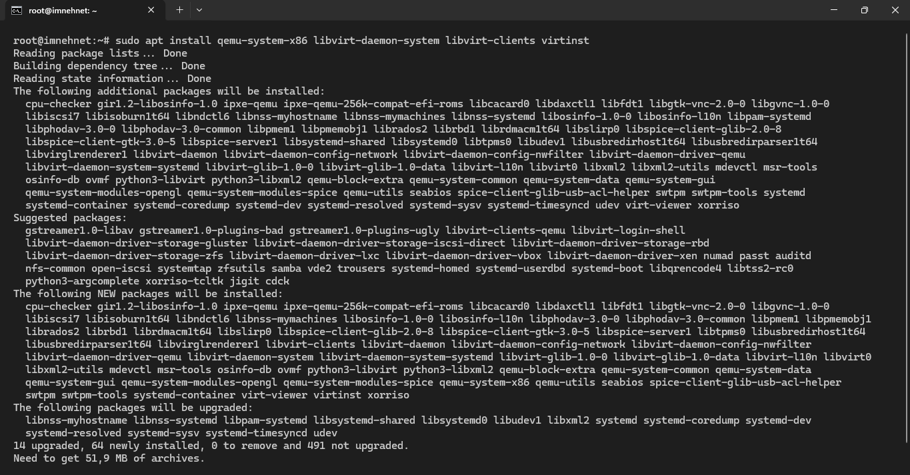

# Dokumentasi 01 — Verifikasi Server Fisik dan Lingkungan Virtualisasi

## Tujuan

Melakukan pemeriksaan terhadap spesifikasi dan sumber daya server fisik yang akan digunakan sebagai infrastruktur utama proyek IMNEHNET. Tahap ini juga mencakup persiapan lingkungan virtualisasi menggunakan KVM, QEMU, dan libvirt sebagai dasar pembuatan dan pengelolaan Virtual Machine (VM).

## Kondisi Awal

Server fisik menggunakan sistem operasi Linux Mint 22.2 dengan hostname `imnehnet`. Server akan digunakan untuk menjalankan beberapa VM yang mendukung kebutuhan infrastruktur Lab-as-a-Service (LaaS).

## Langkah Pengerjaan

### 1. Pemeriksaan Identitas dan Sistem Operasi Server

Melakukan pemeriksaan informasi dasar server untuk mengetahui hostname, sistem operasi, kernel, dan arsitektur perangkat.

```bash
hostnamectl
```

**Hasil yang diharapkan:**
- Hostname: `imnehnet`
- Operating System: Linux Mint 22.2
- Architecture: x86-64

### 2. Pemeriksaan Spesifikasi Perangkat Keras

Memeriksa prosesor, jumlah CPU, dan kapasitas RAM yang tersedia pada server.

```bash
lscpu
free -h
```

**Hasil yang diharapkan:**
- Prosesor: Intel Core i5-4460 @ 3.20 GHz
- Jumlah CPU: 4
- RAM: 16 GB

### 3. Pemeriksaan Kapasitas Penyimpanan

Memeriksa perangkat penyimpanan dan kapasitas disk yang tersedia untuk kebutuhan sistem operasi, VM, dan environment praktikum.

```bash
lsblk
df -h
```

**Hasil yang diharapkan:**
- Tersedia SSD dengan kapasitas sekitar 240 GB.
- Tersedia dua HDD dengan kapasitas masing-masing sekitar 1 TB.
- Lokasi penyimpanan VM menggunakan direktori yang telah disiapkan pada server.

### 4. Pemeriksaan Dukungan Virtualisasi

Memastikan prosesor dan sistem mendukung fitur virtualisasi yang dibutuhkan untuk menjalankan KVM.

```bash
egrep -c '(vmx|svm)' /proc/cpuinfo
```

**Hasil yang diharapkan:**

Perintah menampilkan angka lebih dari 0, yang menunjukkan bahwa prosesor memiliki dukungan virtualisasi hardware. Pada server IMNEHNET, hasil pemeriksaan menunjukkan angka `8`.

### 5. Persiapan Lingkungan Virtualisasi

Melakukan pemasangan komponen virtualisasi KVM, QEMU, dan libvirt untuk mendukung pembuatan serta pengelolaan VM.

```bash
sudo apt update
sudo apt install qemu-kvm libvirt-daemon-system libvirt-clients virtinst -y
```

Memastikan layanan libvirt berjalan dan dapat digunakan.

```bash
sudo systemctl status libvirtd
```

**Hasil yang diharapkan:**

Komponen virtualisasi berhasil dipasang dan layanan libvirt berjalan pada server.

### 6. Verifikasi Lingkungan Virtualisasi

Memastikan koneksi ke libvirt dapat dilakukan dan sistem siap digunakan untuk mengelola VM.

```bash
virsh list --all
```

**Hasil yang diharapkan:**

Perintah berhasil dijalankan dan menampilkan daftar VM yang terdaftar pada libvirt. Pada tahap awal, daftar dapat masih kosong karena VM belum dibuat.

## Dokumentasi

1. Hasil pemeriksaan hostname dan sistem operasi server.
   
   
2. Hasil pemeriksaan spesifikasi CPU dan RAM.
   
   

3. Hasil pemeriksaan kapasitas penyimpanan.
   
   
   
4. Hasil pemeriksaan dukungan virtualisasi.
   
   
5. Proses instalasi komponen KVM, QEMU, dan libvirt.
   
    
6. Hasil pemeriksaan status layanan libvirt.
   
    
7. Hasil verifikasi koneksi menggunakan virsh.
   
   

## Hasil Tahap

Server fisik berhasil diperiksa dan spesifikasi perangkat keras telah diketahui. Lingkungan virtualisasi KVM, QEMU, dan libvirt telah dipersiapkan sebagai dasar untuk membangun infrastruktur virtual proyek IMNEHNET.

## Kesimpulan

Tahap verifikasi server dan persiapan lingkungan virtualisasi telah dilakukan. Berdasarkan hasil pemeriksaan, server memiliki sumber daya yang dapat dimanfaatkan untuk menjalankan beberapa VM sesuai kebutuhan proyek. Lingkungan virtualisasi juga telah disiapkan untuk mendukung tahap konfigurasi infrastruktur selanjutnya.

## Tahap Berikutnya

Melakukan konfigurasi dan pembuatan Virtual Machine, yaitu IAAS-MGMT, LAB-ENV, dan LAB-ATK sesuai dengan rancangan infrastruktur proyek IMNEHNET.
