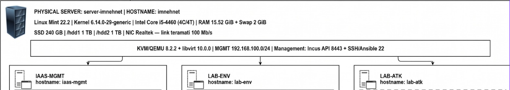
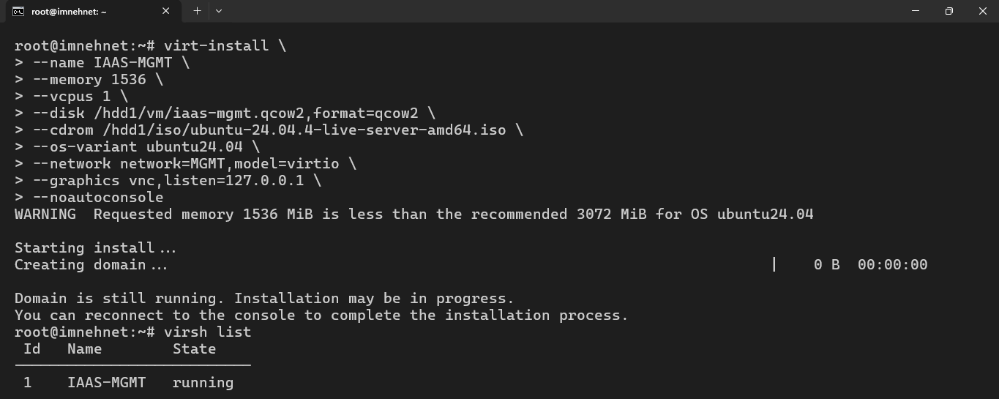
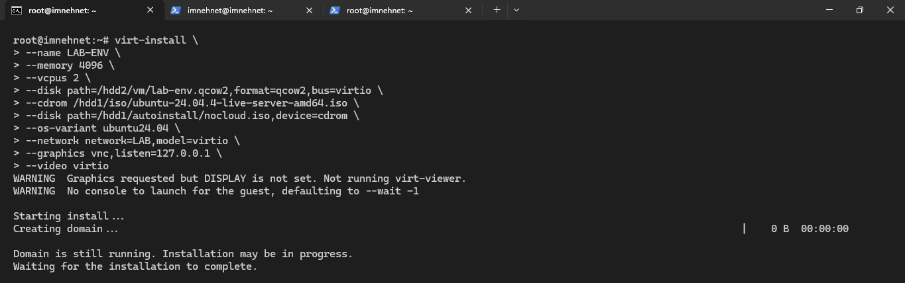
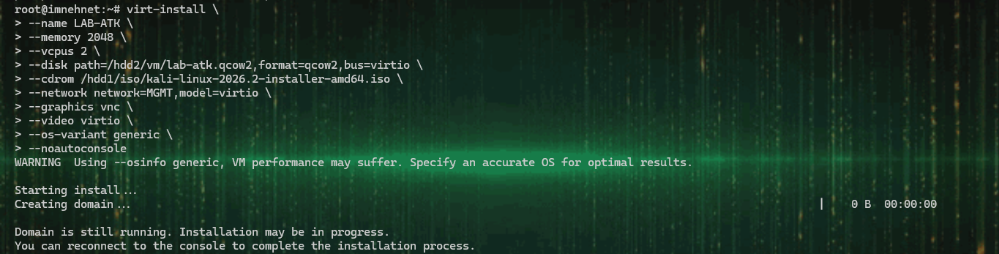
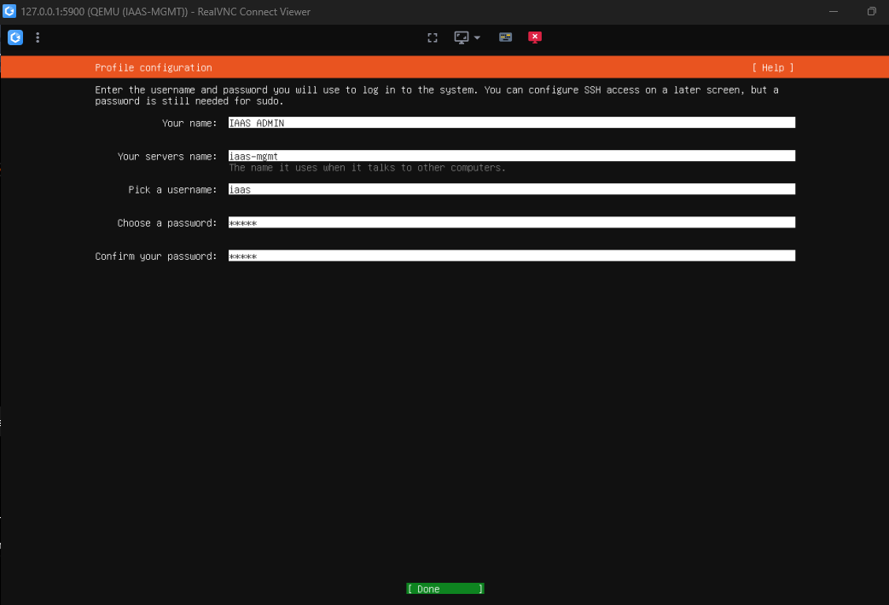
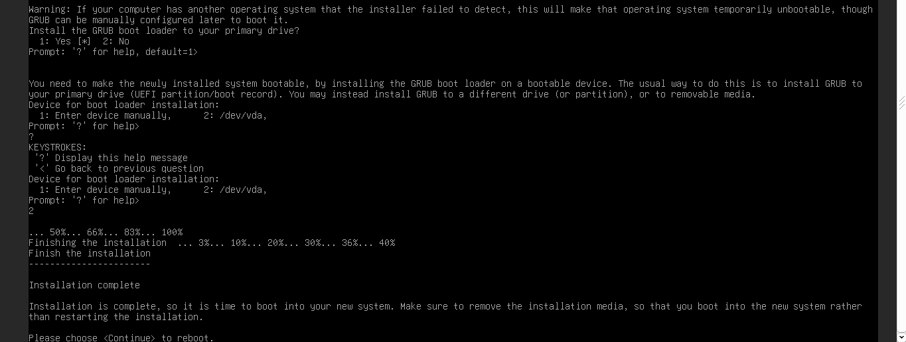
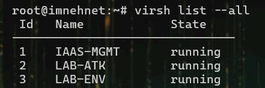
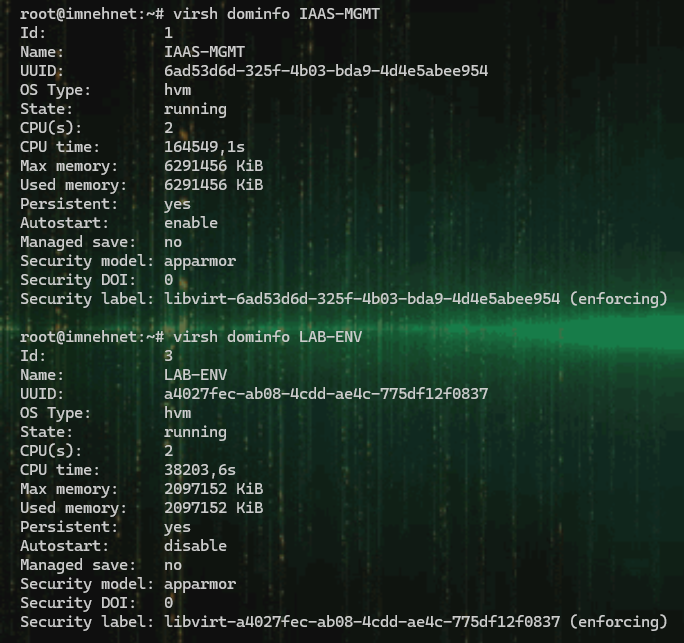
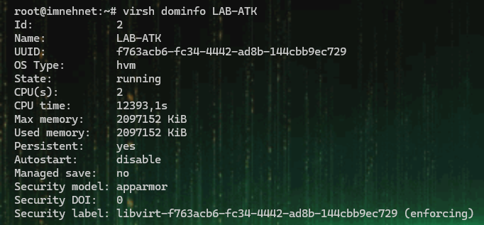

# Dokumentasi 02 — Konfigurasi Virtual Machine

## Tujuan

Melakukan konfigurasi dan penyiapan Virtual Machine (VM) sebagai bagian dari pembangunan infrastruktur Lab-as-a-Service (LaaS) IMNEHNET. Pada tahap ini disiapkan tiga VM utama, yaitu IAAS-MGMT, LAB-ENV, dan LAB-ATK, yang masing-masing memiliki fungsi berbeda sesuai kebutuhan proyek.

## Kondisi Awal

Server fisik telah dipersiapkan menggunakan KVM, QEMU, dan libvirt sebagai lingkungan virtualisasi. Selanjutnya, dilakukan pembuatan dan konfigurasi VM dengan menyesuaikan alokasi CPU, RAM, penyimpanan, serta sistem operasi yang dibutuhkan.

## Langkah Pengerjaan

### 1. Menentukan Pembagian Virtual Machine

Menentukan tiga VM yang akan digunakan dalam infrastruktur IMNEHNET berdasarkan fungsi masing-masing.

| Nama VM | Fungsi | Sistem Operasi |
|---|---|---|
| IAAS-MGMT | Server manajemen infrastruktur | Ubuntu Server |
| LAB-ENV | Lingkungan praktikum defender | Ubuntu Server |
| LAB-ATK | Lingkungan praktikum attacker | Kali Linux |

### 2. Menentukan Alokasi Resource VM

Melakukan pembagian sumber daya server berupa CPU, RAM, dan kapasitas disk untuk setiap VM. Pembagian dilakukan dengan mempertimbangkan kebutuhan masing-masing VM dan kemampuan server fisik.

| Nama VM | CPU | RAM | Disk |
|---|---:|---:|---:|
| IAAS-MGMT | 2 vCPU | 6 GB | 900 GB |
| LAB-ENV | 2 vCPU | 2 GB | 450 GB |
| LAB-ATK | 2 vCPU | 2 GB | 450 GB |

### 3. Membuat dan Mengonfigurasi VM

Membuat ketiga VM menggunakan KVM/QEMU melalui pengelolaan libvirt. Setiap VM dikonfigurasi sesuai alokasi resource dan sistem operasi yang telah ditentukan.

Konfigurasi meliputi:
- Penentuan nama VM.
- Pengalokasian CPU dan RAM.
- Penentuan kapasitas disk virtual.
- Pemilihan file ISO untuk instalasi sistem operasi.
- Pengaturan perangkat jaringan virtual.

### 4. Melakukan Instalasi Sistem Operasi

Melakukan instalasi sistem operasi pada masing-masing VM sesuai peruntukannya.

- IAAS-MGMT menggunakan Ubuntu Server.
- LAB-ENV menggunakan Ubuntu Server.
- LAB-ATK menggunakan Kali Linux.

Instalasi dilakukan hingga masing-masing VM dapat menjalankan sistem operasinya dan digunakan untuk kebutuhan konfigurasi selanjutnya.

### 5. Memeriksa Status Virtual Machine

Melakukan pemeriksaan terhadap seluruh VM yang telah dibuat untuk memastikan VM sudah terdaftar pada libvirt.

```bash
virsh list --all
```

**Hasil yang diharapkan:**

Ketiga VM, yaitu IAAS-MGMT, LAB-ENV, dan LAB-ATK, tampil dalam daftar VM yang dikelola oleh libvirt.

### 6. Memverifikasi Konfigurasi Resource VM

Memeriksa informasi konfigurasi masing-masing VM untuk memastikan alokasi CPU, RAM, dan status VM sesuai dengan rancangan.

```bash
virsh dominfo IAAS-MGMT
virsh dominfo LAB-ENV
virsh dominfo LAB-ATK
```

**Hasil yang diharapkan:**

Informasi masing-masing VM dapat ditampilkan dan menunjukkan konfigurasi resource yang telah ditentukan sebelumnya.

## Dokumentasi

1. Pembagian Virtual Machine
   
   
2. Pembuatan dan Konfigurasi VM
   
   
   

3. Instalasi Sistem Operasi
   
   

4. Pemeriksaan Status Virtual Machine
   
   

5. Verifikasi Konfigurasi Resource VM
   
   

## Hasil Tahap

Tiga Virtual Machine berhasil disiapkan menggunakan KVM/QEMU dan libvirt, yaitu IAAS-MGMT, LAB-ENV, dan LAB-ATK. Masing-masing VM telah menggunakan sistem operasi dan alokasi resource sesuai dengan kebutuhan infrastruktur proyek IMNEHNET.

## Kesimpulan

Konfigurasi Virtual Machine menjadi dasar pembentukan infrastruktur virtual IMNEHNET. Dengan adanya tiga VM yang memiliki fungsi berbeda, kebutuhan server manajemen, lingkungan praktikum defender, dan lingkungan praktikum attacker dapat dipisahkan sesuai rancangan proyek.

## Tahap Berikutnya

Melakukan konfigurasi jaringan virtual dan pengaturan alamat IP pada setiap VM agar seluruh komponen infrastruktur dapat saling terhubung sesuai rancangan jaringan IMNEHNET.
