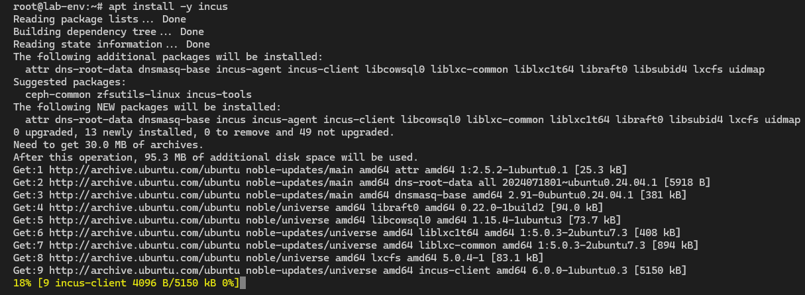
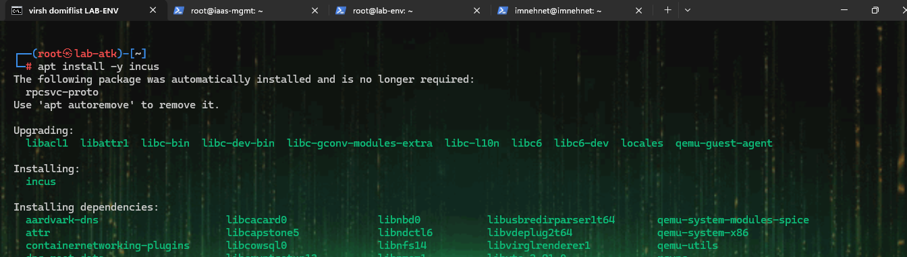
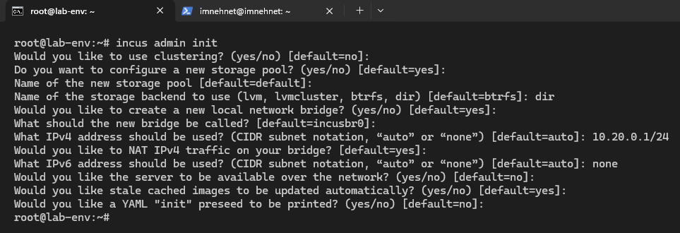
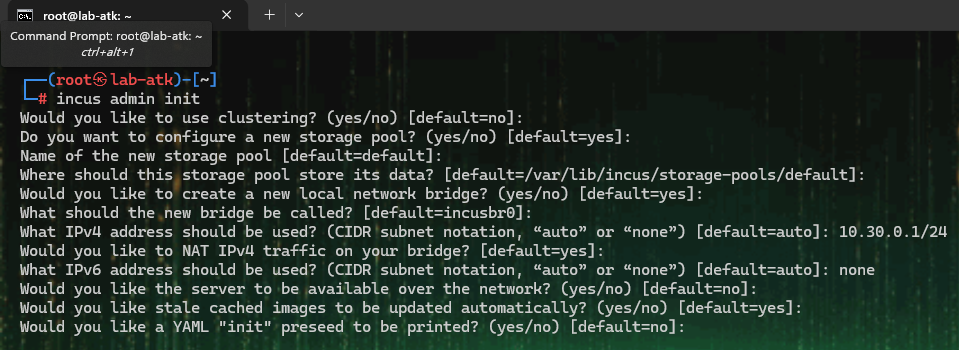
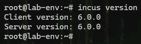
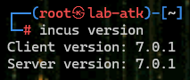
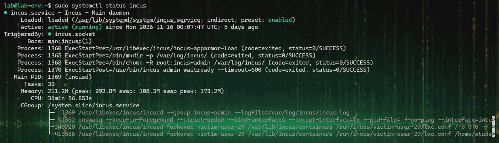
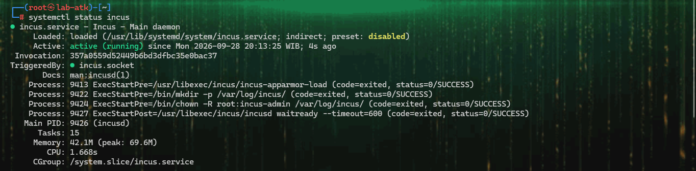

# Dokumentasi 04 — Implementasi Incus

## Tujuan

Tahap ini bertujuan untuk memasang dan menyiapkan Incus pada VM LAB-ENV dan LAB-ATK. Incus digunakan sebagai platform pengelolaan container yang akan menjadi dasar penyediaan lingkungan praktikum defender dan attacker.

## Kondisi Awal

VM LAB-ENV dan LAB-ATK telah berhasil dibuat dan menjalankan sistem operasi masing-masing. Kedua VM juga telah memiliki konfigurasi jaringan dan dapat diakses melalui terminal.

## Langkah Pengerjaan

### 1. Instalasi Incus pada LAB-ENV

Melakukan instalasi Incus pada VM LAB-ENV menggunakan package manager APT.

Perintah:

```bash
sudo apt install incus -y
```

### 2. Instalasi Incus pada LAB-ATK

Melakukan instalasi Incus pada VM LAB-ATK menggunakan package manager APT.

Perintah:

```bash
sudo apt install incus -y
```

### 3. Inisialisasi Incus pada LAB-ENV

Melakukan inisialisasi Incus untuk menyiapkan konfigurasi awal, seperti storage pool dan network bridge.

Perintah:

```bash
sudo incus admin init
```

### 4. Inisialisasi Incus pada LAB-ATK

Melakukan inisialisasi Incus pada VM LAB-ATK dengan menyiapkan konfigurasi awal yang akan digunakan untuk lingkungan praktikum attacker.

Perintah:

```bash
sudo incus admin init
```

### 5. Verifikasi Instalasi Incus

Memeriksa versi Incus pada masing-masing VM untuk memastikan instalasi berhasil.

Perintah:

```bash
incus version
```

### 6. Verifikasi Status Layanan Incus

Memeriksa status layanan Incus untuk memastikan layanan berjalan.

Perintah:

```bash
systemctl status incus
```

## Dokumentasi

1. Hasil instalasi Incus pada LAB-ENV.
   
   
3. Hasil instalasi Incus pada LAB-ATK.
   
   
5. Proses inisialisasi Incus pada LAB-ENV.
   
   
7. Proses inisialisasi Incus pada LAB-ATK.
   
   
9. Hasil verifikasi versi dan status layanan Incus.
   
   
   
   

## Hasil Tahap

Incus berhasil dipasang pada VM LAB-ENV dan LAB-ATK menggunakan package manager APT. Kedua VM telah disiapkan sebagai host container untuk mendukung penyediaan lingkungan praktikum.

## Kesimpulan

Implementasi Incus telah dilakukan pada kedua VM sebagai platform pengelolaan container. Tahap ini menjadi dasar untuk menyiapkan environment praktikum defender dan attacker pada tahap berikutnya.

## Tahap Berikutnya

Melakukan konfigurasi environment container, meliputi persiapan image, profile, storage pool, network, alokasi resource, serta pembuatan container defender dan attacker.
