# Dokumentasi 05 — Konfigurasi Environment Container

## Tujuan

Tahap ini bertujuan untuk menyiapkan environment container pada VM LAB-ENV dan LAB-ATK menggunakan Incus. Konfigurasi meliputi image, profile, storage pool, network, alokasi resource, serta pembuatan container untuk mendukung lingkungan praktikum defender dan attacker.

## Kondisi Awal

Incus telah berhasil dipasang dan diinisialisasi pada VM LAB-ENV dan LAB-ATK. Kedua VM telah disiapkan sebagai host container dengan konfigurasi jaringan yang terpisah untuk lingkungan defender dan attacker.

## Langkah Pengerjaan

### 1. Verifikasi Image Container

Memeriksa image yang tersedia pada masing-masing host Incus untuk memastikan image sistem operasi yang akan digunakan.

Perintah:

```bash
incus image list
```

Pada LAB-ENV tersedia image `imnehnet-gi-victim-v1` sebagai versi khusus untuk kebutuhan lingkungan defender.

Pada LAB-ATK tersedia dua image Kali Linux, yaitu `ctf-attacker-kali-base` sebagai image dasar kebutuhan CTF dan `imnehnet-gi-attacker-v1` sebagai image dengan versi khusus untuk kebutuhan lingkungan attacker.

### 2. Verifikasi Storage Pool

Memeriksa storage pool yang digunakan oleh Incus untuk menyimpan data container.

Perintah:

```bash
incus storage list
```

Storage pool yang digunakan pada kedua host adalah `default` dengan driver `dir`.

### 3. Verifikasi Profile

Memeriksa profile yang digunakan sebagai konfigurasi dasar container.

Perintah:

```bash
incus profile list
```

Kedua host menggunakan profile `default` sebagai konfigurasi dasar container.

### 4. Verifikasi Network Environment Defender

Menyiapkan network bridge pada LAB-ENV untuk menghubungkan container di lingkungan defender.

Perintah untuk memeriksa network:

```bash
incus network list
```

Environment defender menggunakan network bridge `incusbr0` dengan subnet `10.20.0.0/24`.

Container defender yang digunakan:

| Nama Container | IP Address |
|---|---|
| victim-user-16 | 10.20.0.100 |
| victim-user-23 | 10.20.0.102 |

### 5. Verifikasi Network Environment Attacker

Menyiapkan network bridge pada LAB-ATK untuk menghubungkan container di lingkungan attacker.

Perintah untuk memeriksa network:

```bash
incus network list
```

Environment attacker menggunakan network bridge `incusbr0` dengan subnet `10.30.0.0/24`.

Container attacker yang digunakan:

| Nama Container | IP Address |
|---|---|
| attacker-user-16 | 10.30.0.100 |
| attacker-user-23 | 10.30.0.102 |

### 6. Verifikasi Container

Memeriksa daftar container pada masing-masing host Incus untuk memastikan container telah dibuat dan berjalan.

Perintah pada LAB-ENV:

```bash
incus list
```

Perintah pada LAB-ATK:

```bash
incus list
```

Memastikan container defender dan attacker memiliki status `RUNNING` serta IP address sesuai konfigurasi.

### 7. Verifikasi Alokasi Resource Container

Memeriksa alokasi resource yang telah diterapkan pada container di masing-masing host Incus. Setiap container menggunakan alokasi 2 CPU dan RAM sebesar 2048 MiB untuk mendukung kebutuhan lingkungan praktikum.

Pemeriksaan container defender pada LAB-ENV:

```bash
incus config show victim-user-16 --expanded
```

Pemeriksaan container attacker pada LAB-ATK:
```bash
incus config show attacker-user-16 --expanded
```

### 8. Verifikasi Akses Container

Memastikan container dapat diakses melalui terminal menggunakan perintah:

Container defender:

```bash
incus exec victim-user-16 -- bash
```

Container attacker:

```bash
incus exec attacker-user-16 -- bash
```

## Dokumentasi

1. Daftar image container pada LAB-ENV dan LAB-ATK.
   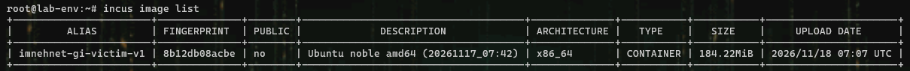
   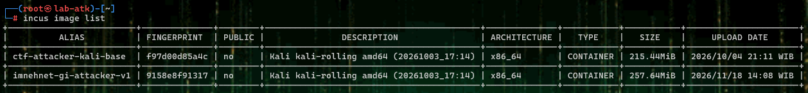
   
2. Daftar storage pool pada kedua host.
   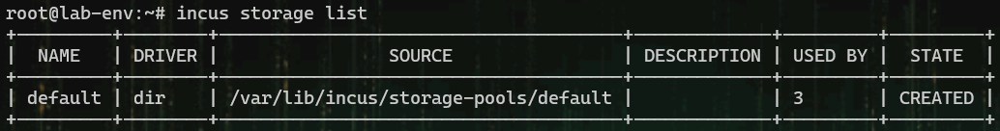
   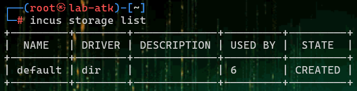
   
3. Daftar profile Incus.
   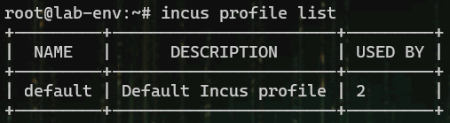
   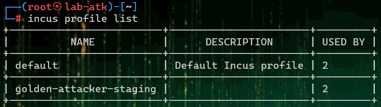
   
4. Verifikasi network environment defender.
   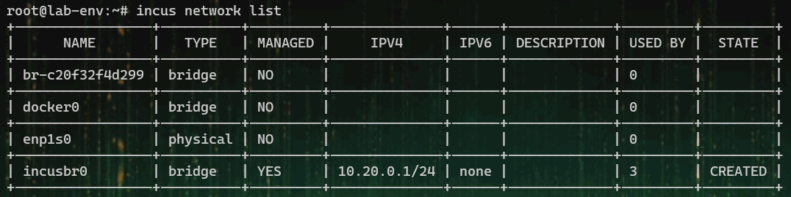
   
5. Verifikasi network environment attacker.
   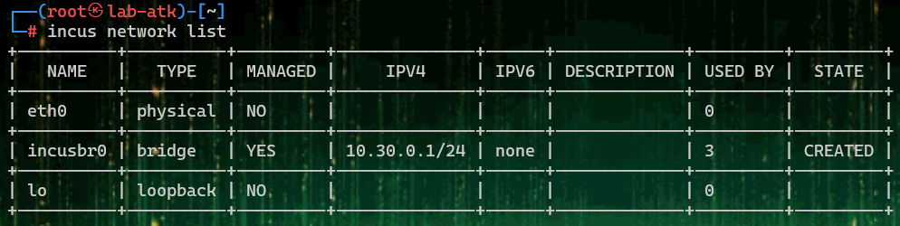
   
6. Daftar container pada kedua host.
   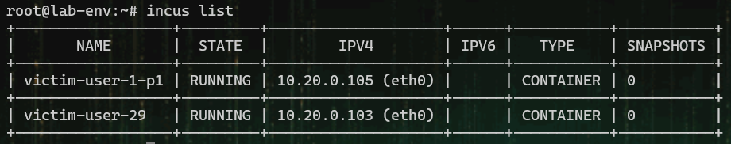
   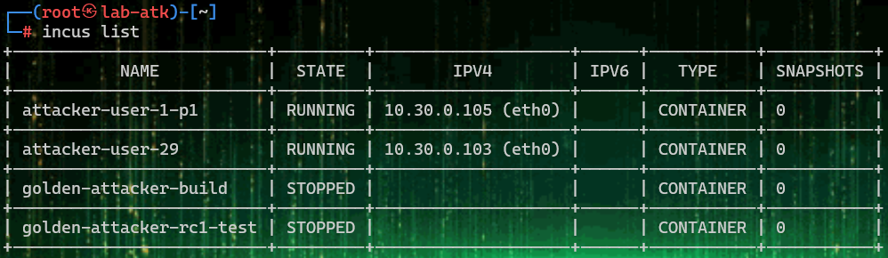
    
7. Konfigurasi alokasi resource container.
   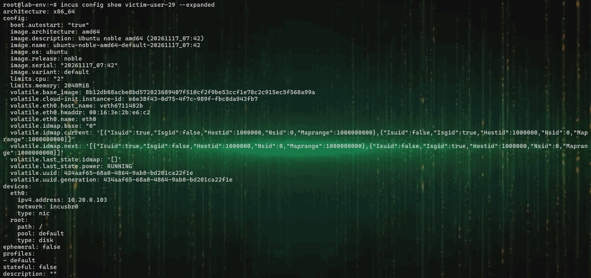
   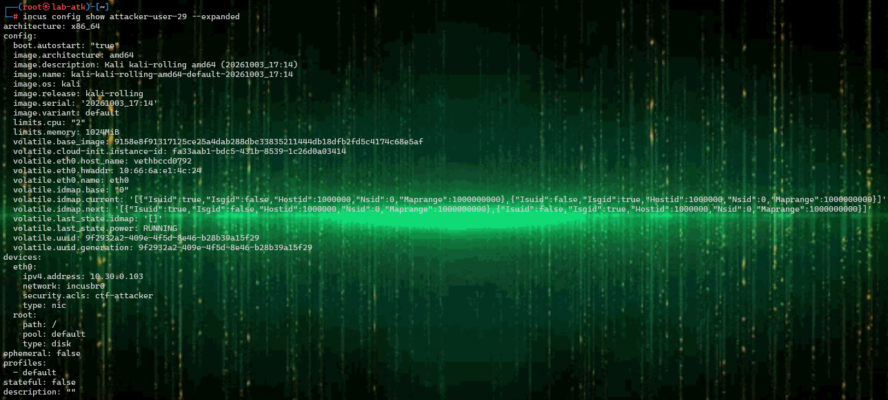
    
8. Bukti akses terminal container.
   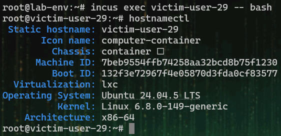
   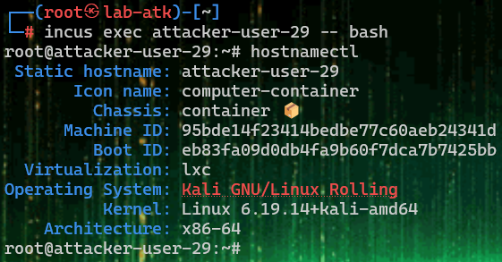

## Hasil Tahap

Environment container telah disiapkan pada LAB-ENV dan LAB-ATK. LAB-ENV digunakan untuk lingkungan praktikum defender dengan subnet 10.20.0.0/24, sedangkan LAB-ATK digunakan untuk lingkungan praktikum attacker dengan subnet 10.30.0.0/24.

Container telah disiapkan dengan alokasi resource CPU dan RAM serta menggunakan profile dan storage pool default.

## Kesimpulan

Konfigurasi environment container telah dilakukan sebagai bagian dari penyediaan lingkungan praktikum defender dan attacker. Pemisahan kedua environment dilakukan melalui host dan subnet yang berbeda untuk mendukung kebutuhan implementasi micro-segmentation.

## Tahap Berikutnya

Melakukan pengujian infrastruktur, meliputi pengujian fungsi container, konektivitas jaringan, micro-segmentation, performa infrastruktur, serta QoS.
