# Pengujian 01 — Pengujian Fungsional Lab-as-a-Service (LaaS)

## 1. Tujuan

Pengujian ini dilakukan untuk memastikan fitur utama pada portal Lab-as-a-Service (LaaS) IMNEHNET dapat berjalan sesuai dengan fungsinya. Pengujian mencakup proses login, pembuatan lab, pengelolaan container, hingga penanganan kondisi kegagalan dan pengulangan proses.

## 2. Ringkasan Hasil

| Kode | Skenario | Status | Dasar penilaian |
|---|---|---|---|
| P1-01 | Login dan akses role student | **PASS** | Form student tersedia, login admin ditolak, dan dashboard student dapat diakses. |
| P1-02 | Create Lab | **PASS** | Progres provisioning, status `Ready`, pasangan container, Incus, dan dua terminal tersedia. |
| P1-03 | Start/Resume Lab | **PASS** | Lab berubah dari `Stopped` menjadi `Ready` dan kedua container kembali `Running`. |
| P1-04 | Stop Lab | **PASS** | Dialog Stop dan kondisi akhir kedua container `Stopped`/terminal `Unavailable` terlihat. |
| P1-05 | Reset Lab | **PASS** | Progres berubah dari `1/6` menjadi `0/6`, objective pertama kembali aktif, dan target tetap sama. |
| P1-06 | Delete Lab | **PASS** | Dialog Delete, status `Deleting`, kuota kembali, dan container user-33 tidak lagi tampak pada kedua host. |
| P1-07 | Kegagalan terminal, refresh, dan retry | **PASS** | Victim yang dihentikan dari Incus gagal dihubungkan melalui portal, sedangkan sesi dan attacker tetap tersedia. |

**Rekap:** 7 PASS dan 0 FAIL.

---

## 3. Tools yang Digunakan

- Portal web IMNEHNET
- Web browser
- Incus CLI
- Browser Developer Tools

---

## 4. Langkah dan Hasil Pengujian

### P1-01 — Login dan Akses Role Student

**Tujuan:** Memastikan pengguna dapat membuka panel student dan percobaan masuk melalui panel yang tidak sesuai ditolak.

1. Buka form login student.
   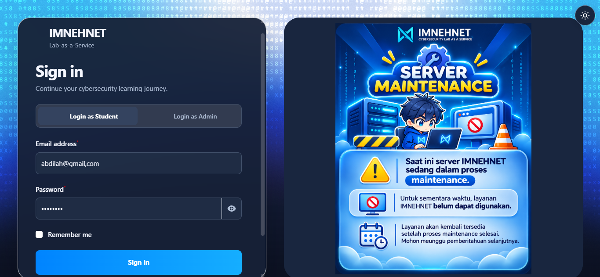
   **Gambar P1-01-A.** Form `Login as Student`. Alamat email telah ditutup.

2. Uji kredensial student pada panel admin.
   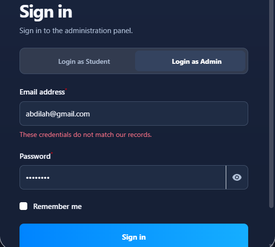
   **Gambar P1-01-B.** Portal menampilkan `These credentials do not match our records.` Email telah disanitasi dan password hanya berbentuk masking.

3. Login melalui panel student dan periksa halaman yang dapat diakses.
   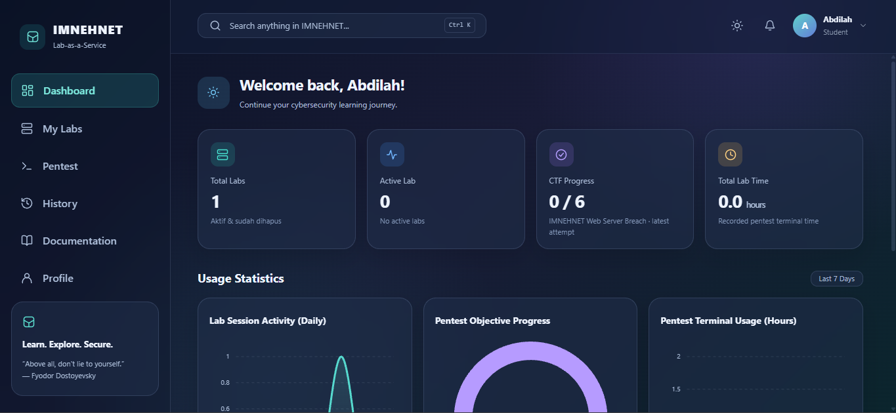

**Hasil aktual:** Form student tersedia, percobaan pada panel admin ditolak, dan dashboard menampilkan pengguna Abdilah sebagai Student.

**Status:** **PASS**

---

### P1-02 — Create Lab

**Tujuan:** Memastikan `Start Lab` membuat satu sesi yang terdiri atas attacker dan victim.

1. Pastikan course **Web Server Breach**, kuota `0/1`, dan tombol `Start Lab` tersedia.
   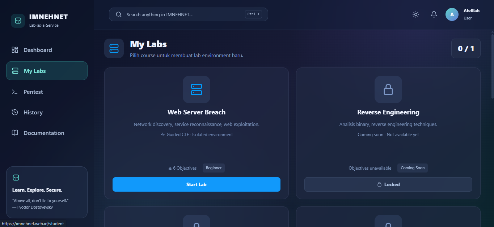

2. Tekan `Start Lab`. Portal menampilkan tahapan provisioning pasangan lab.
   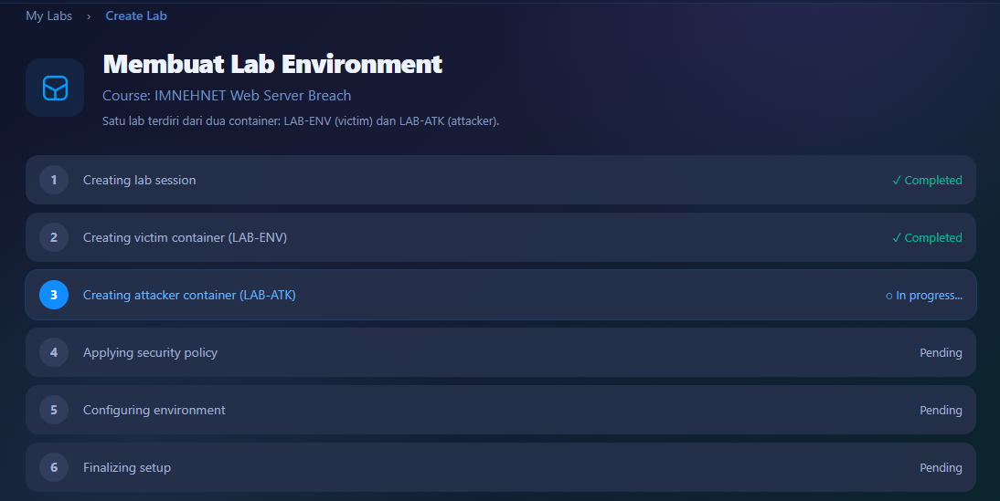

3. Tunggu sampai Lab #57 berstatus `Ready` dengan kedua container `Running`.
   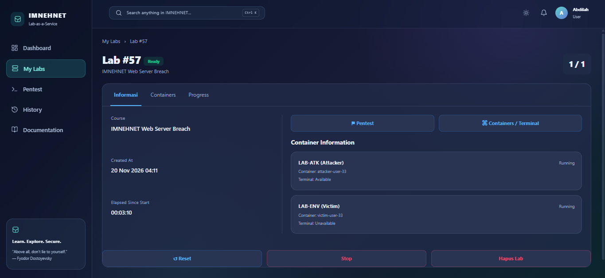
   
4. Bandingkan inventaris Incus sebelum dan sesudah proses.
   Sebelum:
   .png)
   .png)
   Sesudah:
   .png)
   .png)

5. Buka tab `Containers` dan periksa kedua terminal.
   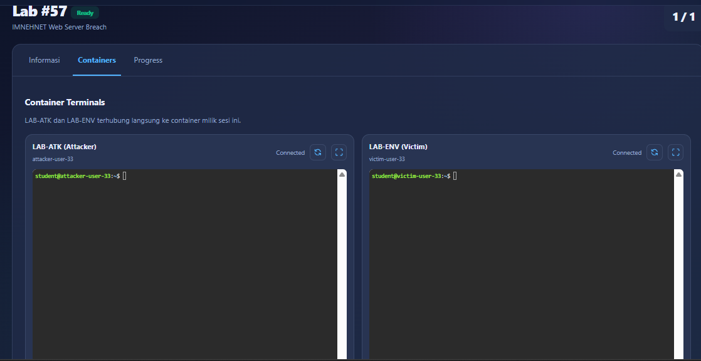

**Hasil aktual:** Lab #57 mencapai `Ready`; `attacker-user-33` dan `victim-user-33` terlihat `Running`; keduanya muncul pada host Incus masing-masing; dua terminal menampilkan `Connected`.

**Status:** **PASS**

---

### P1-03 — Start/Resume Lab

**Tujuan:** Memastikan lab yang berhenti dapat dijalankan kembali sebagai satu pasangan.

1. Pastikan Lab #57 dan kedua container `Stopped`, terminal `Unavailable`, serta tombol `Resume` tersedia.
   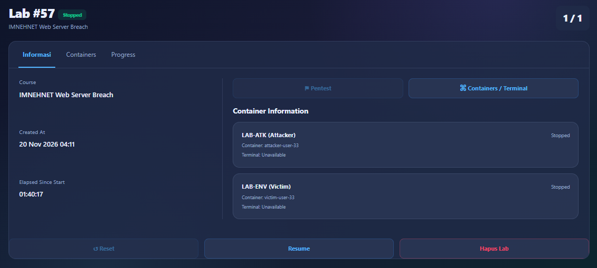

2. Tekan `Resume`, tunggu queue selesai, lalu periksa portal dan Incus.
   

**Hasil aktual:** Sebelum Resume, Lab #57 dan kedua container berstatus `Stopped` serta terminal `Unavailable`. Setelah tombol `Resume` dijalankan, lab kembali berstatus `Ready`, container attacker dan victim kembali `Running`, dan sesi dapat dilanjutkan.

**Status:** **PASS**

---

### P1-04 — Stop Lab

**Tujuan:** Memastikan kedua container berhenti dan terminal tidak lagi tersedia.

1. Tekan `Stop`, lalu periksa dialog konfirmasi.
   

2. Tekan `Confirm Stop` dan tunggu proses selesai.
   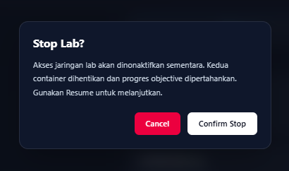

3. Memastikan kondisi lab setelah proses penghentian.
   

**Hasil aktual:** Lab, attacker, dan victim ditampilkan `Stopped`; terminal keduanya `Unavailable`; tombol `Resume` tersedia.

**Status:** **PASS**

---

### P1-05 — Reset Lab

**Tujuan:** Memastikan progres kembali ke baseline tanpa mengganti pasangan container.

1. Catat kondisi awal dengan progres `1/6`.
   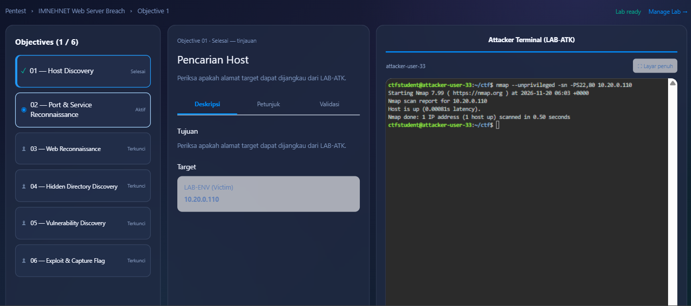
   
2. Tekan `Reset` dan periksa dialog.
   
   
3. Tekan `Confirm Reset`, lalu tunggu status kembali `Ready`.
   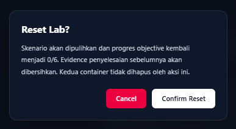

4. Melakukan verifikasi terhadap hasil reset.
   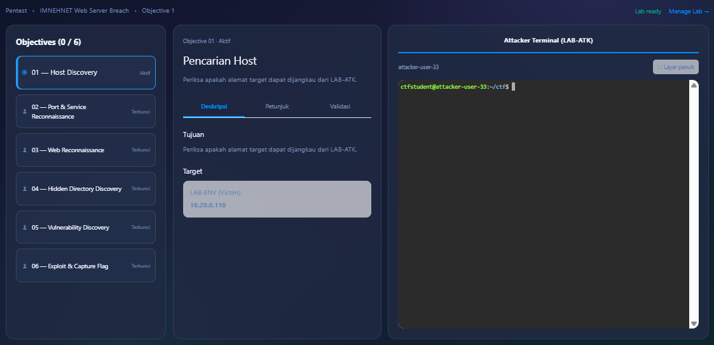

**Hasil aktual:** Progres berubah dari `1/6` menjadi `0/6`; objective pertama kembali aktif dan objective berikutnya terkunci. Target victim tetap `10.20.0.110` dan attacker tetap `attacker-user-33`.

**Status:** **PASS**

---

### P1-06 — Delete Lab

**Tujuan:** Memastikan pasangan lab dihapus dan kuota kembali tersedia.

1. Tekan `Hapus Lab` dan periksa dialog.
   

2. Tekan `Confirm Delete`. Portal menampilkan `Deleting` untuk Session #57.
   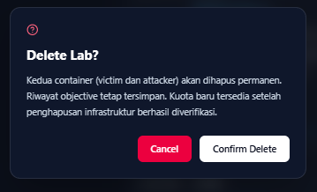

3. Periksa daftar container pada kedua host setelah proses selesai.
   .png)
   .png)

**Hasil aktual:** Portal menampilkan proses `Deleting`. Setelah selesai, `victim-user-33` dan `attacker-user-33` tidak lagi terlihat pada daftar Incus yang diberikan.

**Status:** **PASS**

---

### P1-07 — Kegagalan Koneksi Terminal Victim, Refresh, dan Retry

**Tujuan:** Memeriksa respons portal ketika victim dihentikan dari luar portal serta memastikan refresh/retry tidak menggandakan resource.

1. Hentikan `victim-user-33` melalui Incus CLI dan verifikasi status `STOPPED`.
   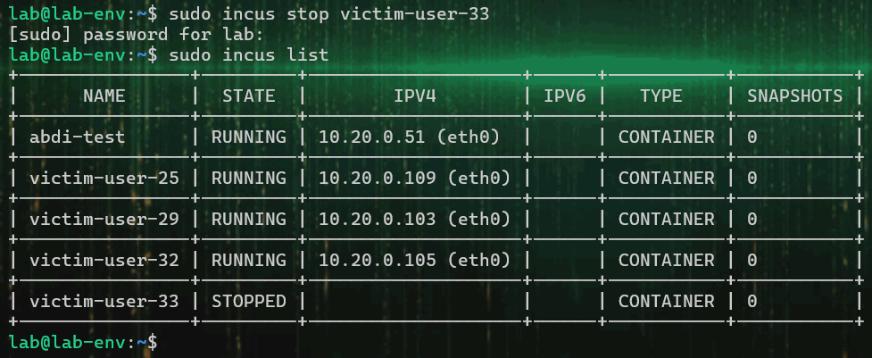

2. Kembali ke tab `Containers` dan coba hubungkan terminal victim.
   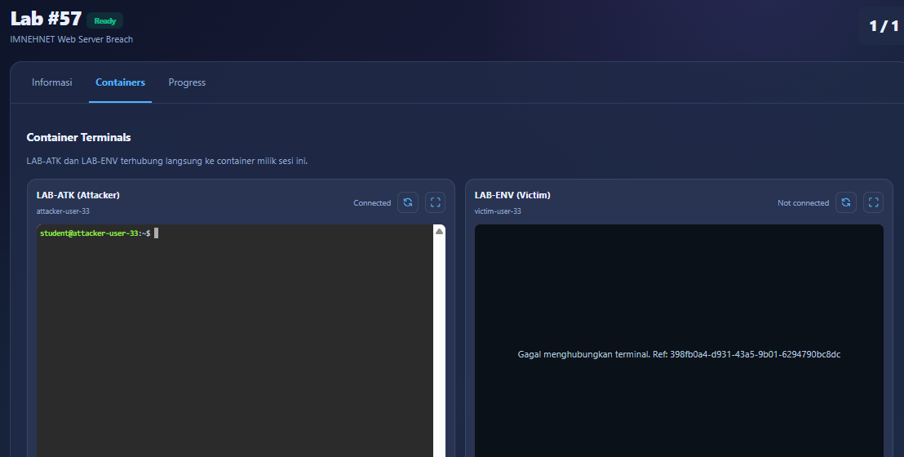

**Hasil aktual:** Setelah `victim-user-33` dihentikan melalui Incus CLI, terminal attacker tetap `Connected`, sedangkan terminal victim berubah menjadi `Not connected` dan portal menampilkan `Gagal menghubungkan terminal` dengan reference ID. Refresh dan percobaan koneksi ulang tetap menggunakan Lab #57; tidak terbentuk sesi atau pasangan container baru. Setelah victim dijalankan kembali, terminal dapat digunakan lagi melalui sesi yang sama.

**Status:** **PASS**

---

## 5. Kesimpulan

Seluruh skenario P1-01 sampai P1-07 berstatus `PASS`. Portal berhasil menangani autentikasi pengguna, pembuatan pasangan lab, Resume, Stop, Reset, Delete, serta kegagalan koneksi terminal victim tanpa membuat sesi atau pasangan container baru.
