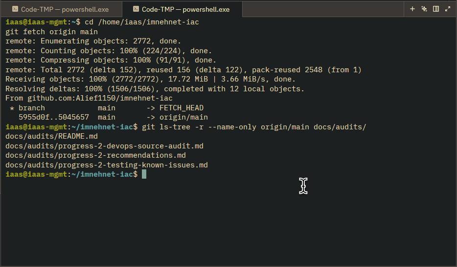

# Progres DevOps

## Terverifikasi pada 16 November 2026

Source utama: [`tofu/`](../../../tofu/) dan
[`ansible/`](../../../ansible/).

- Akses SSH read-only ke `IAAS-MGMT` tersedia melalui public key yang sudah terpasang.
- Source OpenTofu, Ansible, dan Laravel ditemukan pada lokasi kanonik yang ditetapkan.
- OpenTofu `v1.12.6` berhasil divalidasi dan memakai provider Incus `v1.2.0`.
- Workspace aktif `ctf-attacker-104` mengelola `attacker-user-31` pada remote `lab-atk`.
- Ansible Core `2.16.3` dapat menjangkau `iaas-mgmt` dan `lab-env`.
- Enam playbook lolos syntax-check dengan warning inventory yang terdokumentasi.
- Tiga container victim dan tiga container attacker teramati `RUNNING`.
- Integrasi Laravel menunjukkan alur dua fase OpenTofu lalu Ansible melalui queue job.

## Kendala

- Inventory aktif belum memiliki grup `lab_atk` dan `student_labs`.
- Source OpenTofu/Ansible aktif berada pada branch kerja `feat/lab-provisioning` di `IAAS-MGMT`; checkout tersebut satu commit lebih maju daripada branch remote terkait, sedangkan branch GitHub `main` belum melacak file `.tf`, inventory, konfigurasi, dan enam playbook aktif tersebut.
- Source Laravel produksi memiliki banyak perubahan tracked dan untracked. Audit hanya membaca file integrasi yang relevan dan tidak mengubah tree produksi.
- Source aktif tidak disalin ke `jobdesc/` untuk mencegah duplikasi dan konfigurasi berbeda versi.

## Persiapan sinkronisasi Progress Project 2

- Branch staging `docs/jobdesc-progress-2` berada pada worktree terpisah dan
  sudah dipindahkan ke baseline `origin/main` commit `37ef61d`.
- Seluruh commit dokumentasi anggota lain setelah `29ebc2c` tetap menjadi
  bagian baseline dan tidak diubah. Perubahan tersebut mencakup panduan
  Grafana/Prometheus, aset gambar, dan dokumentasi Cloud Architect.
- `origin/main` bergerak saat persiapan berlangsung. Patch staging dicadangkan,
  baseline diperbarui, lalu patch diterapkan kembali tanpa overlap path.
- Pemeriksaan three-way merge antara `origin/main` terbaru dan source aktif
  `123434f` tidak menemukan conflict marker. Keduanya menyentuh path yang berbeda.
- Source yang dipilih untuk publikasi berasal dari object Git commit `123434f`,
  bukan dari penyalinan seluruh working tree produksi yang sedang dirty.
- Inventory aktif tidak disalin. Repository hanya memuat
  [`hosts.ini.example`](../../../ansible/inventory/hosts.ini.example) yang memakai
  placeholder dan mencakup template `lab_env`, `lab_atk`, dan `student_labs`.
- Dua playbook staging mendapat hardening non-runtime untuk memenuhi CI:
  `set -o pipefail` dengan Bash pada pipeline shell dan pemecahan baris panjang.
  Perubahan ini hanya berada di worktree dokumentasi; source produksi tidak diubah.

## Tindak lanjut yang memerlukan keputusan operator

1. Menambahkan grup inventory yang belum ada pada inventory produksi setelah host, akun, key, dan batas privilege diverifikasi.
2. Menjalankan pengujian Ansible check mode dan integrasi Laravel hanya pada staging yang terisolasi.
3. Menindaklanjuti 55 kegagalan full suite sebagai known issues pada iterasi development berikutnya. Submission Progress 2 hanya mengklaim 7 targeted tests PASS dengan 27 assertions, bukan kelulusan full suite atau provisioning nyata end-to-end.
4. Menyimpan bukti pengujian berikutnya tanpa state, kredensial, `.env`, private key, atau output sensitif.

## Pembaruan publikasi GitHub — 16 November 2026

Catatan di atas merekam **kondisi saat audit sebelum submission**. Setelahnya, source terpilih dan laporan Progress 2 sudah masuk `main` melalui [PR #3](https://github.com/Alief1150/imnehnet-iac/pull/3), merge commit `50456572dc115c8520cd5c323d64ec89f791a16f`. Reorganisasi folder `jobdesc/` dan bukti visual disiapkan terpisah dalam [PR #4](https://github.com/Alief1150/imnehnet-iac/pull/4).

### Bukti visual inspeksi repository

**Gambar — inspeksi/fetch repository.** Screenshot dari `Audit File DevOps_V2.zip` memperlihatkan pemeriksaan commit dan daftar perubahan repository melalui Git. Gambar ini adalah bukti aktivitas inspeksi/sinkronisasi, **bukan** bukti deployment atau berhasilnya provisioning live. Berkas PNG harus diunggah ke `../images/git/` agar gambar muncul di GitHub.

Untuk status terkini gunakan riwayat commit dan status PR yang tertaut, bukan catatan staging historis di atas.
