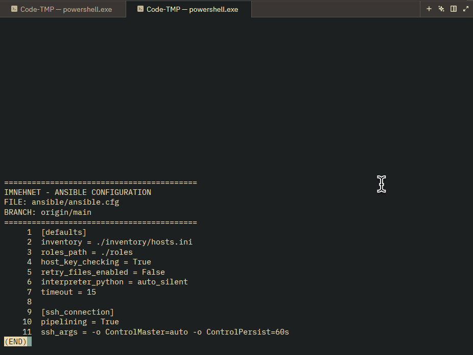
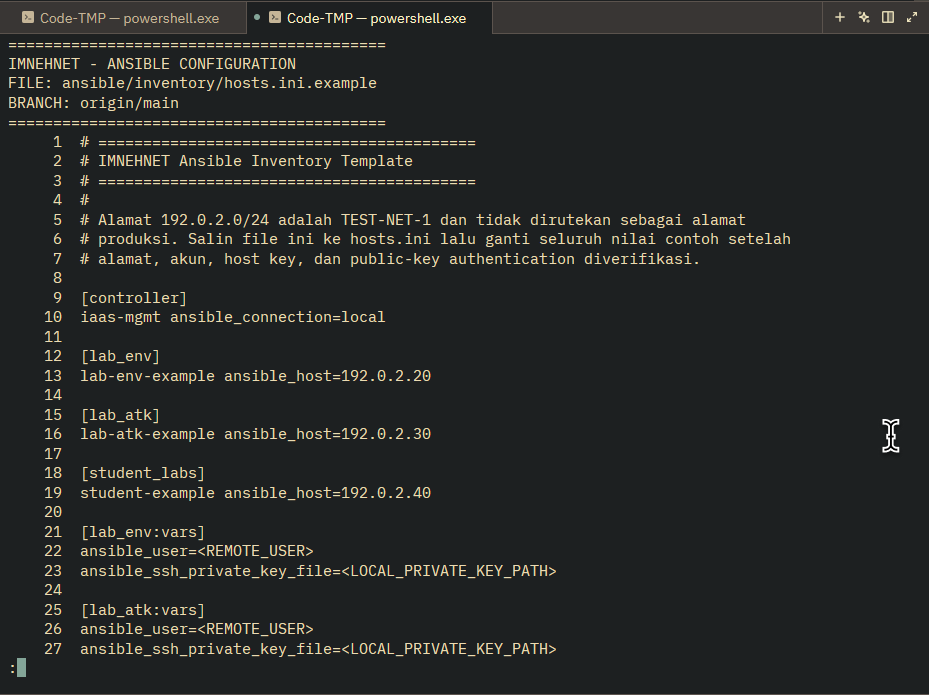
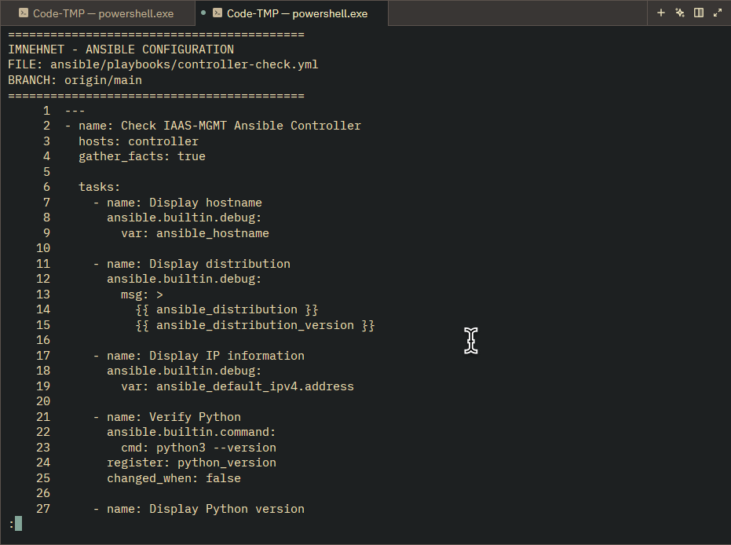
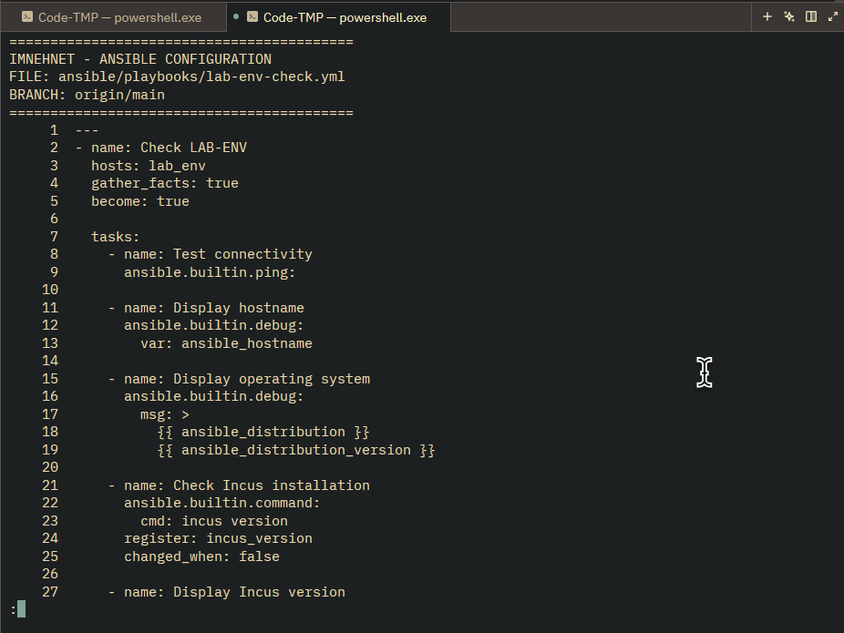
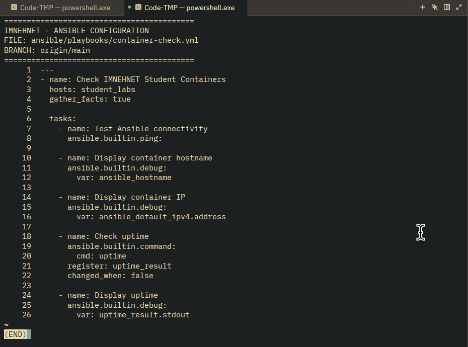
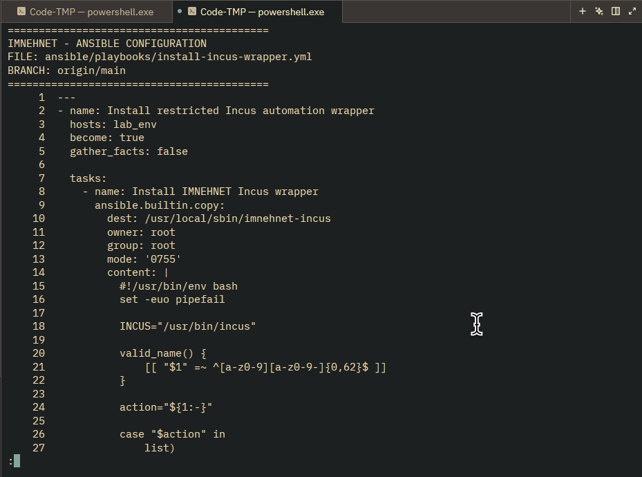
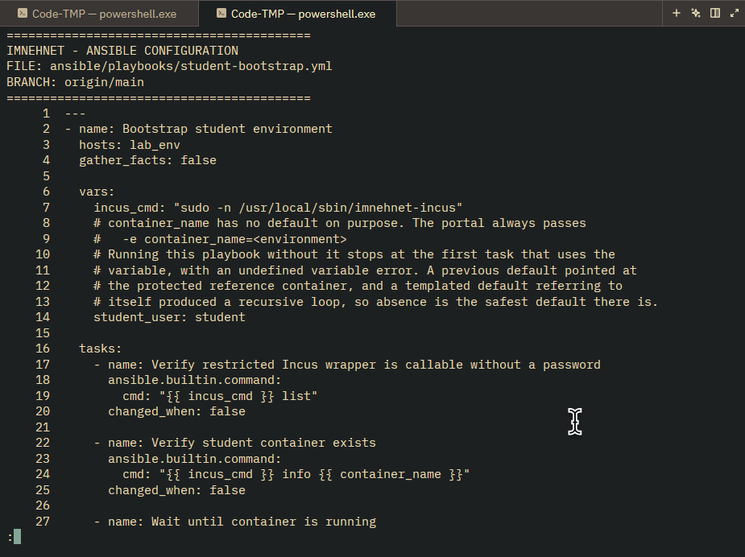
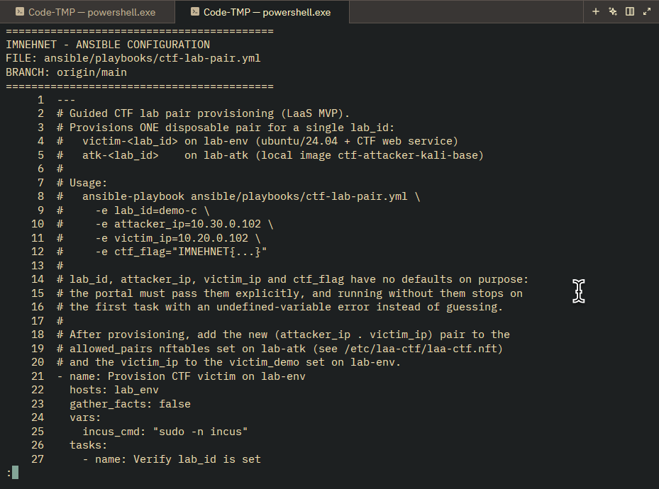

# Dokumentasi 02 — Konfigurasi Ansible dan Automation Playbooks

**PIC:** Alief Athallah Putra Supriatman (DevOps)  
**Proyek:** IMNEHNET — IaaS berbasis micro-segmentation  
**Tanggal dokumentasi:** 16 November 2026  
**Jenis bukti:** screenshot konfigurasi Ansible dan playbook dari `Audit File DevOps_V2.zip`, dibandingkan dengan source GitHub `ansible/`.

> **Status gambar: TERLAMPIR.** Delapan screenshot asli Ansible dari ZIP audit V2 tersimpan pada `jobdesc/DevOps/images/ansible/` dan ditampilkan langsung di setiap subbagian. Screenshot memperlihatkan potongan source, **bukan** bukti semua task telah dijalankan.

## 1. Tujuan

Mendokumentasikan penggunaan Ansible sebagai komponen **configuration management** dan **post-provisioning** yang melengkapi resource provisioning OpenTofu. Dokumentasi mencakup konfigurasi controller, template inventory, pemeriksaan host/container, persiapan akses Incus, bootstrap mahasiswa, serta penyiapan skenario Guided CTF.

## 2. Ringkasan file Ansible

| No. | File | Kategori | Fungsi | Bukti |
| :--: | --- | --- | --- | --- |
| 1 | [`ansible.cfg`](../../../ansible/ansible.cfg) | Controller configuration | Default inventory, SSH, interpreter, host-key checking dan timeout. | Gambar 1 |
| 2 | [`inventory/hosts.ini.example`](../../../ansible/inventory/hosts.ini.example) | Inventory template | Contoh grup host dengan alamat dokumentasi yang disanitasi. | Gambar 2 |
| 3 | [`controller-check.yml`](../../../ansible/playbooks/controller-check.yml) | Diagnostic | Memeriksa identitas dan prasyarat controller `IAAS-MGMT`. | Gambar 3 |
| 4 | [`lab-env-check.yml`](../../../ansible/playbooks/lab-env-check.yml) | Diagnostic | Memeriksa konektivitas, OS dan Incus pada `LAB-ENV`. | Gambar 4 |
| 5 | [`container-check.yml`](../../../ansible/playbooks/container-check.yml) | Diagnostic | Memeriksa konektivitas, hostname, IP dan uptime container. | Gambar 5 |
| 6 | [`install-incus-wrapper.yml`](../../../ansible/playbooks/install-incus-wrapper.yml) | Access setup | Memasang wrapper Incus terbatas dan aturan sudoers khusus. | Gambar 6 |
| 7 | [`student-bootstrap.yml`](../../../ansible/playbooks/student-bootstrap.yml) | Post-provisioning | Mengonfigurasi user dan paket dasar pada container mahasiswa. | Gambar 7 |
| 8 | [`ctf-lab-pair.yml`](../../../ansible/playbooks/ctf-lab-pair.yml) | CTF provisioning | Menyiapkan pasangan environment victim dan attacker. | Gambar 8 |

## 3. Dokumentasi konfigurasi dan bukti visual

### 3.1. `ansible.cfg` — Konfigurasi controller

**Gambar 1.** Parameter global Ansible untuk controller IMNEHNET.

**Penjelasan:** File menetapkan inventory default `./inventory/hosts.ini`, `roles_path`, `host_key_checking = True`, penonaktifan retry file, interpreter Python otomatis, timeout, serta opsi SSH multiplexing. Konfigurasi ini menyatukan cara playbook dijalankan dan mencegah pengabaian otomatis terhadap pemeriksaan identitas host.

**Catatan:** inventory aktif `hosts.ini` adalah file operasional yang tidak disertakan dalam repository publik.

### 3.2. `hosts.ini.example` — Template inventory yang disanitasi

**Gambar 2.** Screenshot template inventory untuk `controller`, `lab_env`, `lab_atk`, dan `student_labs`.

**Penjelasan:** Inventory mengelompokkan target sesuai fungsi serta menunjukkan tempat pengisian `ansible_host`, akun akses dan path key yang dikonfigurasi operator. Alamat contoh menggunakan rentang **TEST-NET-1** untuk dokumentasi. Template tersebut tidak boleh dianggap sebagai inventory produksi yang sudah terkoneksi.

**Peran:** memisahkan target manajemen, victim plane, attacker plane, dan container mahasiswa.

### 3.3. `controller-check.yml` — Diagnostic IAAS-MGMT

**Gambar 3.** Definisi task pemeriksaan controller.

**Penjelasan:** Playbook menargetkan grup `controller` dan mengumpulkan fakta sistem. Task menampilkan hostname, distribusi/versi OS, alamat IP serta versi Python. Output membantu mengidentifikasi kondisi controller dan prasyarat dasar sebelum orchestration dijalankan.

**Peran:** pemeriksaan administratif yang tidak dimaksudkan sebagai provisioning container.

### 3.4. `lab-env-check.yml` — Diagnostic host Incus

**Gambar 4.** Task verifikasi host `LAB-ENV`.

**Penjelasan:** Playbook menargetkan grup `lab_env`, melakukan pemeriksaan koneksi, identitas host/OS dan instalasi maupun versi Incus. Penggunaan `become: true` menandakan sebagian pemeriksaan membutuhkan privilege escalation.

**Peran:** membantu membedakan masalah jaringan/host dari kegagalan konfigurasi container.

### 3.5. `container-check.yml` — Diagnostic student containers

**Gambar 5.** Pemeriksaan konektivitas, hostname, alamat dan uptime target.

**Penjelasan:** Playbook menargetkan `student_labs` untuk melakukan `ansible.builtin.ping` serta membaca informasi sistem. Hasil yang sukses memerlukan inventory dan akses ke container yang benar; screenshot kode tidak menunjukkan apakah semua target runtime sudah pernah berhasil diperiksa.

**Peran:** validasi dasar post-provisioning, sebelum pengujian aplikasi dan micro-segmentation yang lebih khusus.

### 3.6. `install-incus-wrapper.yml` — Restricted Incus wrapper

**Gambar 6.** Bagian instalasi wrapper untuk otomasi Incus.

**Penjelasan:** Playbook menyiapkan wrapper command Incus terbatas serta aturan `sudoers` yang hanya mengizinkan jalur operasi tertentu. Ini membatasi kebutuhan akses privilege yang luas saat service otomasi mengoperasikan container.

**Peran keamanan:** prinsip least privilege. Playbook ini **mengubah konfigurasi host** bila dijalankan, sehingga tidak boleh dieksekusi ke produksi hanya untuk membuat screenshot.

### 3.7. `student-bootstrap.yml` — Bootstrap environment mahasiswa

**Gambar 7.** Tahapan awal bootstrap dan verifikasi container.

**Penjelasan:** Setelah OpenTofu menyediakan container, playbook memverifikasi wrapper Incus, mengecek keberadaan dan status container, lalu menjalankan langkah konfigurasi OS seperti pembuatan user mahasiswa, instalasi paket dasar dan verifikasi akhir. Konfigurasi tersebut adalah fase kedua dari proses provisioning.

**Peran:** memastikan container yang telah dibuat siap digunakan untuk praktikum. Keberhasilan syntax-check tidak membuktikan semua tahap bootstrap pernah dijalankan pada host live.

### 3.8. `ctf-lab-pair.yml` — Paired Guided CTF

**Gambar 8.** Bagian awal playbook paired provisioning Guided CTF.

**Penjelasan:** Playbook berisi dua bagian yang menargetkan `lab_env` untuk victim dan `lab_atk` untuk attacker. Parameter seperti `lab_id` serta identitas/nama dan alamat pasangan memerlukan nilai yang tervalidasi. Langkah lanjutan menyiapkan layanan skenario pada victim dan baseline tools di attacker sesuai definisi source.

**Peran:** menyediakan lingkungan latihan berpasangan, bukan bukti bahwa isolasi antarmahasiswa atau seluruh objective CTF telah lulus pengujian end-to-end.

## 4. Hubungan antar komponen

| Tahap | Komponen | Tujuan operasional |
| --- | --- | --- |
| Menentukan target | `ansible.cfg` dan inventory | Memilih controller, VM, atau container yang tepat. |
| Pre-flight checks | `controller-check.yml` dan `lab-env-check.yml` | Mendeteksi ketidaksesuaian lingkungan. |
| Menyiapkan akses aman | `install-incus-wrapper.yml` | Membatasi operasi Incus berprivilege. |
| Resource provisioning | **OpenTofu** | Menentukan desired state container. |
| Post-provisioning | `student-bootstrap.yml` | Mengatur lingkungan di dalam container. |
| Pengujian connectivity | `container-check.yml` | Memverifikasi akses Ansible terhadap target. |
| Environment CTF | `ctf-lab-pair.yml` | Menyiapkan container victim/attacker dan skenario. |

Dalam portal Laravel, lifecycle normal secara konseptual berjalan sebagai `queue job → OpenTofu apply → Ansible bootstrap → settle status`. Playbook diagnosis maupun CTF terpisah mengikuti trigger dan otorisasi masing-masing; tabel tidak menyiratkan semua playbook selalu dieksekusi secara berurutan.

## 5. Hasil verifikasi dan batas klaim

Audit Progress 2 mencatat **enam playbook lolos syntax-check**, `ansible-lint` lulus pada source staging, dan targeted test two-phase `4 PASS / 13 assertions`. Pengujian yang digunakan untuk targeted tests bersifat terisolasi; belum ada bukti baru bahwa enam playbook berhasil menjalankan seluruh task terhadap seluruh target produksi.

Dokumentasi tidak mempublikasikan private key, `.env`, credential, inventory aktif, atau data state. Screenshot hanya memperlihatkan kode dan beberapa baris awal playbook.

## 6. Kesimpulan

Delapan file yang didokumentasikan memperlihatkan pembagian kerja yang jelas: controller/inventory menentukan konektivitas, playbook diagnostik memeriksa kondisi, wrapper membantu pembatasan privilege, dan playbook provisioning/CTF menyiapkan container setelah resource didefinisikan OpenTofu.

## 7. Referensi

- [Source Ansible](../../../ansible/)
- [Catatan struktur playbook](../notes/struktur-ansible.md)
- [Catatan playbook penting](../notes/ansible-playbook-important.md)
- [Integrasi dengan Laravel](../notes/integrasi-laravel.md)
- [Pengujian dan known issues](../pengujian/)
