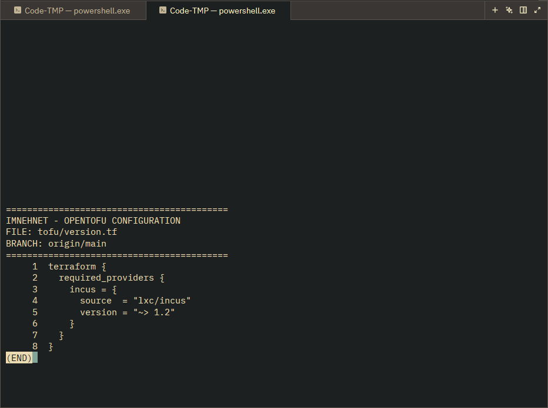
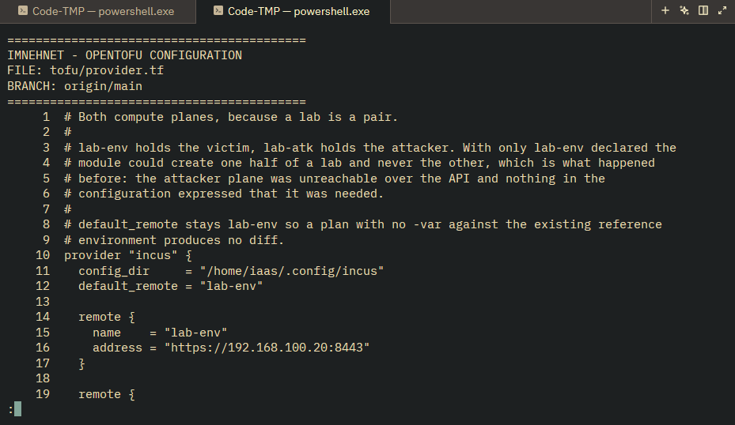
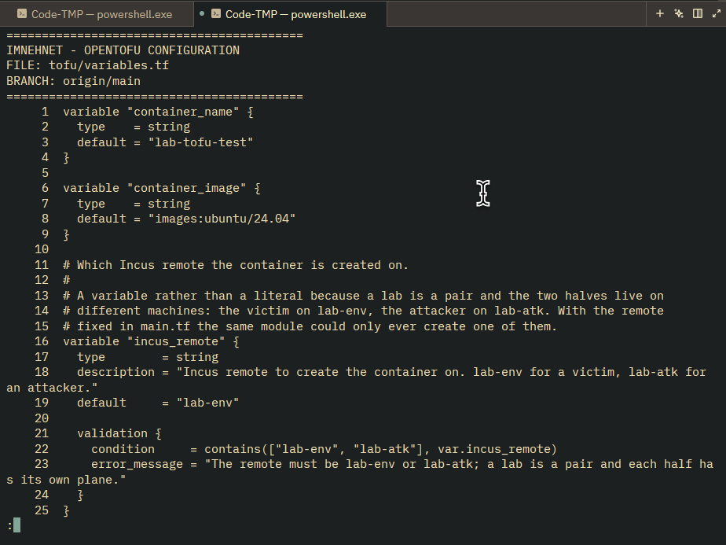
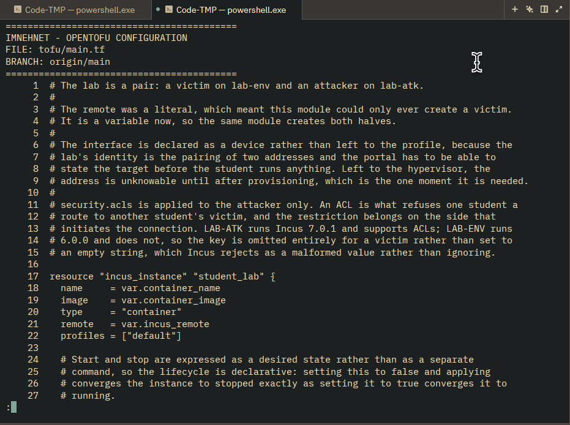
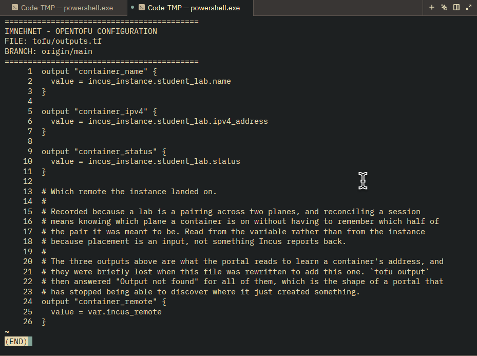

# Dokumentasi 01 — Konfigurasi OpenTofu dan Provisioning Incus

**PIC:** Alief Athallah Putra Supriatman (DevOps)  
**Proyek:** IMNEHNET — IaaS berbasis micro-segmentation  
**Tanggal dokumentasi:** 16 November 2026  
**Jenis bukti:** screenshot kode OpenTofu dari `Audit File DevOps_V2.zip`, dibandingkan dengan source GitHub `tofu/`.

> **Status gambar: TERLAMPIR.** Lima screenshot asli dari ZIP audit V2 tersimpan pada `jobdesc/DevOps/images/opentofu/` dan ditampilkan langsung di setiap subbagian. Screenshot merupakan potongan source konfigurasi, **bukan** bukti eksekusi `tofu apply`.

## 1. Tujuan

Mendokumentasikan struktur, parameter, dan mekanisme Infrastructure as Code (IaC) OpenTofu yang digunakan IMNEHNET untuk mendeklarasikan container pada dua Incus compute plane: `lab-env` (victim) dan `lab-atk` (attacker). Dokumentasi ini juga menjelaskan antarmuka keluaran untuk portal Laravel.

## 2. Ringkasan konfigurasi

| No. | File | Kategori | Tanggung jawab | Bukti |
| :--: | --- | --- | --- | --- |
| 1 | [`version.tf`](../../../tofu/version.tf) | Dependency management | Menentukan provider `lxc/incus` dengan constraint `~> 1.2`. | Gambar 1 |
| 2 | [`provider.tf`](../../../tofu/provider.tf) | Infrastructure connectivity | Mendefinisikan remote Incus `lab-env` dan `lab-atk`; default `lab-env`. | Gambar 2 |
| 3 | [`variables.tf`](../../../tofu/variables.tf) | Input configuration | Parameter container, network, alamat IP, ACL, batas resource dan status. | Gambar 3 |
| 4 | [`main.tf`](../../../tofu/main.tf) | Resource provisioning | Resource `incus_instance.student_lab` serta aturan NIC, CPU, RAM dan status. | Gambar 4 |
| 5 | [`outputs.tf`](../../../tofu/outputs.tf) | Infrastructure outputs | Informasi nama, IPv4, status dan remote container. | Gambar 5 |

## 3. Dokumentasi file dan bukti visual

### 3.1. `version.tf` — Persyaratan provider

**Gambar 1.** Screenshot deklarasi `required_providers` pada `version.tf`.

**Penjelasan:** Blok `terraform.required_providers` menginformasikan dependency `incus` yang diambil dari `lxc/incus` dengan constraint `~> 1.2`. Dengan deklarasi ini, OpenTofu dapat melakukan resolusi provider pada saat `init`. Constraint tersebut adalah batas versi **provider**, bukan versi binary OpenTofu. Versi provider terpilih juga direkam pada `tofu/.terraform.lock.hcl`.

**Peran dalam proyek:** menjaga kompatibilitas definisi resource Incus yang digunakan semua workspace. File ini tidak membuat atau menyalakan container secara langsung.

### 3.2. `provider.tf` — Koneksi dua compute plane

**Gambar 2.** Screenshot konfigurasi provider Incus dan remote host.

**Penjelasan:** `provider "incus"` menetapkan lokasi konfigurasi client Incus, `default_remote = "lab-env"`, serta dua remote: `lab-env` pada management/defender plane dan `lab-atk` pada attacker plane. Koneksi provider memungkinkan modul yang sama ditargetkan ke host berbeda melalui parameter `incus_remote`.

**Peran dalam proyek:** mendukung pemisahan container victim dan attacker. Definisi koneksi bukan bukti bahwa remote selalu dapat diakses; konektivitas tetap harus diuji secara terpisah. Endpoint/IP pada source merupakan informasi jaringan internal proyek, bukan token autentikasi.

### 3.3. `variables.tf` — Parameter provisioning

**Gambar 3.** Screenshot bagian awal deklarasi variabel, termasuk validasi remote Incus.

**Penjelasan:** Modul menerima `container_name`, `container_image`, `incus_remote`, `incus_network`, `static_ipv4`, `security_acls`, `cpu_limit`, `memory_limit`, dan `desired_running`. Variabel `incus_remote` hanya menerima `lab-env` atau `lab-atk`; `static_ipv4 = null` berarti alamat dapat dialokasikan oleh Incus; `security_acls` default kosong sehingga tidak selalu diterapkan.

**Peran dalam proyek:** memungkinkan provisioning yang dapat diulang tanpa membuat file `.tf` berbeda untuk setiap mahasiswa. Parameter dipasok melalui orchestration Laravel/OpenTofu dengan validasi sesuai jenis resource. Screenshot hanya menampilkan sebagian file; daftar sembilan variabel diverifikasi melalui source.

### 3.4. `main.tf` — Definisi resource container

**Gambar 4.** Screenshot bagian awal resource `incus_instance.student_lab`.

**Penjelasan:** Konfigurasi utama membuat deklarasi resource bertipe `container` dengan nama, image, remote, dan profile yang berasal dari variabel. Di bagian lanjutan file, `running` mengikuti `desired_running`; konfigurasi mencakup `boot.autostart`, batas CPU/RAM, NIC `eth0` dinamis untuk IPv4 statis, ACL opsional, serta `wait_for` alamat IPv4.

**Peran dalam proyek:** menghasilkan model desired state bagi container Incus. Satu instansiasi modul mengelola **satu** container; pasangan victim/attacker dibuat melalui proses/konfigurasi terpisah yang menargetkan dua remote. ACL merupakan salah satu kontrol micro-segmentation tetapi efektivitasnya memerlukan pengujian jaringan aktual.

### 3.5. `outputs.tf` — Integrasi hasil provisioning

**Gambar 5.** Screenshot empat output OpenTofu.

**Penjelasan:** File mengekspor `container_name`, `container_ipv4`, `container_status`, dan `container_remote`. Tiga output pertama membaca atribut resource `incus_instance.student_lab`, sedangkan lokasi remote diambil dari input `var.incus_remote`.

**Peran dalam proyek:** informasi output digunakan oleh control plane untuk merekam identitas, alamat dan status provisioned environment, lalu melanjutkan fase Ansible. Output aktual harus divalidasi dari workspace yang tepat; jangan menyimpan state mentah ataupun output sensitif di Git.

## 4. Hubungan OpenTofu dengan sistem IMNEHNET

| Tahap | Komponen | Hasil yang diharapkan |
| --- | --- | --- |
| Deklarasi dependency | `version.tf` | Provider Incus dikenali OpenTofu. |
| Konfigurasi akses | `provider.tf` | Remote victim dan attacker terdaftar. |
| Input environment | `variables.tf` | Parameter lab tervalidasi. |
| Provisioning deklaratif | `main.tf` | Desired state instance Incus dapat dikelola. |
| Pengambilan keluaran | `outputs.tf` | Identitas/alamat/status/remote dapat dibaca portal. |
| Konfigurasi lanjutan | Ansible | Bootstrap environment setelah container tersedia. |

OpenTofu membaca seluruh berkas `.tf` dalam satu modul sebagai satu konfigurasi; urutan tabel di atas adalah **hubungan tanggung jawab**, bukan urutan eksekusi file.

## 5. Hasil pemeriksaan dan batas klaim

Audit Progress 2 sebelumnya mencatat `tofu fmt` dan `tofu validate` **PASS** serta tiga pengujian terarah `OpenTofuWorkspaceTest` **PASS (14 assertions)**. Pengujian targeted memakai isolasi/fake yang aman. Screenshot ini adalah bukti konfigurasi source; tidak membuktikan provisioning nyata, akses terminal, enforcement ACL, atau end-to-end lifecycle sudah lulus.

## 6. Kesimpulan

Lima file OpenTofu membentuk konfigurasi IaC yang dapat diparameterkan untuk dua compute plane IMNEHNET. Pemisahan provider, input, resource dan output membantu pemeliharaan dan integrasi ke portal, sementara hasil runtime tetap memerlukan pengujian tersendiri.

## 7. Referensi

- [Source OpenTofu](../../../tofu/)
- [Catatan audit konfigurasi](../notes/arsitektur-konfigurasi-audit.md)
- [Catatan parameter dan resource](../notes/resource-opentofu.md)
- [Pengujian dan known issues](../pengujian/)
