# 01 — Persiapan Resource dan Instalasi Webportal IMNEHNET

**Proyek:** IMNEHNET — Webportal IaaS untuk Praktikum Keamanan Siber  
**Bidang:** Portal Developer  
**Penanggung jawab:** Malik  
**Tahap:** 01 — Persiapan lingkungan dan dependency aplikasi  
**Lokasi source aplikasi:** `/home/iaas/projects/webportal-iaas`  
**Repository:** [`imnehnet-iac/webportal`](../../../webportal/)  

---

## 1. Deskripsi Pekerjaan

Tahap awal pengembangan Webportal IMNEHNET adalah mempersiapkan perangkat lunak dan dependency untuk membangun aplikasi berbasis **Laravel** dan **Filament**. Fondasi ini mendukung autentikasi, administrasi pengguna, pengelolaan data laboratorium, penyajian antarmuka, serta pemrosesan tugas backend secara asynchronous.

Dokumentasi ini **khusus komponen Webportal**: PHP, Composer, Laravel, Filament, MySQL, Node.js, npm, Vite, Tailwind CSS, Apache, PHP-FPM, Laravel Queue, Git, dan keterkaitan akses web dengan Cloudflare. Konfigurasi VM, hypervisor, OpenTofu, Incus, dan Ansible tidak dibahas sebagai pekerjaan instalasi Portal Developer.

**Tujuan pekerjaan:**

1. Menyiapkan runtime backend dan package manager PHP.
2. Menyiapkan source Laravel dan kerangka panel Filament.
3. Menyiapkan koneksi database aplikasi dan sistem migrasi.
4. Menyiapkan toolchain build antarmuka.
5. Memastikan layanan web dan queue siap menunjang fitur aplikasi.
6. Memeriksa komponen yang terpasang sebelum pengembangan halaman Login, Admin, dan Student.

> **Dasar dokumentasi:** ini merupakan dokumentasi retrospektif dari source repository dan audit proyek, bukan rekaman layar proses instalasi pertama. Audit [25–26 September 2026](../../../docs/status.md) menunjukkan perubahan dari workspace portal kosong menjadi aplikasi Laravel/Filament yang telah berjalan. Perintah pemasangan ditulis sebagai **contoh prosedur reproduksi pada lingkungan baru**, sedangkan perintah pemeriksaan dipakai untuk memvalidasi instalasi yang sudah ada. Jangan mengulang instalasi atau migrasi pada server aktif hanya demi dokumentasi.

## 2. Resource dan Teknologi Webportal

| No. | Komponen | Kegunaan pada Webportal | Acuan konfigurasi |
|:--:|---|---|---|
| 1 | PHP 8.3 | Runtime backend Laravel | `composer.json` → `php: ^8.3` |
| 2 | Composer | Instalasi dan manajemen package PHP | `composer.json`, `composer.lock` |
| 3 | Laravel 13 | Routing, controller, Eloquent, migration, jobs, autentikasi | `composer.json` → `laravel/framework: ^13.17` |
| 4 | Filament 5 | Komponen panel berbasis Laravel | `composer.json` → `filament/filament: ^5.0` |
| 5 | MySQL | Penyimpanan data aplikasi dan koneksi data inventaris | `config/database.php` |
| 6 | Apache HTTP Server | Pelayanan request HTTP, routing dan reverse proxy | `deploy/apache/` |
| 7 | PHP-FPM | Pemrosesan PHP untuk Apache | `deploy/` |
| 8 | Node.js dan npm | Runtime dan dependency manager frontend | `package.json` → Node `>=24` |
| 9 | Vite 8 | Bundling dan build asset frontend | `package.json`, `scripts/build-assets.sh` |
| 10 | Tailwind CSS 4 | Styling antarmuka | `package.json` |
| 11 | Laravel Queue (database) | Pemrosesan job aplikasi secara asynchronous | `config/queue.php` |
| 12 | Git dan GitHub | Pengelolaan versi source Webportal | Repository `imnehnet-iac` |
| 13 | Cloudflare | Layanan jaringan yang relevansinya perlu dipisahkan dari hosting portal | `docs/networking.md`, `docs/status.md` |

**Catatan versi:** angka `^` pada `composer.json` menyatakan rentang versi dependency, bukan versi pasti yang terpasang. Audit 26 September 2026 mencatat **Laravel 13.33.0** dan **Filament 5.8.4** pada saat itu. Runtime Node pernah tercatat pada versi 22 ketika audit lama dilakukan; konfigurasi frontend saat ini mensyaratkan **Node.js >=24** dan script build menggunakan Node 24. Versi aktual ditentukan dari hasil pemeriksaan terbaru.

## 3. Persiapan Backend: PHP dan Composer

### 3.1 PHP dan ekstensi pendukung

PHP menjadi bahasa backend utama. Untuk proyek ini, persyaratan aplikasi adalah PHP 8.3 beserta ekstensi yang diperlukan oleh Laravel dan driver MySQL.

**Contoh pemasangan dependency sistem pada Ubuntu baru:**

```bash
sudo apt update
sudo apt install -y git curl unzip ca-certificates \
  apache2 mysql-server \
  php8.3 php8.3-cli php8.3-fpm \
  php8.3-mysql php8.3-mbstring php8.3-xml \
  php8.3-curl php8.3-zip php8.3-bcmath php8.3-intl
```

Kompatibilitas paket disesuaikan dengan repositori sistem operasi. Pemasangan di atas **bukan perintah untuk dijalankan ulang** pada Webportal aktif.

**Verifikasi instalasi:**

```bash
php -v
php -m | grep -Ei 'pdo_mysql|mysqli|mbstring|xml|curl|zip|bcmath|intl'
```

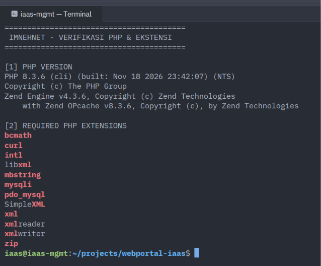

*Gambar 1. Hasil verifikasi versi PHP serta ekstensi utama yang dibutuhkan Webportal IMNEHNET.*

### 3.2 Composer

Composer digunakan untuk mengelola package PHP berdasarkan `composer.json` dan menginstal versi dependency yang tersimpan pada `composer.lock`.

Pada mesin pengembangan baru, Composer dipasang mengikuti [panduan instalasi resmi Composer](https://getcomposer.org/download/) dengan verifikasi installer dari sumber resminya. Setelah tersedia, pengecekan dilakukan melalui:

```bash
composer --version
composer validate --no-check-publish
```

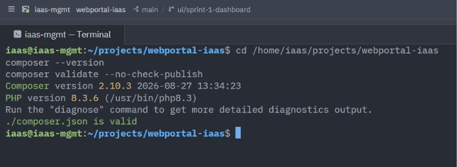

*Gambar 2. Composer tersedia dan dapat membaca konfigurasi dependency aplikasi.*

## 4. Persiapan Framework Laravel

### 4.1 Direktori dan struktur project

Source aplikasi Webportal yang digunakan tim berada pada:

```text
/home/iaas/projects/webportal-iaas/
├── app/            # Controller, Model, Service, Job, Filament
├── bootstrap/      # Bootstrap dan registrasi provider
├── config/         # Konfigurasi aplikasi
├── database/       # Migration dan seeders
├── public/         # Entry point HTTP dan asset publik
├── resources/      # Blade, CSS, JavaScript, SVG
├── routes/         # Definisi endpoint
├── storage/        # Cache, session, dan log runtime
├── tests/          # Pengujian
├── artisan         # Laravel CLI
├── composer.json   # Dependency PHP
└── package.json    # Dependency frontend
```

Struktur tersebut menunjukkan pemisahan logika backend, konfigurasi, database, antarmuka, dan pengujian.

**Pemeriksaan pada aplikasi yang sudah tersedia:**

```bash
cd /home/iaas/projects/webportal-iaas
pwd
php artisan --version
ls -d app bootstrap config database public resources routes storage tests
```

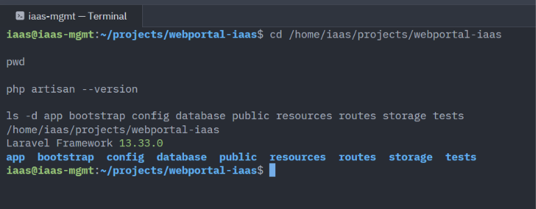

*Gambar 3. Verifikasi framework Laravel dan keberadaan direktori utama source Webportal.*

### 4.2 Instalasi dependency Laravel

Pada deployment **baru** yang telah memiliki source repository dan file lock, dependency dipasang melalui:

```bash
composer install --no-dev --optimize-autoloader
```

Perintah tersebut merupakan referensi reproduksi, **bukan langkah verifikasi** dan tidak perlu diulang pada server aktif. Untuk pengembangan dan testing, dependency dev diperlukan dan opsi `--no-dev` tidak digunakan.

Konfigurasi aplikasi Laravel disimpan pada environment lokal (`.env`), sedangkan template variabel dasar terdapat di [`.env.example`](../../../webportal/.env.example). File `.env` produksi, application key, dan credential database tidak boleh dipublikasikan.

## 5. Persiapan Filament

Filament merupakan framework UI di atas Laravel yang digunakan untuk mengembangkan panel administrasi. Dependency-nya dideklarasikan pada [`composer.json`](../../../webportal/composer.json).

**Pemeriksaan package terpasang:**

```bash
cd /home/iaas/projects/webportal-iaas
composer show filament/filament
```

Registrasi provider panel dapat dilihat pada:

- [`app/Providers/Filament/AdminPanelProvider.php`](../../../webportal/app/Providers/Filament/AdminPanelProvider.php)
- [`app/Providers/Filament/StudentPanelProvider.php`](../../../webportal/app/Providers/Filament/StudentPanelProvider.php)
- [`bootstrap/providers.php`](../../../webportal/bootstrap/providers.php)

Di tahap ini, Filament dibahas sebatas **persiapan framework dan registrasi panel**. Desain serta pengembangan modul Admin dijelaskan dalam dokumen tersendiri, begitu pula modul Student.

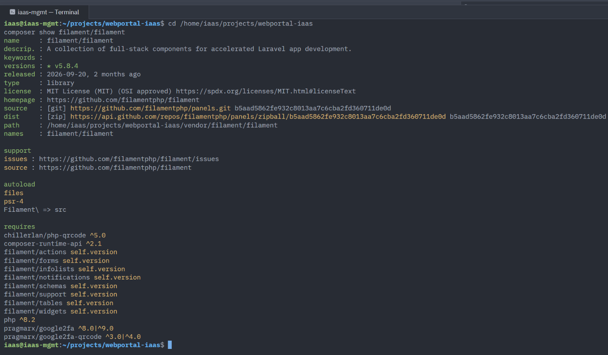

*Gambar 4. Verifikasi dependency Filament pada aplikasi Webportal IMNEHNET.*

## 6. Persiapan MySQL dan Database Laravel

### 6.1 Database aplikasi

Konfigurasi MySQL dilakukan melalui [`config/database.php`](../../../webportal/config/database.php). Dalam audit proyek, database aplikasi disebut **`iaas_portal`**. Aplikasi juga memiliki koneksi terpisah bernama **`imnehnet`** untuk membaca data inventaris infrastruktur.

| Koneksi | Fungsi |
|---|---|
| Database utama Laravel | Data pengguna, sesi, queue, migrasi, dan kebutuhan internal aplikasi |
| `imnehnet` | Pembacaan informasi inventaris infrastruktur melalui konfigurasi koneksi terpisah |

Parameter konfigurasi yang relevan adalah nama koneksi, host, port, nama database, username, dan password. Contoh **nama parameter** tanpa kredensial:

```dotenv
DB_CONNECTION=mysql
DB_DATABASE=iaas_portal

IMNEHNET_DB_CONNECTION=mysql
IMNEHNET_DB_DATABASE=imnehnet
```

> Template `.env.example` pada repository masih menggunakan default `DB_CONNECTION=sqlite`; nilai ini **bukan bukti database utama pada deployment aktif**. Jangan mengunggah file `.env`, password, atau dump database untuk dokumentasi.

### 6.2 Verifikasi MySQL dan migrasi

**Pemeriksaan service MySQL:**

```bash
mysql --version
systemctl is-active mysql
```

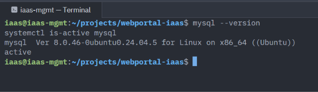

*Gambar 5. Hasil pemeriksaan versi dan status service MySQL.*

**Pemeriksaan status migration Laravel:**

```bash
cd /home/iaas/projects/webportal-iaas
php artisan migrate:status --no-interaction
```

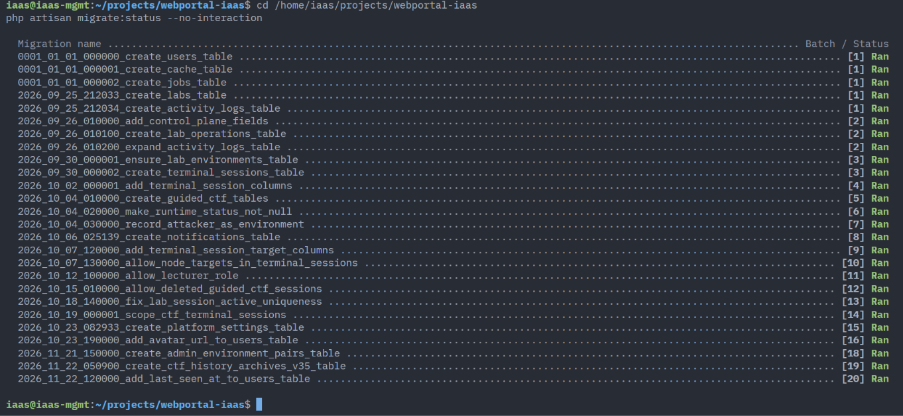

*Gambar 6. Status migration Laravel pada database aplikasi yang telah dikonfigurasi.*

Penggunaan Laravel Migration memudahkan pelacakan perubahan skema database. Perintah pemeriksaan di atas tidak sama dengan menjalankan migrasi. Perintah `migrate`, `migrate:fresh`, dan `db:wipe` **tidak dilakukan untuk pengumpulan bukti**.

## 7. Persiapan Frontend: Node.js, npm, Vite, dan Tailwind CSS

### 7.1 Node.js dan npm

Frontend Webportal memanfaatkan Node.js dan npm untuk mengelola dependency JavaScript yang ditentukan pada [`package.json`](../../../webportal/package.json). Konfigurasi saat ini mensyaratkan **Node.js minimal versi 24**.

Pengelolaan versi Node pada server menggunakan pendekatan **nvm**, sebagaimana diterapkan pada [`scripts/build-assets.sh`](../../../webportal/scripts/build-assets.sh). Pendekatan ini mencegah kegagalan build akibat Node sistem yang lebih lama.

```bash
node --version
npm --version
```

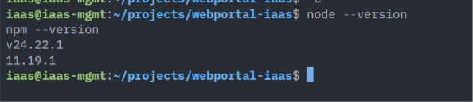

*Gambar 7. Pemeriksaan toolchain Node.js dan npm yang digunakan untuk frontend Webportal.*

### 7.2 Dependency frontend dan proses build

Berdasarkan `package.json`, frontend memanfaatkan **Vite 8**, **Tailwind CSS 4**, plugin Vite Laravel, serta dependency lain seperti Lucide, ApexCharts, React, dan library pendukung. Tidak semua package otomatis berarti digunakan pada setiap halaman.

Contoh penyiapan dependency pada workspace **baru** menggunakan file lock:

```bash
npm ci
```

Proses build frontend yang telah disediakan source proyek:

```bash
bash scripts/build-assets.sh
```

Script tersebut memuat runtime Node yang sesuai lalu menjalankan build Vite. Kedua perintah di atas mengubah file/dependency; keduanya **bukan perintah pengambilan bukti pada server aktif**.

**Pemeriksaan hasil build yang sudah ada:**

```bash
cd /home/iaas/projects/webportal-iaas
node --version
npm --version
test -f public/build/manifest.json && echo 'Vite build manifest: tersedia'
```

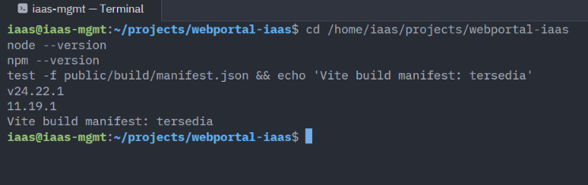

*Gambar 8. Toolchain frontend dan bukti keberadaan hasil build Vite.*

## 8. Persiapan Apache dan PHP-FPM

Apache digunakan sebagai web server, sedangkan PHP-FPM menjadi komponen pemrosesan PHP. Konfigurasi deployment aplikasi disediakan dalam [`webportal/deploy/`](../../../webportal/deploy/) dan mengarahkan akses melalui direktori publik Laravel.

Untuk mendukung routing Laravel dan integrasi terminal web, konfigurasi Apache terkait mencakup modul `rewrite`, `proxy_fcgi`, `proxy`, dan dukungan WebSocket (`proxy_wstunnel`). Pengaktifan modul dan VirtualHost merupakan proses deployment terkontrol, bukan langkah screenshot.

**Verifikasi layanan:**

```bash
apache2 -v
systemctl is-active apache2 php8.3-fpm
```

**Verifikasi endpoint lokal jika konfigurasi portal sudah aktif pada port 80:**

```bash
curl -sS -o /dev/null -w 'Health: HTTP %{http_code}\n' http://127.0.0.1/up
curl -sS -o /dev/null -w 'Admin login: HTTP %{http_code}\n' http://127.0.0.1/admin/login
```

Kode HTTP yang diperoleh perlu dicatat sesuai kondisi aktual. Audit awal menunjukkan portal semula menggunakan development server di port 8000; keberadaan template Apache tidak membuktikan bahwa VirtualHost sudah diaktifkan pada setiap periode.

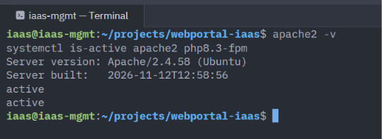

*Gambar 9. Pemeriksaan web server Apache dan layanan PHP-FPM.*

## 9. Persiapan Laravel Queue

Webportal menggunakan **database queue** sebagai mekanisme pemrosesan pekerjaan yang berlangsung di background. Konfigurasi berada pada [`config/queue.php`](../../../webportal/config/queue.php), dan source menyediakan script worker/supervisor di direktori [`scripts/`](../../../webportal/scripts/).

Queue dipakai untuk memisahkan pekerjaan backend yang membutuhkan waktu lebih lama dari request antarmuka pengguna. Dengan demikian, proses aplikasi dapat dikelola secara asynchronous.

**Pemeriksaan worker yang sedang berjalan:**

```bash
pgrep -af '[q]ueue:work|[q]ueue-supervisor' || true
```

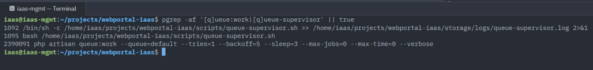

*Gambar 10. Pemeriksaan proses Laravel Queue Worker pada lingkungan Webportal.*

## 10. Akses Webportal dan Kaitan Cloudflare

Cloudflare perlu dibedakan berdasarkan **layanan yang benar-benar digunakan**:

- **Cloudflare WARP** tercatat dalam audit dan [`docs/networking.md`](../../../docs/networking.md) sebagai dukungan **konektivitas keluar pada host fisik**, bukan sebagai bukti publikasi Webportal.
- **Cloudflare Tunnel**, **Cloudflare DNS**, **Cloudflare Proxy**, dan **Cloudflare Access** adalah layanan berbeda. Dari source dan audit yang diperiksa untuk dokumen ini, **belum ada bukti yang cukup** untuk menyatakan bahwa Webportal diterbitkan melalui Tunnel, domain tertentu, atau bahwa proteksi Cloudflare Access telah aktif.
- Karena itu, konfigurasi Cloudflare untuk **akses Webportal** perlu diverifikasi dari dashboard Cloudflare atau konfigurasi layanan terkait **sebelum** dicatat sebagai implementasi yang selesai.

Apabila publikasi melalui domain/Cloudflare telah terverifikasi, dokumentasi berikutnya dapat memuat nama host publik, metode routing ke aplikasi, status HTTPS/TLS, dan kontrol akses **tanpa mencantumkan token tunnel, credential, atau private key**.

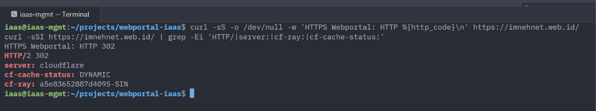

*Gambar 11. Bukti konfigurasi domain atau layanan Cloudflare yang benar-benar digunakan untuk mengakses Webportal (diisi setelah diverifikasi).* 

## 11. Hasil dan Evaluasi Tahap Awal

Berdasarkan audit proyek yang tersedia:

- **25 September 2026:** PHP 8.3, PHP-FPM, Apache, MySQL, dan Git tersedia pada lingkungan IAAS-MGMT; direktori project Webportal saat itu masih kosong.
- **26 September 2026:** source Laravel/Filament sudah tersedia di direktori aplikasi. Audit mencatat Laravel **13.33.0**, Filament **5.8.4**, build frontend berhasil, pengujian **42 tests / 154 assertions**, dan migrasi awal selesai pada saat tersebut.
- **23 November 2026:** perubahan source Webportal sebanyak **74 file** tercatat dalam [commit `658b8cd`](https://github.com/Alief1150/imnehnet-iac/commit/658b8cd2e82375f015450250f87b1a1158aee66f) pada branch `main`. Commit ini adalah bukti sinkronisasi pengembangan, bukan bukti instalasi pertama setiap package.

Secara teknis, resource yang disiapkan menjadi fondasi bagi backend Laravel, panel Filament, database MySQL, build aset frontend, HTTP server, dan sistem pekerjaan asynchronous. Hasil audit historis tidak menggantikan pemeriksaan versi dan status layanan pada lingkungan saat ini.

## 12. Kesimpulan

Tahap persiapan resource Webportal IMNEHNET mencakup penyediaan runtime dan dependency aplikasi, penyusunan project Laravel, integrasi awal Filament, koneksi MySQL, toolchain frontend, web server, dan queue worker. Fondasi ini mendukung pengembangan modul aplikasi secara terstruktur dan memungkinkan pengelolaan source melalui Git.

Tahap lanjutan dalam dokumentasi **Portal Developer** adalah **02 — Pembuatan Tampilan Depan, Login, dan Registrasi**. Setelah itu, pengembangan **Admin Panel** dijelaskan per halaman, diikuti dokumentasi **Student Panel**.

---

## Referensi Source

- [Source Webportal](../../../webportal/)
- [PHP dan Laravel — `composer.json`](../../../webportal/composer.json)
- [Frontend — `package.json`](../../../webportal/package.json)
- [Contoh environment — `.env.example`](../../../webportal/.env.example)
- [Database — `config/database.php`](../../../webportal/config/database.php)
- [Queue — `config/queue.php`](../../../webportal/config/queue.php)
- [Provider panel Filament](../../../webportal/bootstrap/providers.php)
- [Build asset — `scripts/build-assets.sh`](../../../webportal/scripts/build-assets.sh)
- [Konfigurasi Apache — `deploy/`](../../../webportal/deploy/)
- [Catatan jaringan dan Cloudflare WARP](../../../docs/networking.md)
- [Audit implementasi proyek](../../../docs/status.md)


---

## Lampiran Audit Final: Konfirmasi Dependensi dan Struktur Final (23 November 2026)

**Versi:** [`feat(portal): joh nggateli` — `b3370b5`](https://github.com/Alief1150/imnehnet-iac/commit/b3370b58f5cda76e6b982cc788a1cf42ef75ecdf). Cuplikan persis dari source, dengan penjelasan di luar blok kode dan tautan tepat di bawah setiap cuplikan.

### 1. composer.json

Paket backend dalam composer.json menjadi dasar Laravel/Filament aktual; composer.lock mengunci versi resolusi yang tepat. File .env tidak disimpan dalam repository. Pemasangan produksi tidak dijalankan ulang hanya untuk kebutuhan dokumentasi.

```json
    "license": "MIT",
    "require": {
        "php": "^8.3",
        "filament/filament": "^5.0",
        "laravel/framework": "^13.17",
        "laravel/tinker": "^3.0"
    },
    "require-dev": {
        "fakerphp/faker": "^1.23",
        "laravel/boost": "^2.2",
        "laravel/pail": "^1.2.5",
        "laravel/pao": "^1.0.6",
        "laravel/pint": "^1.27",
        "mockery/mockery": "^1.6",
        "nunomaduro/collision": "^8.6",
        "pestphp/pest": "^4.7",
        "pestphp/pest-plugin-laravel": "^4.1"
```

**[Buka kode asli `webportal/composer.json` (L7–L23)](https://github.com/Alief1150/imnehnet-iac/blob/main/webportal/composer.json#L7-L23)**

### 2. package.json

Node/npm, Vite, Tailwind, dan skrip build frontend.

```json
  "private": true,
  "type": "module",
  "scripts": {
    "build": "vite build",
    "dev": "vite"
  },
  "devDependencies": {
    "@tailwindcss/vite": "^4.3.3",
    "@vitejs/plugin-react": "^6.1.2",
    "concurrently": "^10.0.3",
    "flyonui": "^2.4.1",
    "laravel-vite-plugin": "^3.1",
    "tailwindcss": "^4.3.3",
    "vite": "^8.0.0"
  },
  "optionalDependencies": {
```

**[Buka kode asli `webportal/package.json` (L3–L18)](https://github.com/Alief1150/imnehnet-iac/blob/main/webportal/package.json#L3-L18)**

### 3. imnehnet-portal.conf

Konfigurasi web server yang tercatat pada source; kredensial atau konfigurasi lokal aktif tidak dibuktikan hanya oleh template.

```apache
# IMNEHNET portal - Apache vhost
#
# This file is NOT active. It has to be installed by a human with sudo,
# because /etc/apache2 is root-owned and the portal must not edit it itself.
#
# What it does, and why each part is here:
#
#   1. Serves the portal from this application's public/ directory through
#      php-fpm. The portal is currently served by "php artisan serve", which is
#      PHP's built-in development server: single threaded, no WebSocket support,
#      and it does not come back after a reboot. Apache with php-fpm is what
#      should be serving it anyway.
#
#   2. Proxies /terminal/<slot>/ and /embed/<slot>/ to a ttyd listener on
#      loopback. ttyd speaks WebSocket, and WebSocket is an HTTP upgrade, so it
#      cannot be forwarded by an ordinary reverse proxy. mod_proxy_wstunnel
#      exists for exactly this and has to be enabled; without it the terminal
#      page loads and then hangs. /terminal/ asks the browser for the slot's
#      password; /embed/ takes the slot's ticket from a cookie, which is what
#      the embedded frame uses.
#
# Why slots instead of one port per session:
#
#   A ttyd process serves exactly one shell, so every session needs its own
#   listener. Apache resolves ProxyPass targets statically and cannot look a port
#   up in the portal's database, so the ports have to be declared here in
#   advance. Each slot is a fixed port the portal lends out. The number of slots
#   below is therefore the number of terminals that can exist at once; raising
```

**[Buka kode asli `webportal/deploy/apache/imnehnet-portal.conf` (L1–L28)](https://github.com/Alief1150/imnehnet-iac/blob/main/webportal/deploy/apache/imnehnet-portal.conf#L1-L28)**

**Keterangan pengujian:** akses situs yang berjalan mendukung keberhasilan integrasi dasar, tetapi tidak cukup untuk mengklaim seluruh skenario instalasi, autentikasi, validasi, atau otorisasi telah PASS. Catat status aktual dan bukti per kasus; tanpa bukti hasil, gunakan *belum dilampirkan*, bukan *gagal* atau *lulus*.
