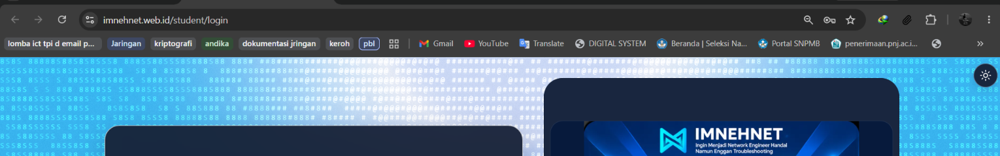
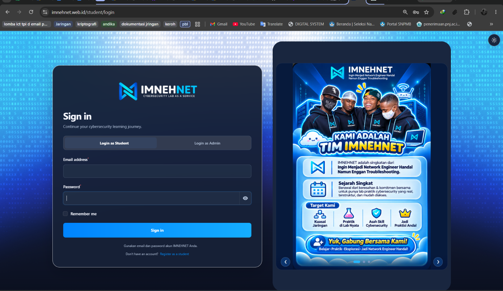
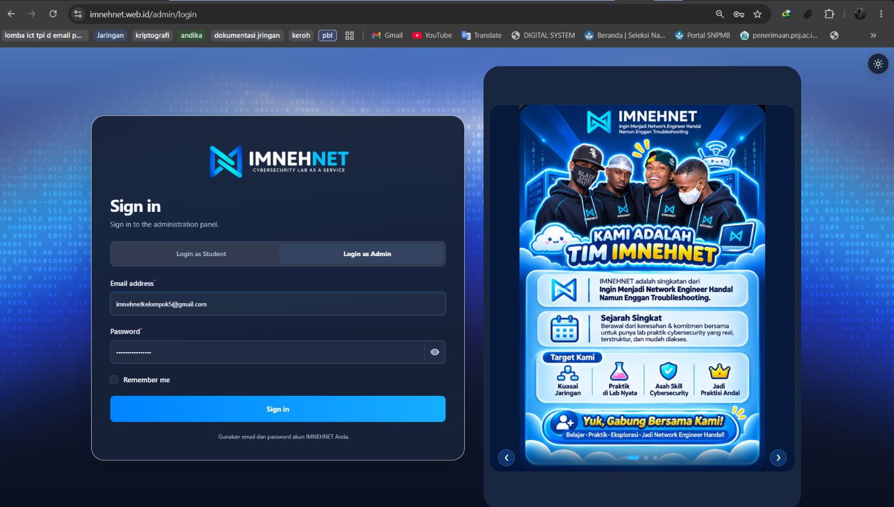
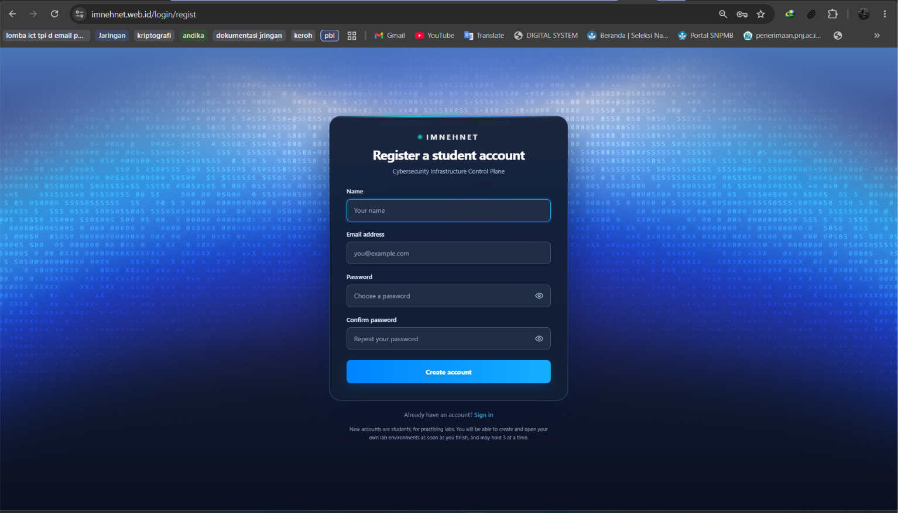
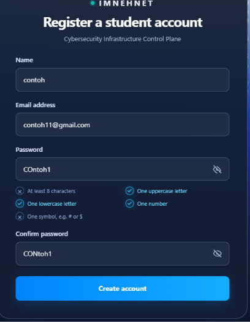
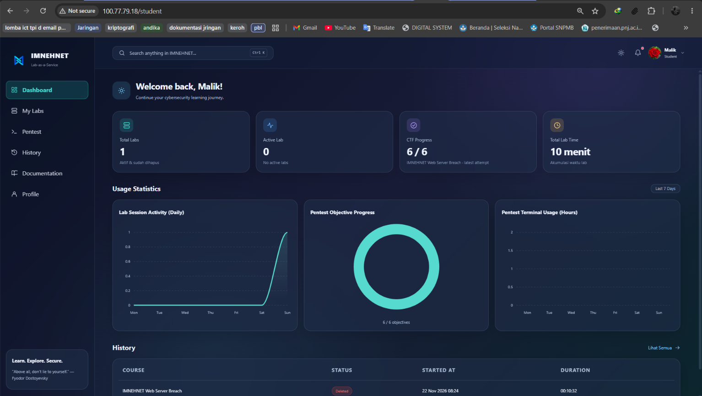

# 02 — Frontpage, Login, dan Registration Webportal IMNEHNET

**Proyek:** IMNEHNET — Webportal IaaS untuk Praktikum Keamanan Siber  
**Bidang:** Portal Developer  
**PIC:** Malik  
**Tahap:** 02 — Antarmuka awal dan autentikasi  
**Basis audit:** repository `Alief1150/imnehnet-iac`, branch `main`, commit `b3370b5` (23 November 2026)  
**Status:** Implementasi final terverifikasi melalui source; pengujian end-to-end perlu bukti hasil dan screenshot  

> **Ruang lingkup:** pembahasan ini mendokumentasikan kode yang benar-benar teramati di repository, bukan menyalin seluruh source. Komentar pada contoh di bawah **ditambahkan untuk menjelaskan kode**, bukan berarti sudah ditempel pada source aplikasi. Implementasi produksi tidak diubah oleh dokumen ini.

## 1. Deskripsi Pekerjaan

Tahap ini mencakup akses awal Webportal IMNEHNET, antarmuka login untuk Student dan Admin, form registrasi akun Student, validasi data, serta pengarahan pengguna ke panel yang sesuai dengan perannya (*role-based navigation*). Antarmuka memakai **Laravel Blade** sebagai template, **Filament** untuk panel dan proses login, **Livewire** untuk interaksi dan penyimpanan registrasi, **Alpine.js** untuk interaksi lokal pada form, serta CSS dan JavaScript untuk presentasi visual.

Perlu dibedakan: **Blade menampilkan elemen dan memanggil aksi**, sementara **class PHP, autentikasi Filament, middleware, dan model pengguna menentukan apa yang benar-benar terjadi**. Oleh sebab itu, penjelasan tombol *Sign in* tidak cukup apabila hanya mencantumkan file `.blade.php`.

## 2. Pemetaan Source dan Tanggung Jawab

| Komponen | File source | Fungsi |
|---|---|---|
| Route awal | [`routes/web.php`](../../../webportal/routes/web.php) | Redirect `/`, alias login, dan URL registrasi |
| Tampilan login | [`resources/views/imnehnet/auth/login.blade.php`](../../../webportal/resources/views/imnehnet/auth/login.blade.php) | UI login, pilihan Student/Admin, tombol Sign in, branding, carousel, theme |
| Handler login | [`app/Filament/Auth/Pages/Login.php`](../../../webportal/app/Filament/Auth/Pages/Login.php) | Menghubungkan Blade kustom dengan proses autentikasi Filament |
| Panel Admin | [`AdminPanelProvider.php`](../../../webportal/app/Providers/Filament/AdminPanelProvider.php) | Registrasi panel dan login `/admin` |
| Panel Student | [`StudentPanelProvider.php`](../../../webportal/app/Providers/Filament/StudentPanelProvider.php) | Registrasi panel dan login `/student` |
| Form registrasi | [`resources/views/livewire/register-student.blade.php`](../../../webportal/resources/views/livewire/register-student.blade.php) | Input nama, email, password, konfirmasi, tombol Create account |
| Proses registrasi | [`app/Livewire/RegisterStudent.php`](../../../webportal/app/Livewire/RegisterStudent.php) | Validasi, pembatasan percobaan, pembuatan akun Student, login, redirect |
| Autorisasi panel | [`app/Models/User.php`](../../../webportal/app/Models/User.php) | Menentukan peran dan izin memasuki panel |
| Redirect panel | [`RedirectToOwnPanel.php`](../../../webportal/app/Http/Middleware/RedirectToOwnPanel.php) | Memindahkan user yang salah membuka panel ke panel yang sesuai |
| Branding | [`imnehnet-auth-brand.blade.php`](../../../webportal/resources/views/components/imnehnet-auth-brand.blade.php) | Logo dan pengaturan visual branding |
| Carousel | [`imnehnet-login-carousel.blade.php`](../../../webportal/resources/views/components/imnehnet-login-carousel.blade.php) | Gambar poster dan navigasi carousel |
| CSS login | [`public/imnehnet-login/login-v5.css`](../../../webportal/public/imnehnet-login/login-v5.css) | Tata letak dan gaya login |

**Hasil pemeriksaan source final:** route `/login/regist` menggunakan `Route::view('/login/regist', 'imnehnet.auth.register')`. View pembungkus `resources/views/imnehnet/auth/register.blade.php` tersedia pada commit `b3370b5` dan memuat komponen `@livewire('register-student')`. Hasil pengujian runtime tetap dicatat berdasarkan bukti.

## 3. Akses Awal dan Navigasi Login

### 3.1 Route awal

Pada source, halaman root **bukan landing page publik tersendiri**. Pengunjung diarahkan ke login Student. Karena itu, istilah *frontpage* pada tahap ini merujuk ke **halaman masuk/authentication gateway**.

```php
// routes/web.php — cuplikan sesuai alur source, diberi komentar penjelas.

// URL "/" adalah alamat awal webportal.
// redirect() mengalihkan browser ke halaman login Student.
Route::get('/', function () {
    return redirect('/student/login');
});

// URL "/login" adalah alias login umum.
// route('filament.student.auth.login') mencari URL dari nama route Filament,
// sehingga alamat tidak perlu ditulis berulang di semua komponen.
Route::get('/login', function () {
    return redirect()->route('filament.student.auth.login');
})->name('login');

// URL registrasi ditetapkan di "/login/regist".
// Route::view() menampilkan sebuah view Blade, bukan memproses akun secara langsung.
Route::view('/login/regist', 'imnehnet.auth.register')
    ->name('register');
```

**Kode asli:** [routes/web.php](https://github.com/Alief1150/imnehnet-iac/blob/main/webportal/routes/web.php) — bagian route `/`, `/login`, dan `/login/regist`.

| URL | Tujuan berdasarkan konfigurasi |
|---|---|
| `/` | Redirect ke `/student/login` |
| `/login` | Redirect ke route login Student milik Filament |
| `/student/login` | Form login Student |
| `/admin/login` | Form login Admin |
| `/login/regist` | View pembungkus registrasi `imnehnet.auth.register` tersedia pada source final |



*Gambar 1. Tampilan awal Webportal ketika pengguna mengakses alamat root. Ambil screenshot aktual dan pastikan URL/hasil redirect sesuai deployment.*

### 3.2 Peran panel Filament

```php
// Contoh ringkas deklarasi dari dua PanelProvider; kode berikut
// disusun untuk menjelaskan bagian relevan, bukan file lengkap.

// AdminPanelProvider::panel():
->id('admin')            // ID panel Admin untuk identifikasi role.
->path('admin')          // Prefix URL, termasuk /admin/login.
->login(Login::class);  // Menggunakan halaman login kustom yang sama.

// StudentPanelProvider::panel():
->id('student')          // ID panel Student.
->path('student')        // Prefix URL, termasuk /student/login.
->login(Login::class);  // Sama-sama menggunakan class login kustom.
```

**Kode asli (dua file):** [AdminPanelProvider.php](https://github.com/Alief1150/imnehnet-iac/blob/main/webportal/app/Providers/Filament/AdminPanelProvider.php) dan [StudentPanelProvider.php](https://github.com/Alief1150/imnehnet-iac/blob/main/webportal/app/Providers/Filament/StudentPanelProvider.php). Cuplikan di atas menggabungkan deklarasi dari kedua file.

Kedua panel memakai handler login yang sama, tetapi alamat, otorisasi, dan fitur setelah autentikasi berbeda. **Klik tab Student/Admin mengubah alamat halaman login, bukan langsung mengubah role sebuah akun.**

## 4. Implementasi Tampilan Login Menggunakan Blade

Source utamanya adalah `resources/views/imnehnet/auth/login.blade.php`. Class `App\Filament\Auth\Pages\Login` mengatur properti `$view = 'imnehnet.auth.login'`, sedangkan autentikasi dasarnya diwarisi dari `Filament\Auth\Pages\Login`.

### 4.1 Elemen branding, judul, dan tab role

```blade
{{-- @include memuat logo/branding dari komponen Blade terpisah. --}}
@include('components.imnehnet-auth-brand')

{{-- filament() mendapatkan panel aktif dari konteks request. --}}
{{-- getId() menghasilkan ID, misalnya "admin" atau "student". --}}
@php($imLoginPanel = filament()->getCurrentPanel()?->getId())

<nav class="im-v5-tabs" aria-label="Login role">
    {{-- route() membuat URL berdasarkan nama route Filament. --}}
    {{-- class "active" dipakai CSS untuk menandai tab terpilih. --}}
    <a href="{{ route('filament.student.auth.login') }}"
       class="{{ $imLoginPanel === 'student' ? 'active' : '' }}">
        Login as Student
    </a>

    <a href="{{ route('filament.admin.auth.login') }}"
       class="{{ $imLoginPanel === 'admin' ? 'active' : '' }}">
        Login as Admin
    </a>
</nav>
```

**Kode asli:** [login.blade.php](https://github.com/Alief1150/imnehnet-iac/blob/main/webportal/resources/views/imnehnet/auth/login.blade.php) — branding dan tab login.

**Penjelasan variabel dan fungsi:**

| Elemen | Jenis | Fungsi |
|---|---|---|
| `$imLoginPanel` | Variabel Blade/PHP | Menyimpan ID panel aktif agar tab yang benar diberi kelas `active` |
| `filament()` | Helper Filament | Mengakses konteks Filament yang sedang melayani request |
| `getCurrentPanel()?->getId()` | Pemanggilan method, null-safe | Mengambil ID panel tanpa melempar error ketika tidak ada panel |
| `route('filament.*.auth.login')` | Helper Laravel | Menghasilkan alamat login berdasarkan nama route |
| `@include(...)` | Direktif Blade | Menyisipkan komponen branding yang dapat digunakan ulang |
| `{{ ... }}` | Output Blade | Mencetak nilai ke HTML secara escaped |

Pada source lengkap, tab juga memuat ikon Lucide dan atribut `aria-current` untuk menunjukkan halaman aktif kepada teknologi bantu.



*Gambar 2. Tampilan form Sign in pada tab Login as Student.*



*Gambar 3. Tampilan form Sign in pada tab Login as Admin.*

### 4.2 Mengapa ada tombol Sign in dan bagaimana logikanya?

Tombol **Sign in** adalah aksi untuk mengirim data kredensial pengguna yang diinput melalui **form Filament**. Tombol ini bukan sekadar perpindahan halaman; aksi autentikasi dipanggil melalui Livewire.

```blade
{{-- wire:submit memanggil method authenticate pada komponen Livewire login. --}}
<form wire:submit="authenticate" class="im-v5-form">

    {{-- $this->form berasal dari konfigurasi form milik class Login
         dan kelas induk Filament, bukan variabel yang dibuat manual di Blade. --}}
    {{ $this->form }}

    {{-- type="submit" berarti menekan tombol mengirim form. --}}
    {{-- wire:loading.attr menonaktifkan tombol selama authenticate berjalan. --}}
    <button type="submit"
            class="im-v5-submit"
            wire:loading.attr="disabled"
            wire:target="authenticate">

        {{-- Label normal sebelum request berlangsung. --}}
        <span wire:loading.remove wire:target="authenticate">
            Sign in
        </span>

        {{-- Label yang muncul selama request berlangsung. --}}
        <span wire:loading wire:target="authenticate">
            Signing in...
        </span>
    </button>
</form>
```

**Kode asli:** [login.blade.php](https://github.com/Alief1150/imnehnet-iac/blob/main/webportal/resources/views/imnehnet/auth/login.blade.php) — form dan tombol Sign in. **Handler autentikasi:** [Login.php](https://github.com/Alief1150/imnehnet-iac/blob/main/webportal/app/Filament/Auth/Pages/Login.php) (mewarisi method `authenticate` dari Filament).

Alur yang didukung source:

1. Pengguna memilih tab login Student atau Admin, kemudian mengisi kredensial.
2. `{{ $this->form }}` menampilkan form autentikasi Filament pada halaman.
3. Klik tombol `Sign in` memicu `wire:submit="authenticate"`.
4. Method `authenticate` berasal dari kelas login Filament yang diwarisi oleh `App\Filament\Auth\Pages\Login`; isi internal method tersebut berada pada dependency vendor dan tidak ditulis ulang di Blade.
5. Selama request, label berganti ke `Signing in...` dan tombol dinonaktifkan untuk mengurangi pengiriman berulang.
6. Akses ke panel berikutnya ditentukan oleh autentikasi dan pemeriksaan role, bukan oleh teks atau pilihan tab semata.

**Mengapa tidak membuat handler password sendiri di Blade?** Karena Filament menangani alur autentikasi, session, dan validasi login pada lapisan yang sesuai. Template Blade bertanggung jawab mempresentasikan form dan menghubungkan event UI ke handler tersebut.

### 4.3 Link pendaftaran dan kondisi tampilnya

```blade
{{-- Link registrasi hanya ditampilkan pada halaman login Student,
     serta jika route bernama "register" telah terdaftar. --}}
@if (
    filament()->getCurrentPanel()?->getId() === 'student'
    && \Illuminate\Support\Facades\Route::has('register')
)
    <p class="im-v5-register">
        Don't have an account?
        <a href="{{ route('register') }}">
            Register as a student
        </a>
    </p>
@endif
```

**Kode asli:** [login.blade.php](https://github.com/Alief1150/imnehnet-iac/blob/main/webportal/resources/views/imnehnet/auth/login.blade.php) — kondisi tampilnya tautan registrasi.

`@if` adalah percabangan Blade. `Route::has('register')` mengecek keberadaan definisi route, **bukan** memastikan file view target bisa dirender. Link registrasi tidak ditampilkan di login Admin karena self-registration memang hanya dirancang untuk akun Student.

### 4.4 Elemen visual pelengkap

Login menggunakan branding `components.imnehnet-auth-brand`, teks pengantar, area poster/carousel `components.imnehnet-login-carousel`, serta tombol pergantian mode terang/gelap. Source menautkan `login-v5.css`, file JS carousel, theme-safe, dan poster; animasi/visual interaktif juga melibatkan `@vite('resources/js/imnehnet-login-ascii.jsx')`.

```blade
{{-- @vite memuat aset frontend yang dibundel oleh pipeline Vite. --}}
@vite('resources/js/imnehnet-login-ascii.jsx')

{{-- include memisahkan HTML/Blade carousel dari halaman login utama. --}}
@include('components.imnehnet-login-carousel')

{{-- defer mengunduh skrip tanpa memblokir parsing HTML; dieksekusi
     setelah dokumen diparsing sesuai aturan browser. --}}
<script defer src="/imnehnet-login/carousel-v1.js?v=1"></script>
```

**Sumber terkait (cuplikan ilustratif):** [login.blade.php](https://github.com/Alief1150/imnehnet-iac/blob/main/webportal/resources/views/imnehnet/auth/login.blade.php) dan [imnehnet-login-carousel.blade.php](https://github.com/Alief1150/imnehnet-iac/blob/main/webportal/resources/views/components/imnehnet-login-carousel.blade.php). Baris dalam contoh tidak seluruhnya berdampingan pada source.

Cuplikan terakhir merupakan **ilustrasi integrasi komponen**, bukan satu blok persis yang berdampingan di file login: carousel dipanggil melalui bagian poster dalam file aslinya. Source `imnehnet-login-carousel.blade.php` juga memuat JavaScript untuk tombol sebelumnya/berikutnya, titik navigasi, dan perpindahan slide otomatis (interval 5 detik pada implementasi yang diaudit). CSS hanya mengatur presentasi; interaksi digerakkan JavaScript.

## 5. Implementasi Registrasi Student

### 5.1 Koneksi form Blade dengan class Livewire

Form berada pada `resources/views/livewire/register-student.blade.php`, sedangkan pemrosesan dilakukan oleh `app/Livewire/RegisterStudent.php`.

```blade
{{-- wire:submit memanggil public function register() pada RegisterStudent.php. --}}
<form wire:submit="register">

    {{-- wire:model menyinkronkan nilai input dengan public property
         pada class Livewire yang mempunyai nama sama. --}}
    <input type="text" wire:model="name" required>
    <input type="email" wire:model="email" required>

    {{-- Password disimpan sebagai property pada komponen Livewire.
         Bentuk input yang lengkap menyediakan show/hide melalui Alpine. --}}
    <input type="password" wire:model="password" required>
    <input type="password"
           wire:model="password_confirmation" required>

    {{-- Pesan validasi dari server ditampilkan sesuai nama field. --}}
    @error('email')
        <p>{{ $message }}</p>
    @enderror

    {{-- Tombol ini menjalankan registrasi, bukan sekadar navigasi. --}}
    <button type="submit"
            wire:loading.attr="disabled"
            wire:target="register">
        <span wire:loading.remove wire:target="register">Create account</span>
        <span wire:loading wire:target="register">Creating...</span>
    </button>
</form>
```

**Kode asli:** [register-student.blade.php](https://github.com/Alief1150/imnehnet-iac/blob/main/webportal/resources/views/livewire/register-student.blade.php) — input dan tombol Create account. **Logika pemrosesan:** [RegisterStudent.php](https://github.com/Alief1150/imnehnet-iac/blob/main/webportal/app/Livewire/RegisterStudent.php).

**Catatan:** ini cuplikan ringkas yang mempertahankan hubungan antar-API; markup asli memiliki class CSS, label aksesibilitas, dan indikator password yang lebih lengkap.

| Property Livewire | Isi dari form | Fungsi |
|---|---|---|
| `$name` | Input Name | Nama yang ditampilkan pada akun |
| `$email` | Input Email | Identitas unik akun; dinormalisasi ke huruf kecil |
| `$password` | Input Password | Kata sandi yang divalidasi dan di-hash |
| `$password_confirmation` | Input Confirm password | Dipakai aturan `confirmed` untuk mencocokkan password |

### 5.2 Checklist password dan Alpine.js

Pada source, form password memiliki:

```html
<!-- x-data membuat state lokal di browser.
     value menyimpan input saat mengetik; show mengendalikan visibilitas. -->
<div x-data="{ value: '', show: false }">
    <!-- :type mengganti tipe input tanpa request ke server. -->
    <input :type="show ? 'text' : 'password'"
           @input="value = $event.target.value">

    <!-- @click membalik nilai show saat tombol mata ditekan. -->
    <button type="button" @click="show = !show">
        Show / hide password
    </button>
</div>
```

**Kode asli:** [register-student.blade.php](https://github.com/Alief1150/imnehnet-iac/blob/main/webportal/resources/views/livewire/register-student.blade.php) — state Alpine.js dan tombol tampil/sembunyikan password. Contoh di atas dipersingkat.

Checklist visual mengevaluasi panjang minimal delapan karakter, huruf kapital, angka, dan simbol. **Alpine.js hanya memberikan umpan balik instan di browser**, sedangkan validasi yang berwenang tetap dijalankan di PHP. Mengubah JavaScript tidak boleh dianggap cukup untuk melewati validasi backend.

### 5.3 Proses register() di backend

Cuplikan alur berikut menyederhanakan method `register()` asli, dengan komentar edukatif dan tanpa menggantikan algoritme implementasi lengkap.

```php
// RegisterStudent.php — ekstrak yang disusun ulang untuk dokumentasi.
// Signature asli menerima ActivityLogService $activity.
public function register(ActivityLogService $activity): void
{
    // Normalisasi email agar perbedaan huruf besar/kecil tidak
    // menghasilkan identitas yang secara logika sama.
    $email = Str::lower(trim($this->email));

    // Source asli melakukan RateLimiter sebelum validasi.
    // Maksimum 5 percobaan per kombinasi email + alamat IP
    // dalam periode 3600 detik; jika melebihi, lempar error validasi.
    $key = $this->throttleKey($email);
    if (RateLimiter::tooManyAttempts($key, self::ATTEMPTS)) {
        // Source asli menghitung waktu tunggu dan melempar
        // ValidationException untuk field email.
        // Bagian pesan error tidak ditampilkan ulang di cuplikan ini.
        throw ValidationException::withMessages([
            'email' => 'Too many registration attempts.',
        ]);
    }
    RateLimiter::hit($key, self::DECAY_SECONDS);

    // Validasi server: nama, email unik, password kuat,
    // dan konfirmasi password yang cocok.
    $this->validate([
        'name' => ['required', 'string', 'max:255'],
        'email' => ['required', 'string', 'email',
                    'max:255', 'unique:users,email'],
        'password' => ['required', 'confirmed',
            Password::min(8)->mixedCase()->numbers()->symbols()],
    ]);

    // Role dan status ditentukan di server.
    // Form publik TIDAK diberi kewenangan memilih akun Admin.
    $user = new User;
    $user->name = trim($this->name);
    $user->email = $email;
    $user->password = Hash::make($this->password);
    $user->role = UserRole::Student;
    $user->status = UserStatus::Active;
    $user->must_change_password = false;
    $user->save();

    // Source lengkap kemudian membersihkan rate limit,
    // mencatat Activity Log, login sebagai pengguna baru,
    // mengirim notifikasi ke admin aktif, lalu redirect.
    RateLimiter::clear($key);
    $activity->record(/* lihat argumen asli pada source */);
    Auth::login($user);
    // foreach admin aktif: notify(new NewStudentRegistered($user))
    $this->redirect(
        route('filament.student.pages.dashboard'),
        navigate: false
    );
}
```

**Kode asli:** [RegisterStudent.php](https://github.com/Alief1150/imnehnet-iac/blob/main/webportal/app/Livewire/RegisterStudent.php) — method `register()` lengkap. Cuplikan di atas adalah penyederhanaan untuk penjelasan, **bukan source siap tempel**.

**Penting:** blok di atas adalah **pseudocode PHP berkomentar untuk pembelajaran**, bukan function siap ditempel. Pemanggilan `$activity->record(/* ... */)` sengaja dipersingkat agar tidak menduplikasi seluruh method asli. Periksa source tertaut jika membutuhkan implementasi persis.

Urutan yang terkonfirmasi dari class asli:

1. Normalisasi email dan cek rate limit sebelum validasi.
2. Validasi field, termasuk keunikan email serta aturan kekuatan dan konfirmasi password.
3. Buat pengguna dengan role `Student` dan status `Active` **di sisi server**.
4. Hash password menggunakan `Hash::make`; jangan menyimpan password plaintext.
5. Catat aktivitas registrasi dan login pengguna baru dengan `Auth::login`.
6. Kirim notifikasi kepada administrator aktif.
7. Redirect ke dashboard Student.



*Gambar 4. Form self-registration Student dan elemen inputnya. Bukti perlu diambil dari deployment aktual.*



*Gambar 5. Contoh pemeriksaan validasi form tanpa menampilkan password asli, email pribadi, atau token.*

## 6. Otorisasi dan Redirect Berdasarkan Role

**Tab login bukan mekanisme keamanan.** Pemeriksaan role dilakukan melalui model `User` dan middleware Filament.

```php
// app/Models/User.php — inti pemeriksaan akses panel.
public function canAccessPanel(Panel $panel): bool
{
    // Akun yang tidak aktif ditolak untuk kedua panel.
    if ($this->status !== UserStatus::Active) {
        return false;
    }

    // Hak masuk panel dibedakan berdasarkan role akun.
    return match ($panel->getId()) {
        'admin' => $this->isAdmin() || $this->isLecturer(),
        'student' => ! $this->isAdmin() && ! $this->isLecturer(),
        default => false,
    };
}
```

**Kode asli:** [User.php](https://github.com/Alief1150/imnehnet-iac/blob/main/webportal/app/Models/User.php) — method `canAccessPanel()`.

Class `App\Filament\Auth\Pages\Login` mengembalikan `true` pada `isUserAllowedToAccessPanel()` untuk memungkinkan kredensial valid diproses meskipun pengguna membuka alamat login panel yang berbeda. **Ini bukan berarti semua user bebas mengakses semua halaman.** Sesudah autentikasi, `RedirectToOwnPanel` mengecek `canAccessPanel()` untuk mengirim user ke panel yang diperbolehkan; pengamanan resource dan tindakan sensitif tetap harus dijalankan di backend.

```php
// RedirectToOwnPanel.php — logika ringkas berdasarkan source.
$user = $request->user();

if ($user !== null
    && ! $user->canAccessPanel(Filament::getCurrentOrDefaultPanel())) {

    // Admin diarahkan ke panel admin, selain itu ke student.
    $own = $user->isAdmin() ? 'admin' : 'student';

    // Redirect hanya dilakukan jika panel tujuan memang diizinkan.
    if ($user->canAccessPanel(Filament::getPanel($own))) {
        return redirect()->route("filament.{$own}.pages.dashboard");
    }
}

// Jika tidak perlu redirect, lanjutkan autentikasi Filament.
return parent::handle($request, $next);
```

**Kode asli:** [RedirectToOwnPanel.php](https://github.com/Alief1150/imnehnet-iac/blob/main/webportal/app/Http/Middleware/RedirectToOwnPanel.php) — method `handle()`.

**Catatan audit untuk role Lecturer:** Model mengizinkan Lecturer pada panel Admin, tetapi middleware memilih tujuan redirect berdasarkan `isAdmin()` saja. Dengan demikian, Lecturer yang mencoba login melalui panel Student perlu diuji: kode tujuan default memilih Student, yang justru ditolak oleh `canAccessPanel()`. Dokumentasi ini tidak mengklaim redirect lintas panel bagi Lecturer sudah benar.



*Gambar 6. Bukti navigasi akun Student ke Student Panel atau akun Admin ke Admin Panel; gunakan akun pengujian dan jangan tampilkan data sensitif.*


## Interaksi dan Alur Backend

### View pembungkus registrasi yang digunakan

View pembungkus registrasi memuat Livewire register-student dan aset tampilan.

```blade

<body class="imnehnet-register-body">

    <div class="im-v5 im-register" data-theme="dark">

        <div id="im-react-bits-ascii" aria-hidden="true"></div>

        <main class="im-register-shell">

            @livewire('register-student')

        </main>

    </div>

    @vite('resources/js/imnehnet-login-ascii.jsx')
```

**[Buka kode asli `webportal/resources/views/imnehnet/auth/register.blade.php` (L30–L45)](https://github.com/Alief1150/imnehnet-iac/blob/main/webportal/resources/views/imnehnet/auth/register.blade.php#L30-L45)**

### Pemetaan tombol, aksi, dan handler

| Kontrol | Handler / state | Proses, validasi, dan hasil |
|---|---|---|
| **Login as Student / Admin** | `route('filament.student.auth.login') / route('filament.admin.auth.login')` | Navigasi tab menentukan panel dan route tujuan; bukan pilihan role yang langsung mengganti hak akses akun. |
| **Sign in** | `wire:submit="authenticate"` | Mengirim form ke autentikasi Filament, menangani validasi kredensial dan redirect sesuai panel serta middleware. |
| **Register student** | `/login/regist / RegisterStudent::register` | Mengarahkan ke form Livewire registrasi; backend memvalidasi dan menyimpan akun baru sesuai aturan. |
| **Validasi password** | `wire:model + Alpine.js` | Indikator klien membantu pengguna, tetapi validasi penentu tetap di backend PHP. |


**Penjelasan:** Blade menyajikan form, tombol, dan indikator loading; method PHP/Livewire menjalankan otorisasi, query, notifikasi, validasi, serta memanggil service atau queue ketika diperlukan. **Pengujian UI dan runtime dipisahkan** agar status keberhasilan tidak dilebihkan tanpa bukti kasus uji.

## 7. Pengujian dan Verifikasi

### 7.1 Pemeriksaan source dan route (tanpa mengubah data)

```bash
cd /home/iaas/projects/webportal-iaas

# Pastikan route penting terdaftar; hanya menampilkan informasi.
php artisan route:list --path=login
php artisan route:list --path=student
php artisan route:list --path=admin

# Periksa sintaks class backend yang relevan.
php -l app/Filament/Auth/Pages/Login.php
php -l app/Livewire/RegisterStudent.php
php -l app/Http/Middleware/RedirectToOwnPanel.php

# Pastikan view pembungkus registrasi tersedia di deployment aktif.
test -f resources/views/imnehnet/auth/register.blade.php \
  && echo "Registration wrapper: present" \
  || echo "Registration wrapper: missing"
```

**Referensi file untuk pemeriksaan:** [routes/web.php](https://github.com/Alief1150/imnehnet-iac/blob/main/webportal/routes/web.php), [Login.php](https://github.com/Alief1150/imnehnet-iac/blob/main/webportal/app/Filament/Auth/Pages/Login.php), [RegisterStudent.php](https://github.com/Alief1150/imnehnet-iac/blob/main/webportal/app/Livewire/RegisterStudent.php), dan [RedirectToOwnPanel.php](https://github.com/Alief1150/imnehnet-iac/blob/main/webportal/app/Http/Middleware/RedirectToOwnPanel.php). Perintah shell adalah instruksi verifikasi, bukan salinan dari satu file source.

Tidak ada perintah di atas yang membuat akun, menjalankan migration, atau merestart aplikasi. **Hindari mempublikasikan `.env`, password, session cookie, atau secret dalam screenshot.**

### 7.2 Matriks pengujian fungsional (belum dinyatakan PASS)

| ID | Skenario | Hasil yang diharapkan | Status bukti |
|---|---|---|---|
| AUTH-01 | Akses `/` | Redirect ke login Student | Belum diverifikasi pada deployment aktif |
| AUTH-02 | Klik tab Admin/Student | URL login berpindah, tab aktif sesuai panel | Belum diverifikasi |
| AUTH-03 | Submit login valid Student | Autentikasi dan akses panel Student | Belum diverifikasi |
| AUTH-04 | Submit login valid Admin | Autentikasi dan akses panel Admin | Belum diverifikasi |
| AUTH-05 | Submit kredensial tidak valid | Login ditolak, tidak membuka panel | Belum diverifikasi |
| AUTH-06 | Buka registrasi Student | Form registrasi tampil | **Perlu cek view pembungkus** |
| AUTH-07 | Registrasi dengan input tidak valid | Error validasi muncul | Belum diverifikasi |
| AUTH-08 | Registrasi valid | Role Student, password hashed, login, redirect Student | Belum diverifikasi |
| AUTH-09 | Student membuka halaman Admin | Akses Admin tidak diberikan | Belum diverifikasi |
| AUTH-10 | Akun Disabled membuka panel | Akses ditolak | Belum diverifikasi |
| AUTH-11 | Lecturer membuka login Student | Redirect/akses sesuai kebijakan Lecturer | **Perlu audit dan pengujian tambahan** |
| AUTH-12 | UI responsif dan pergantian theme | Elemen login dapat digunakan di desktop/mobile | Belum diverifikasi |

Matriks di atas adalah **rencana verifikasi**, bukan laporan hasil pengujian yang sudah selesai. Pengujian registrasi menggunakan akun uji yang diizinkan dan dikerjakan dalam lingkungan yang sesuai karena dapat membuat data pengguna nyata.

## 8. Rencana Screenshot dan Penamaan File

Simpan gambar pada folder [`jobdesc/Portal-Developer/images/02-frontpage-auth/`](../images/02-frontpage-auth/). Nama file harus **identik** dengan referensi Markdown.

| Gambar | Nama file | Bukti yang harus terlihat |
|---|---|---|
| 1 | `01-frontpage.png` | Halaman awal/redirect login Student |
| 2 | `02-login-student.png` | Login as Student dan tombol Sign in |
| 3 | `03-login-admin.png` | Login as Admin dan tombol Sign in |
| 4 | `04-register-student.png` | Form registrasi Student |
| 5 | `05-validasi-register.png` | Validasi form atau checklist password tanpa secret |
| 6 | `06-redirect-role.png` | Dashboard tujuan setelah login dengan role yang diizinkan |

Semua screenshot di atas masih perlu diunggah. Pilih resolusi yang membuat elemen dan URL terbaca; jika user/email terlihat, gunakan akun dummy atau sensor data pribadi.

## 9. Hasil Audit dan Evaluasi

**Yang terverifikasi dari source:**

- Root `/` mengalihkan pengguna ke login Student, bukan halaman landing publik yang berdiri sendiri.
- Login Student dan Admin menggunakan Blade kustom dan handler Filament yang sama; tombol `Sign in` memicu method `authenticate`.
- Navigasi Student/Admin menggunakan named route; pilihan tab hanya mengganti antarmuka/URL, bukan role.
- Registrasi menggunakan komponen Livewire `RegisterStudent` dengan validasi backend, rate limiting, penetapan role Student di server, hash password, Activity Log, notifikasi admin, dan redirect Student.
- Ada pemisahan akses panel melalui model User dan middleware.

**Temuan yang memerlukan tindak lanjut:**

1. `resources/views/imnehnet/auth/register.blade.php` tidak ditemukan pada snapshot GitHub `main`, padahal dipanggil oleh route registrasi. Periksa file pada deployment aktif lalu sinkronkan ke repository bila memang diperlukan dan telah lolos audit.
2. Redirect lintas panel untuk role Lecturer berpotensi tidak sesuai harapan karena cabang `$user->isAdmin() ? 'admin' : 'student'` tidak mempertimbangkan `isLecturer()`.
3. Screenshot dan hasil pengujian end-to-end belum tersedia; dokumentasi implementasi tidak otomatis menjadi bukti bahwa semua skenario berjalan.

## 10. Kesimpulan

Frontpage dan autentikasi IMNEHNET dibangun dengan pembagian tanggung jawab antara **Laravel Routes** (alamat), **Blade/CSS/JavaScript** (tampilan), **Filament** (login dan panel), **Livewire** (registrasi dan interaksi server), serta **model dan middleware** (otorisasi). Tombol Sign in dan Create account dibuat pada Blade tetapi alur autentikasi serta pembuatan akun terjadi melalui class PHP/backend.

Dokumen ini merupakan **hasil audit source dengan contoh kode berkomentar**, bukan modifikasi source ataupun klaim pengujian produksi telah selesai. Tahap selanjutnya setelah screenshot dan verifikasi adalah **03 — Dokumentasi Admin Panel**, dimulai dari Dashboard dan dilanjutkan sesuai urutan sidebar.

---

## Referensi Source

- [Webportal](../../../webportal/)
- [Routes](../../../webportal/routes/web.php)
- [Login Blade](../../../webportal/resources/views/imnehnet/auth/login.blade.php)
- [Login Page PHP](../../../webportal/app/Filament/Auth/Pages/Login.php)
- [Livewire registration](../../../webportal/app/Livewire/RegisterStudent.php)
- [Registration form Blade](../../../webportal/resources/views/livewire/register-student.blade.php)
- [AdminPanelProvider](../../../webportal/app/Providers/Filament/AdminPanelProvider.php)
- [StudentPanelProvider](../../../webportal/app/Providers/Filament/StudentPanelProvider.php)
- [User role access](../../../webportal/app/Models/User.php)
- [Redirect middleware](../../../webportal/app/Http/Middleware/RedirectToOwnPanel.php)


---
