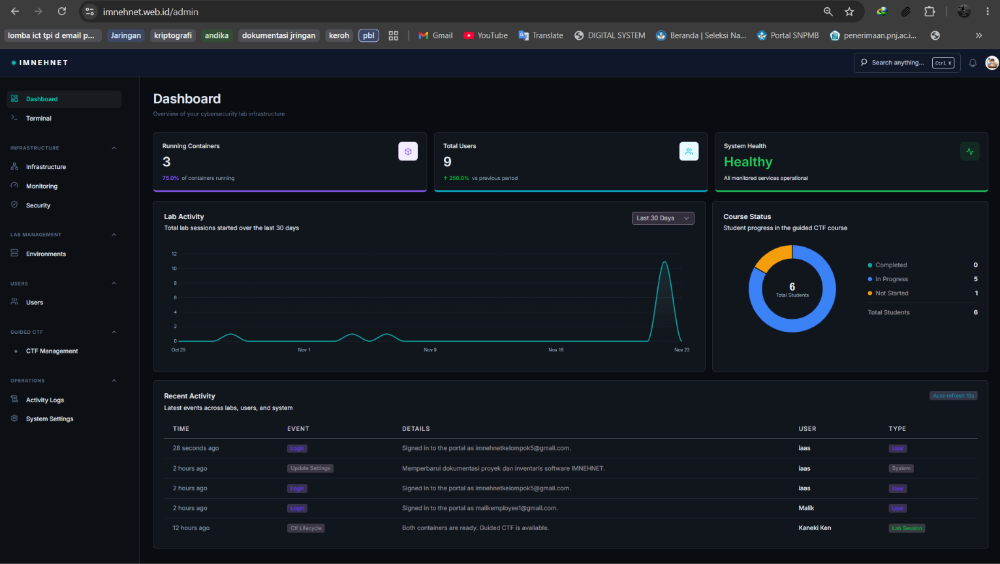
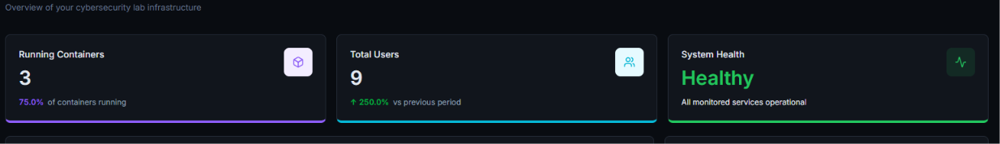
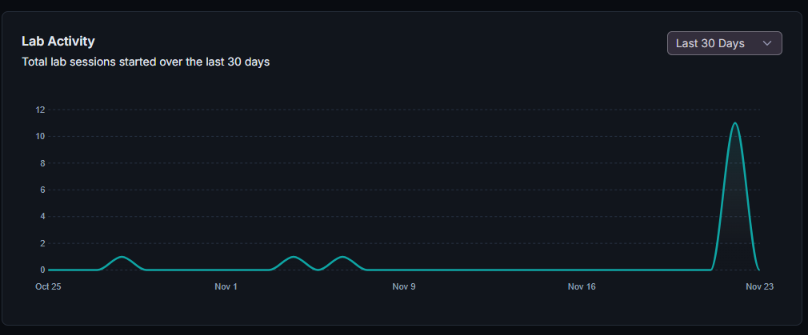
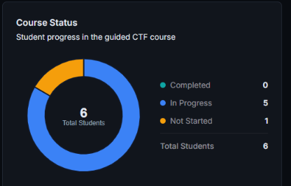
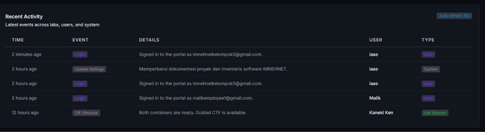

# 03.01 — Pengembangan Admin Dashboard Webportal IMNEHNET

**Proyek:** IMNEHNET — Webportal IaaS untuk Praktikum Keamanan Siber  
**Bidang:** Portal Developer  
**Penanggung jawab:** Malik  
**Modul:** Admin Panel → Dashboard  
**Status:** Source diaudit, dokumentasi implementasi tersedia; screenshot dan uji fungsional perlu dilengkapi  
**Acuan:** Repository `Alief1150/imnehnet-iac`, branch `main`, diperiksa 23 November 2026

> Dokumen ini menjelaskan kode yang ditemukan pada repository dan mengacu pada pembaruan server yang telah disinkronkan ke GitHub melalui commit `b3370b5`. Contoh kode diberi komentar tambahan untuk pembelajaran; komentar tersebut tidak harus sudah ada dalam source. Tidak ada kode aplikasi yang diubah oleh dokumen ini.

## 1. Deskripsi Pekerjaan

Pengerjaan halaman **Admin Dashboard** ditujukan untuk memberikan ringkasan kondisi Webportal dan aktivitas laboratorium kepada administrator. Pengguna tidak harus membuka satu per satu menu untuk memeriksa jumlah container, jumlah akun, kondisi layanan, aktivitas lab, perkembangan course, dan aktivitas sistem terbaru.

Halaman menggunakan **Filament Dashboard** untuk struktur panel, **widget PHP** untuk menyiapkan data, dan **Blade** untuk menampilkan kartu statistik, grafik, serta tabel. Komponen grafik menerima data dari PHP dan dirender oleh JavaScript.

## 2. File Source dan Fungsinya

| File | Tanggung jawab |
|---|---|
| [`app/Filament/Pages/Dashboard.php`](../../../../webportal/app/Filament/Pages/Dashboard.php) | Menentukan halaman dashboard, judul, serta widget berdasarkan role |
| [`app/Filament/Widgets/AdminDashboardOverview.php`](../../../../webportal/app/Filament/Widgets/AdminDashboardOverview.php) | Menyiapkan statistik, data grafik, system health, dan aktivitas terbaru |
| [`resources/views/filament/widgets/admin-dashboard-overview.blade.php`](../../../../webportal/resources/views/filament/widgets/admin-dashboard-overview.blade.php) | Menampilkan kartu KPI, grafik, filter periode, dan Recent Activity |
| [`app/Services/IncusInventoryMonitoringService.php`](../../../../webportal/app/Services/IncusInventoryMonitoringService.php) | Sumber ringkasan container/monitoring inventaris |
| [`app/Services/InfrastructureStatusService.php`](../../../../webportal/app/Services/InfrastructureStatusService.php) | Menyediakan hasil probe kesehatan layanan |
| [`app/Models/User.php`](../../../../webportal/app/Models/User.php) | Model akun pengguna |
| [`app/Models/LabSession.php`](../../../../webportal/app/Models/LabSession.php) | Model sesi lab untuk grafik aktivitas |
| [`app/Models/ActivityLog.php`](../../../../webportal/app/Models/ActivityLog.php) | Model riwayat aktivitas |

## 3. Alur Menampilkan Dashboard

1. Administrator berhasil masuk ke panel `/admin`.
2. Filament memuat class `Dashboard`.
3. Class tersebut memeriksa role melalui `auth()->user()?->isAdmin()`.
4. Untuk Admin, widget `AdminDashboardOverview` dipilih.
5. Method `getViewData()` menyiapkan data dari layanan monitoring, database, sesi lab, dan log aktivitas.
6. Blade menerima variabel dan merender kartu ringkasan, grafik, dan tabel.
7. Pemilihan periode grafik melalui Livewire memicu pembaruan data.

### 3.1 Pemilihan widget di halaman Dashboard — PHP

```php
// Dashboard.php — cuplikan dari method getWidgets().
// Hanya akun Admin yang mendapatkan widget ringkasan khusus Admin.
public function getWidgets(): array
{
    if (auth()->user()?->isAdmin() === true) {
        return [
            AdminDashboardOverview::class,
        ];
    }

    // Widget yang disediakan untuk konteks non-Admin
    // pada halaman Dashboard generik.
    return [
        EnvironmentStatsOverview::class,
        NeedsAttention::class,
        RecentEnvironments::class,
    ];
}
```

**Kode asli:** [Dashboard.php — getWidgets()](https://github.com/Alief1150/imnehnet-iac/blob/main/webportal/app/Filament/Pages/Dashboard.php).

**Penjelasan:** `auth()->user()` mengambil akun yang login, `?->` menghindari error jika tidak ada user, dan `isAdmin()` menguji role. Daftar class widget memberi tahu Filament komponen yang harus ditampilkan. Pada Student Panel, halaman dashboard aktual didaftarkan terpisah melalui `StudentPanelProvider` dan `StudentDashboard`, sehingga percabangan ini tidak boleh dianggap sebagai keseluruhan implementasi dashboard Student.

## 4. Pengolahan Data pada AdminDashboardOverview.php

### 4.1 Statistik Running Containers dan Total Users

```php
// getViewData() — bagian yang relevan dari source.
// summary() mengembalikan hasil monitoring inventaris Incus.
$inventory = app(IncusInventoryMonitoringService::class)->summary();

// Data container dipakai hanya bila kedua sumber monitoring
// tersedia dan freshness menyatakan data masih baru.
$containersAvailable =
    ($inventory['freshness'] ?? null) === 'fresh'
    && (int) ($inventory['available'] ?? 0) === 2;

// Jika belum terverifikasi, nilainya null dan UI menampilkan "—".
$runningContainers = $containersAvailable
    ? (int) ($inventory['running'] ?? 0)
    : null;

// Eloquent menghitung akun yang tersimpan pada tabel users.
$totalUsers = User::query()->count();
```

**Kode asli:** [AdminDashboardOverview.php — getViewData()](https://github.com/Alief1150/imnehnet-iac/blob/main/webportal/app/Filament/Widgets/AdminDashboardOverview.php).

| Variabel | Fungsi |
|---|---|
| `$inventory` | Menampung ringkasan data container dari service monitoring |
| `$containersAvailable` | Menandai apakah hasil monitoring memenuhi syarat kelayakan |
| `$runningContainers` | Jumlah container berjalan; `null` jika data tidak dapat dipercaya |
| `$totalUsers` | Total akun terdaftar berdasarkan Eloquent |
| `$containerPercentage` | Persentase container berjalan dibanding total container terpantau |

Ketika data monitoring belum tersedia, dashboard tidak mengisi nilai perkiraan. Ini penting agar ringkasan tidak memberikan kesan kondisi infrastruktur telah diperiksa padahal belum.

### 4.2 Menyalurkan data PHP ke Blade

```php
// getViewData() mengembalikan array asosiatif.
// Key menjadi nama variabel yang dapat dibaca Blade.
return [
    'runningContainers' => $runningContainers,
    'containerPercentage' => $containerPercentage,
    'totalUsers' => $totalUsers,
    'systemHealth' => $systemHealth,
    'labActivity' => $labActivity,
    'courseProgress' => $this->courseProgress(),
    'labActivityTrend' => $this->labActivityTrend(),
    'userGrowthTrend' => $this->userGrowthTrend(),
    // Kode asli juga mengirim recentActivity dari ActivityLog.
];
```

**Kode asli:** [AdminDashboardOverview.php — return view data](https://github.com/Alief1150/imnehnet-iac/blob/main/webportal/app/Filament/Widgets/AdminDashboardOverview.php).

Contohnya, key `'totalUsers'` membuat variabel `$totalUsers` tersedia pada file Blade widget. Blade tidak perlu melakukan query MySQL sendiri untuk menampilkan jumlah pengguna.

## 5. Implementasi Antarmuka — Blade

### 5.1 Kartu Running Containers

```blade
{{-- Kartu KPI menggunakan class layout dari stylesheet aplikasi. --}}
<section class="card min-w-0 border border-base-content/10 border-b-4 shadow-sm">
    <div class="card-body gap-3 p-5">
        <p>Running Containers</p>

        {{-- Ternary: tampilkan "—" jika monitoring belum tersedia;
             selain itu format nilai bilangan dari PHP. --}}
        <p class="mt-2 text-3xl font-semibold">
            {{ $runningContainers === null
                ? '—'
                : number_format($runningContainers) }}
        </p>

        {{-- @if menentukan apakah persentase dapat ditampilkan. --}}
        @if ($containerPercentage !== null)
            <span>{{ number_format($containerPercentage, 1) }}%</span>
        @else
            <span>Inventory unavailable</span>
        @endif
    </div>
</section>
```

**Kode asli:** [admin-dashboard-overview.blade.php — KPI Running Containers](https://github.com/Alief1150/imnehnet-iac/blob/main/webportal/resources/views/filament/widgets/admin-dashboard-overview.blade.php).

Cuplikan di atas disederhanakan dari markup lengkap agar logika mudah dipahami. **`{{ ... }}` melakukan output ter-escape**, sedangkan `@if` merupakan percabangan kondisional pada Blade. Nilai berasal dari widget PHP, bukan dari perhitungan browser.

### 5.2 Kartu Total Users dan tren pertumbuhan

Kartu **Total Users** menampilkan `number_format($totalUsers)`. Di bagian bawah, Blade membaca `$userGrowthTrend['direction']` dan `$userGrowthTrend['value']` untuk menampilkan tren naik, turun, datar, atau keterangan tidak ada baseline sebelumnya. Tren dihitung dari selisih jumlah akun baru dalam periode berjalan dibanding periode sebelumnya.

### 5.3 Grafik Lab Activity dan filter periode

```blade
{{-- wire:model.live menyinkronkan pilihan periode ke properti
     public int $activityDays = 30 pada widget Livewire. --}}
<select wire:model.live="activityDays"
        class="select select-sm w-36"
        aria-label="Lab activity period">
    <option value="7">Last 7 Days</option>
    <option value="30">Last 30 Days</option>
    <option value="90">Last 90 Days</option>
</select>

{{-- @js mengubah array PHP menjadi data JavaScript secara aman.
     x-init memanggil fungsi pembuat grafik dari frontend aplikasi. --}}
<div
    wire:key="lab-activity-chart-{{ $activityDays }}"
    x-data
    x-init="
        const instance = window.createImnehnetLabChart(
            $refs.chart,
            @js($labActivity['labels']),
            @js($labActivity['values'])
        );
        $cleanup(() => instance?.destroy());
    "
>
    <div wire:ignore x-ref="chart"
         class="min-h-[260px] w-full"></div>
</div>
```

**Kode asli:** [admin-dashboard-overview.blade.php — Lab Activity chart/filter](https://github.com/Alief1150/imnehnet-iac/blob/main/webportal/resources/views/filament/widgets/admin-dashboard-overview.blade.php); [AdminDashboardOverview.php — labActivity()](https://github.com/Alief1150/imnehnet-iac/blob/main/webportal/app/Filament/Widgets/AdminDashboardOverview.php).

**Mengapa ada pilihan Last 7/30/90 Days?** Agar administrator dapat membandingkan aktivitas sesi lab dalam beberapa periode tanpa membuka halaman laporan yang lain. Nilai `activityDays` diperiksa lagi pada backend; hanya `7`, `30`, atau `90` yang diterima. Fungsi `labActivity()` menyusun label tanggal beserta jumlah sesi yang dimulai, lalu JavaScript menggambarkannya.

**Arti direktif:** `wire:model.live` mengirim pembaruan property Livewire, `wire:key` membantu mengidentifikasi ulang elemen ketika periode berubah, `x-init` menjalankan inisialisasi JavaScript dari Alpine, `x-ref` menandai node grafik, dan `wire:ignore` menghindari Livewire menimpa DOM yang dikelola pustaka grafik.

### 5.4 Course Status

Kartu **Course Status** mengambil array dari method `courseProgress()`, dengan empat nilai: `completed`, `inProgress`, `notStarted`, dan `total`. Grafik menggunakan `window.createImnehnetCourseChart()`. Method menghitung status **berdasarkan mahasiswa**, bukan jumlah semua percobaan lab: pengguna dianggap completed jika minimal satu sesinya selesai, in progress jika memiliki sesi tanpa completed, dan not started jika belum memiliki sesi terkait course.


### 5.4.1 Penjelasan kode Course Status — PHP

```php
// Penjelasan: menghitung progres per student, bukan sekadar total sesi.
    private function courseProgress(): array
    {
        $course = Course::webServerBreach();

        $studentIds = User::query()
            ->where('role', 'student')
            ->pluck('id');

        $total = $studentIds->count();

        if ($course === null || $total === 0) {
            return [
                'completed' => 0,
                'inProgress' => 0,
                'notStarted' => $total,
                'total' => $total,
            ];
        }
```

**Kode asli:** [AdminDashboardOverview.php — courseProgress() baris 99–116](https://github.com/Alief1150/imnehnet-iac/blob/main/webportal/app/Filament/Widgets/AdminDashboardOverview.php#L99-L116).

**Logika:** method `courseProgress()` mengambil course, lalu daftar `user_id` yang berperan sebagai Student. Untuk setiap akun yang mempunyai sesi, status dibedakan menjadi `completed`, `inProgress`, dan `notStarted` berdasarkan riwayat `LabSession`. Variabel `$total` adalah jumlah mahasiswa yang diperiksa; `$sessionsByStudent` berisi sesi yang dikelompokkan berdasarkan pemilik.

### 5.4.2 Penjelasan kode Course Status — Blade

```blade
{{-- Penjelasan: data PHP dikirim ke pembuat grafik Course Status di JavaScript. --}}
                                        $courseProgress['completed'],
                                        $courseProgress['inProgress'],
                                        $courseProgress['notStarted'],
                                    ]),
                                    {{ $courseProgress['total'] }}
                                );

                                $cleanup(() => instance?.destroy());
                            "
                            class="min-w-0"
                        >
                            <div
                                x-ref="chart"
```

**Kode asli:** [admin-dashboard-overview.blade.php — Course Chart baris 184–196](https://github.com/Alief1150/imnehnet-iac/blob/main/webportal/resources/views/filament/widgets/admin-dashboard-overview.blade.php#L184-L196).

**Logika:** `@js(...)` mengirim array kategori untuk grafik, sementara `$courseProgress['total']` menjadi total pembanding. `wire:ignore` menjaga agar elemen grafik tidak rusak saat Livewire memperbarui komponen.

### 5.5 Recent Activity

```php
// Bagian query pada getViewData().
'recentActivity' => ActivityLog::query()
    ->with('actor')        // Eager loading user pelaku aktivitas.
    ->latest('created_at') // Urutkan catatan paling baru.
    ->limit(5)             // Ambil lima aktivitas terbaru.
    ->get(),
```

**Kode asli:** [AdminDashboardOverview.php — recentActivity query](https://github.com/Alief1150/imnehnet-iac/blob/main/webportal/app/Filament/Widgets/AdminDashboardOverview.php).

```blade
{{-- Source menampilkan data pada tabel lengkap Time, Event,
     Details, User, dan Type. --}}
<div wire:poll.10s class="card">
    {{-- wire:poll.10s memicu refresh komponen Livewire berkala. --}}
    <table class="table">
        <tbody>
            @forelse ($recentActivity as $activity)
                <tr>
                    <td>
                        {{ $activity->created_at?->diffForHumans() ?? '—' }}
                    </td>
                    <td>{{ $activity->description ?: 'Activity recorded' }}</td>
                    <td>{{ $activity->actor?->name ?? 'System' }}</td>
                </tr>
            @empty
                <tr><td>No recent activity recorded.</td></tr>
            @endforelse
        </tbody>
    </table>
</div>
```

**Kode asli:** [admin-dashboard-overview.blade.php — Recent Activity](https://github.com/Alief1150/imnehnet-iac/blob/main/webportal/resources/views/filament/widgets/admin-dashboard-overview.blade.php). Cuplikan dokumentasi diringkas.

`@forelse` merupakan perulangan dengan kondisi ketika daftar kosong. `$activity->actor?->name` mengambil nama pelaku dari relasi model, sedangkan `diffForHumans()` mengubah tanggal menjadi relatif (misalnya *3 minutes ago*). Contoh ini disingkat; tabel asli juga membedakan jenis event menggunakan badge dan label yang berasal dari action.

## 6. System Health — Klasifikasi Status Layanan

Cuplikan berikut dibaca dari source pada branch `main`; baris pertama adalah komentar penjelasan yang hanya ditambahkan dalam dokumentasi.

```php
// CATATAN DOKUMENTASI (bukan kode produksi): Prioritas penilaian health: Offline bila layanan core offline; Critical bila masalah core >= 2; Healthy jika semua cek sehat; Unknown jika seluruh pemeriksaan unknown; selain itu Degraded.
            if ($coreOffline) {
                return $result(
                    'Offline',
                    'Core platform services unavailable',
                    '#ef4444'
                );
            }

            if ($coreProblems >= 2) {
                return $result(
                    'Critical',
                    'Major infrastructure disruption',
                    '#f97316'
                );
            }

            if ($unhealthy === 0 && $unknown === 0) {
                return $result(
                    'Healthy',
                    'All monitored services operational',
                    '#22c55e'
                );
            }

            // Unknown checks must never produce Healthy.
            if ($unhealthy === 0 && $unknown === count($summary)) {
                return $result(
                    'Unknown',
                    'Health could not be verified',
                    '#94a3b8'
                );
            }

            return $result(
                'Degraded',
                $unknown > 0
                    ? 'Some services unavailable or unverified'
                    : 'Some services are experiencing issues',
                '#eab308'
            );
        } catch (Throwable) {
            return $result(
                'Unknown',
                'Health checks are unavailable',
                '#94a3b8'
            );
        }
    }

```

**[Buka kode asli — app/Filament/Widgets/AdminDashboardOverview.php (L265–L313)](https://github.com/Alief1150/imnehnet-iac/blob/b3370b58f5cda76e6b982cc788a1cf42ef75ecdf/webportal/app/Filament/Widgets/AdminDashboardOverview.php#L265-L313)**

**Penjelasan teknis:** `InfrastructureStatusService::summary()` menyediakan status pemeriksaan infrastruktur. Logika PHP menetapkan **Offline** saat layanan inti offline, **Critical** untuk setidaknya dua masalah inti, **Healthy** jika tidak ada unhealthy/unknown, **Unknown** saat hasil tidak memadai, dan **Degraded** untuk kondisi penurunan yang tersisa. Ini **lima label status**, bukan empat; jangan mempertahankan narasi skor persentase sebagai indikator utama.

## 7. Dokumentasi Screenshot

Unggah screenshot ke folder `jobdesc/Portal-Developer/images/03-admin/01-dashboard/`. Lokasi gambar di bawah adalah placeholder dan akan tampil setelah file diunggah.



*Gambar 1. Tampilan Admin Dashboard yang memperlihatkan ringkasan statistik dan tata letak halaman.*



*Gambar 2. Kartu Running Containers, Total Users, dan System Health.*



*Gambar 3. Grafik Lab Activity dan filter pilihan periode 7, 30, atau 90 hari.*



*Gambar 4. Grafik progres Student pada course.*



*Gambar 5. Tabel aktivitas terbaru beserta badge event, deskripsi, pelaku, dan waktu.*

## 8. Verifikasi dan Pengujian


### Hasil Pengujian Implementasi Admin — PASS (23 November 2026)

**Server:** `iaas-mgmt` · **Project:** `/home/iaas/projects/webportal-iaas` · **Metode:** verifikasi PHP read-only terhadap Laravel GET routes, class/method, Blade, binding `wire:click`/`wire:submit`, deklarasi aksi Filament Resource, dan indikasi validasi/otorisasi/pemanggilan service.

**Hasil pada modul dashboard: PASS.** Seluruh **10 dari 10 modul Admin PASS**, dengan **146 pemeriksaan PASS dan 0 FAIL** pada script *Admin Panel Deep Verification V2*, dieksekusi **23 November 2026 pukul 05:04:41** (waktu tercetak di terminal server). Angka 146 merupakan **total lintas 10 modul**, bukan 146 pengujian khusus modul ini.

**Makna hasil:** halaman, class, method dan relasi UI–handler yang diperiksa tersedia. Sinyal seperti `authorization-check`, `validation` dan `service-reference` adalah hasil pembacaan source, **bukan** eksekusi seluruh cabang logika.

**Batas pembuktian:** belum dilakukan klik browser end-to-end, perubahan database, eksekusi action lifecycle lab, pembuatan sesi terminal, atau penyimpanan konfigurasi. Perilaku runtime tidak dinyatakan PASS dari pemeriksaan statis saja.


### 8.1 Perintah pemeriksaan source (read-only)

```bash
cd /home/iaas/projects/webportal-iaas

# Sintaks class halaman dan widget.
php -l app/Filament/Pages/Dashboard.php
php -l app/Filament/Widgets/AdminDashboardOverview.php

# Periksa lokasi file Blade.
test -f resources/views/filament/widgets/admin-dashboard-overview.blade.php   && echo "Admin Dashboard Blade: tersedia"

# Lihat nama route Dashboard terdaftar.
php artisan route:list --path=admin
```

**Referensi kode yang diperiksa:** [Dashboard.php](https://github.com/Alief1150/imnehnet-iac/blob/main/webportal/app/Filament/Pages/Dashboard.php), [AdminDashboardOverview.php](https://github.com/Alief1150/imnehnet-iac/blob/main/webportal/app/Filament/Widgets/AdminDashboardOverview.php), [admin-dashboard-overview.blade.php](https://github.com/Alief1150/imnehnet-iac/blob/main/webportal/resources/views/filament/widgets/admin-dashboard-overview.blade.php). Perintah terminal adalah instruksi audit, bukan source aplikasi.

### 8.2 Hasil pemeriksaan Dashboard

| ID | Pemeriksaan di IAAS-MGMT | Hasil |
|---|---|---|
| ADM-DASH-01 | GET `/admin`, route `filament.admin.pages.dashboard` dan class `Dashboard` | **PASS** |
| ADM-DASH-02 | Widget `AdminDashboardOverview` tersedia dan sumber PHP dapat dibaca | **PASS** |
| ADM-DASH-03 | Method `getWidgets`, `getHeaderWidgets`, `getFooterWidgets` tersedia | **PASS** |
| ADM-DASH-04 | Klasifikasi `Healthy / Degraded / Critical / Offline / Unknown` ditemukan dalam widget | **PASS** |

**Status modul: PASS — verifikasi implementasi.** Pengujian V2 total 146 PASS/0 FAIL mencakup 10 modul Admin. Perubahan grafik, ketepatan nilai monitoring, perilaku saat service down, serta respons tampilan pada browser tidak dieksekusi oleh script ini.

## 9. Hasil, Kendala, dan Evaluasi

Berdasarkan inspeksi source, Admin Dashboard telah memiliki struktur KPI, grafik Lab Activity, ringkasan Course Status, dan Recent Activity. Logika pengolahan data berada pada PHP widget; Blade berperan untuk menampilkannya dengan gaya antarmuka IMNEHNET. Pemisahan ini mempermudah perubahan UI tanpa harus menduplikasi query dan perhitungan dalam template.

Hal yang perlu dilanjutkan adalah pengumpulan screenshot aktual, pengujian fungsi filter serta grafik, dan sinkronisasi source versi System Health empat status dari server ke GitHub. Selain itu, klaim *real-time* perlu dipakai hati-hati: Recent Activity menggunakan polling 10 detik, sedangkan kesehatan infrastruktur menggunakan cache/probe yang mempunyai interval sendiri.

## 10. Kesimpulan

Halaman **Admin Dashboard** berfungsi sebagai titik ringkasan aktivitas dan kondisi Webportal IMNEHNET. Komponen utamanya adalah Filament Page, widget PHP, Blade, Eloquent, service monitoring, serta JavaScript grafik. Dokumentasi ini mencatat keterkaitan setiap komponen, variabel utama, cara kerja filter, dan logika pengambilan data, sekaligus menjaga perbedaan antara source yang telah masuk repository dan pembaruan terbaru yang sudah masuk commit `b3370b5`.

**Dokumentasi berikutnya:** `03-admin/02-terminal.md`, setelah screenshot dan verifikasi Dashboard dilengkapi.

---

## Referensi

- [Dashboard.php](../../../../webportal/app/Filament/Pages/Dashboard.php)
- [AdminDashboardOverview.php](../../../../webportal/app/Filament/Widgets/AdminDashboardOverview.php)
- [admin-dashboard-overview.blade.php](../../../../webportal/resources/views/filament/widgets/admin-dashboard-overview.blade.php)
- [InfrastructureStatusService.php](../../../../webportal/app/Services/InfrastructureStatusService.php)


---
