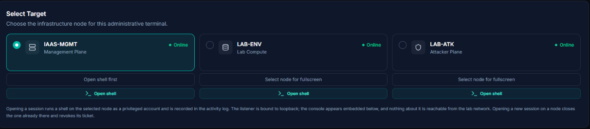
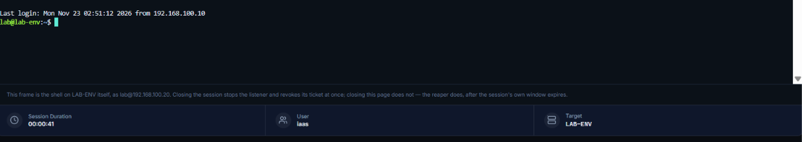

# Admin Terminal — Dokumentasi Implementasi Webportal IMNEHNET

**Penanggung jawab:** Septihadi Malik — Portal Developer  
**Tahap:** 03 — Admin Panel  
**Sumber:** Repository `Alief1150/imnehnet-iac`, branch `main` (audit 23 November 2026)  
**Status:** Implementasi terverifikasi pada source final; bukti end-to-end dan screenshot menyusul.

## 1. Deskripsi dan fungsi modul

Halaman Admin Terminal menyediakan pemilihan target node, pembukaan/penutupan sesi administratif, dan tampilan browser terminal hanya ketika sesi valid tersedia.

Modul dibuat dengan **Filament/Livewire PHP** untuk state, pengambilan data, otorisasi dan aksi backend, serta **Blade** untuk presentasi dan interaksi `wire:click`/`wire:poll`. Kode di bawah merupakan baris dari source asli dengan **komentar tambahan untuk penjelasan**, bukan file lengkap yang dapat langsung ditempel.

## 2. Kode penting: PHP, Blade, variabel dan alurnya

### 2.1 Terminal.php

```php
// PENJELASAN: State node pilihan dapat dipertahankan melalui URL.
    #[Url(as: 'target')]
    public string $selectedAdminTarget = 'iaas-mgmt';

    /**
     * Open a shell on the selected node.
     *
     * Every refusal is turned into a message on the page rather than an exception,
     * because the refusals are the expected cases here: an unprivileged role, a node
     * that will not answer, a slot that is already in use. A stack trace for any of
     * those tells an operator nothing they can act on.
     */
    public function openAdminSession(): void
    {
```

**Kode asli:** [Terminal.php — baris 67–79](https://github.com/Alief1150/imnehnet-iac/blob/main/webportal/app/Filament/Pages/Terminal.php#L67-L79).

**Fungsi dan alasan:** State node pilihan dapat dipertahankan melalui URL. Method/properti PHP memproses data di server. Nama variabel pada cuplikan perlu dibaca bersama class dan service yang dipanggil.

### 2.2 terminal-admin.blade.php

```blade
{{-- PENJELASAN: Blade membaca daftar target, sesi dan alamat terminal dari PHP. --}}
    @php
        $targets = collect($this->adminTargets());
        $selected = $targets->firstWhere('key', $this->selectedAdminTarget) ?? $targets->first();
        $session = $this->adminSession();
        $state = $this->adminSessionState();
        $url = $this->adminUrl();
        $embedUrl = $this->adminEmbedUrl();
        $frameSrc = $this->adminEmbedFrameSrc();
        $browserAccess = (bool) config('infrastructure.terminal.browser_access_enabled');
    @endphp

    <div class="space-y-5">
        <section class="rounded-xl border border-gray-200 bg-white shadow-sm dark:border-white/10 dark:bg-gray-900">
```

**Kode asli:** [terminal-admin.blade.php — baris 13–25](https://github.com/Alief1150/imnehnet-iac/blob/main/webportal/resources/views/filament/pages/terminal-admin.blade.php#L13-L25).

**Fungsi dan alasan:** Blade membaca daftar target, sesi dan alamat terminal dari PHP. Elemen Blade bertanggung jawab menampilkan UI atau mengirim event ke method Livewire; keputusan akses dan efek sistem tetap berada di PHP.

### 2.3 terminal-admin.blade.php

```blade
{{-- PENJELASAN: Tombol Open memanggil Livewire, bukan membuka shell langsung. --}}
                             depends on an earlier selection round trip having applied. --}}
                        <button type="button" wire:click="openAdminSessionFor('{{ $target['key'] }}')"
                                wire:key="admin-terminal-open-{{ $target['key'] }}"
                                wire:loading.attr="disabled"
                                title="Open a shell on {{ $target['name'] }} now"
                                class="mt-1.5 inline-flex h-7 w-full items-center justify-center gap-1.5 rounded-lg border border-teal-600/30 bg-teal-600/10 px-3 text-[11px] font-semibold text-teal-700 hover:bg-teal-600/20 disabled:opacity-60 dark:text-teal-300 dark:hover:bg-teal-500/20">
                            {!! \App\Support\Lucide::html('terminal') !!}
                            Open shell
                        </button>

                        @if ($this->hasAdminSession($target['key']))
                            <button type="button" wire:click="closeAdminSessionFor('{{ $target['key'] }}')"
                                    wire:key="admin-terminal-close-{{ $target['key'] }}"
```

**Kode asli:** [terminal-admin.blade.php — baris 95–107](https://github.com/Alief1150/imnehnet-iac/blob/main/webportal/resources/views/filament/pages/terminal-admin.blade.php#L95-L107).

**Fungsi dan alasan:** Tombol Open memanggil Livewire, bukan membuka shell langsung. Elemen Blade bertanggung jawab menampilkan UI atau mengirim event ke method Livewire; keputusan akses dan efek sistem tetap berada di PHP.

### 2.4 Terminal.php

```php
// PENJELASAN: Handler PHP menyiapkan pembukaan sesi dan pemeriksaan target.
     */
    public function openAdminSessionFor(string $node): void
    {
        $allowed = collect($this->adminTargets())->pluck('key');

        if (! $allowed->contains($node)) {
            $this->deny();

            return;
        }

        $this->selectedAdminTarget = $node;

```

**Kode asli:** [Terminal.php — baris 90–102](https://github.com/Alief1150/imnehnet-iac/blob/main/webportal/app/Filament/Pages/Terminal.php#L90-L102).

**Fungsi dan alasan:** Handler PHP menyiapkan pembukaan sesi dan pemeriksaan target. Method/properti PHP memproses data di server. Nama variabel pada cuplikan perlu dibaca bersama class dan service yang dipanggil.

### 2.5 Terminal.php

```php
// PENJELASAN: Sumber iframe ditentukan berdasarkan sesi backend.
     */
    public function adminEmbedFrameSrc(): ?string
    {
        $url = $this->adminEmbedUrl();

        if ($url === null) {
            return null;
        }

        return $url.'?'.http_build_query(AdminTerminalService::terminalPreferences());
    }

    /**
```

**Kode asli:** [Terminal.php — baris 317–329](https://github.com/Alief1150/imnehnet-iac/blob/main/webportal/app/Filament/Pages/Terminal.php#L317-L329).

**Fungsi dan alasan:** Sumber iframe ditentukan berdasarkan sesi backend. Method/properti PHP memproses data di server. Nama variabel pada cuplikan perlu dibaca bersama class dan service yang dipanggil.

## 3. Alur penggunaan

1. Administrator masuk ke panel **Admin** dengan akun yang memiliki izin.
2. Halaman Filament memuat data yang diperlukan dari service atau model.
3. Blade menampilkan nilai/status; tombol dan filter mengirim event Livewire jika tersedia.
4. Server memverifikasi permintaan dan mengembalikan hasil; status operasi harus diperiksa melalui data aktual.


## Implementasi dan Interaksi Terminal

### Alur lengkap Open Shell, penutupan sesi, dan service terminal

Tombol **Open shell** tidak sama dengan tautan **Open Terminal Fullscreen**. Tombol Open shell memicu pembuatan/mengambil sesi backend, sedangkan Fullscreen membuka konsol ttyd yang URL-nya tersedia setelah sesi berhasil dan embed ticket valid. Mengklik kartu target saja tidak menjalankan shell. UI menyediakan penutupan sesi secara terpisah.

**Urutan:** pilih target melalui tombol per-node → Livewire validasi node → service validasi user → audit permintaan → reconnect/create proses terminal → persist sesi dan ticket → embed frame → opsi fullscreen atau Close.

#### Tombol dan state Blade

**Open shell di Blade.** `wire:click` memanggil `openAdminSessionFor` menggunakan key node pada kartu. `wire:loading.attr` menonaktifkan tombol selama request. `wire:target` memastikan `Connecting...` hanya muncul untuk target yang sedang diproses. Tombol `Close` ditampilkan secara kondisional ketika sesi aktif.

```blade

                        {{-- Beside the card, never inside it: a button in a button is
                             invalid markup, and the inner click would also select. One
                             click opens that node's shell directly, so a shell never
                             depends on an earlier selection round trip having applied. --}}
                        <button type="button" wire:click="openAdminSessionFor('{{ $target['key'] }}')"
                                wire:key="admin-terminal-open-{{ $target['key'] }}"
                                wire:loading.attr="disabled"
                                wire:target="openAdminSessionFor('{{ $target['key'] }}')"
                                title="Open a shell on {{ $target['name'] }} now"
                                class="mt-1.5 inline-flex h-7 w-full items-center justify-center gap-1.5 rounded-lg border border-teal-600/30 bg-teal-600/10 px-3 text-[11px] font-semibold text-teal-700 hover:bg-teal-600/20 disabled:opacity-60 dark:text-teal-300 dark:hover:bg-teal-500/20">
                            {!! \App\Support\Lucide::html('terminal') !!}
                            <span wire:loading.remove wire:target="openAdminSessionFor('{{ $target['key'] }}')">Open shell</span>
                            <span wire:loading wire:target="openAdminSessionFor('{{ $target['key'] }}')">Connecting...</span>
                        </button>

                        @if ($this->hasAdminSession($target['key']))
                            <button type="button" wire:click="closeAdminSessionFor('{{ $target['key'] }}')"
                                    wire:key="admin-terminal-close-{{ $target['key'] }}"
                                    wire:loading.attr="disabled"
                                    wire:target="closeAdminSessionFor('{{ $target['key'] }}')"
                                    title="Close the shell on {{ $target['name'] }}"
                                    class="mt-1.5 inline-flex h-7 w-full items-center justify-center gap-1.5 rounded-lg border border-gray-300 px-3 text-[11px] font-semibold text-gray-600 hover:bg-gray-50 disabled:opacity-60 dark:border-white/15 dark:text-gray-300 dark:hover:bg-white/5">
                                {!! \App\Support\Lucide::html('trash') !!}
                                <span wire:loading.remove wire:target="closeAdminSessionFor('{{ $target['key'] }}')">Close</span>
                                <span wire:loading wire:target="closeAdminSessionFor('{{ $target['key'] }}')">Closing...</span>
                            </button>
                        @endif
                    </div>
                    @endforeach
                </div>
```

**[Buka kode asli `resources/views/filament/pages/terminal-admin.blade.php` — L112–L142](https://github.com/Alief1150/imnehnet-iac/blob/main/webportal/resources/views/filament/pages/terminal-admin.blade.php#L112-L142)**

#### Handler PHP/Livewire

**Alur Livewire.** Method memvalidasi key node terhadap `adminTargets()`, memilih target, kemudian memanggil `openAdminSessionOn`. Method internal memastikan user login, meminta service membuka sesi, membuat embed ticket, lalu menampilkan notifikasi sukses atau pesan kesalahan.

```php
    public function openAdminSessionFor(string $node): void
    {
        $allowed = collect($this->adminTargets())->pluck('key');

        if (! $allowed->contains($node)) {
            $this->deny();

            return;
        }

        $this->selectedAdminTarget = $node;

        $this->openAdminSessionOn($node);
    }

    /**
     * Open a shell on a node key the caller has already decided.
     *
     * Every refusal is turned into a message on the page rather than an exception,
     * because the refusals are the expected cases here: an unprivileged role, a node
     * that will not answer, a slot that is already in use. A stack trace for any of
     * those tells an operator nothing they can act on.
     */
    private function openAdminSessionOn(string $nodeKey): void
    {
        $user = auth()->user();

        if ($user === null) {
            $this->deny();

            return;
        }

        try {
            $service = app(AdminTerminalService::class);
            $session = $service->open($user, $nodeKey);

            $this->rememberEmbedTicket($service, $session);

            Notification::make()
                ->title('Shell opened')
                ->body(sprintf('Connected to %s as %s.', $session->target_node, $session->shell_user))
                ->success()
                ->send();
        } catch (Throwable $exception) {
            Notification::make()
                ->title('Could not open a shell')
                ->body($exception->getMessage())
                ->danger()
                ->persistent()
                ->send();
        }
    }

    /**
     * Close this person's live shell on the selected node.
     */
```

**[Buka kode asli `app/Filament/Pages/Terminal.php` — L91–L147](https://github.com/Alief1150/imnehnet-iac/blob/main/webportal/app/Filament/Pages/Terminal.php#L91-L147)**

#### Service otorisasi, audit, dan sesi

**Alur service.** Service menjalankan `assertMayOperate` untuk role/otorisasi, mengidentifikasi node, menulis audit aktivitas `requested`, melakukan reconnect jika sesi masih hidup, atau menyiapkan port/credential/PID bagi sesi baru. Proses belum selesai pada cuplikan: pencatatan `TerminalSession`, grant ticket, dan penanganan kegagalan dilanjutkan pada source.

```php
    public function open(User $user, string $nodeKey): TerminalSession
    {
        $this->assertMayOperate($user);

        $node = $this->node($nodeKey);

        // Before the shell exists. A log written only on success contains nothing about
        // the attempts that failed, which are the ones worth reading.
        $this->activity->record(
            actor: $user,
            action: self::ACTION_OPEN,
            resource: null,
            status: 'requested',
            description: sprintf('Requested an administrative shell on %s.', $node['label']),
        );

        $existing = TerminalSession::query()
            ->where('user_id', $user->getKey())
            ->where('target_kind', 'node')
            ->where('target_node', $node['key'])
            ->whereNull('closed_at')
            ->orderByDesc('created_at')
            ->first();

        // Reconnect reuses the existing PTY, preserving shell history and running tasks.
        if ($existing && $this->isConnected($existing)) {
            return $existing;
        }
        if ($existing) {
            $this->close($existing);
        }

        $port = $this->reservePort();
        $credential = bin2hex(random_bytes(self::CREDENTIAL_BYTES));
        $pid = $this->spawn($node, $port);

        try {
            $session = TerminalSession::query()->create([
            'user_id' => $user->getKey(),
            'lab_environment_id' => null,
            'target_kind' => 'node',
            'target_node' => $node['key'],
            'container_name' => null,
            'pid' => (string) $pid,
            'ttyd_port' => (string) $port,
            'credential' => $credential,
            'shell_uid' => null,
            'shell_user' => $this->loginName($node),
            'expires_at' => Carbon::now()->addMinutes(self::SESSION_MINUTES),
            ]);

            $this->slotAuth()->grant($port, $credential);
            $this->embedTickets()->issue($port);
        } catch (Throwable $exception) {
            // No orphaned shell when the database or grant file fails.
            $this->terminate($pid);
            if (isset($session)) {
                $session->forceFill(['closed_at' => Carbon::now()])->save();
            }
```

**[Buka kode asli `app/Services/Terminal/AdminTerminalService.php` — L163–L221](https://github.com/Alief1150/imnehnet-iac/blob/main/webportal/app/Services/Terminal/AdminTerminalService.php#L163-L221)**

**Kontrol keamanan:** akses terminal administratif bersifat istimewa. Keberhasilan klik tombol harus dibuktikan dengan audit log, status sesi, batasan role, dan hasil koneksi pada node uji; kegagalan tidak boleh disamarkan sebagai sesi terbuka. Jangan membuka shell produksi hanya untuk dokumentasi screenshot.

### Pemetaan tombol, aksi, dan handler

| Kontrol pada halaman | Handler atau state | Penjelasan alur dan hasil |
|---|---|---|
| **Open shell** | `openAdminSessionFor` | Node spesifik dikirim dari kartu ke Livewire, divalidasi terhadap target yang diizinkan, kemudian operasi diteruskan ke AdminTerminalService untuk otorisasi, audit, port, proses ttyd, dan penyimpanan sesi. |
| **Connecting...** | `wire:loading` | Indikator loading selama request, bukan tanda bahwa koneksi shell sudah berhasil. |
| **Close** | `closeAdminSessionFor` | Menutup sesi pada node terkait melalui handler dan service; pelepasan listener, kredensial, dan ticket harus sukses. |
| **Fullscreen** | `adminEmbed` | Tautan/akses fullscreen bergantung pada status sesi dan URL embed yang sudah valid; tidak membuat shell baru. |


**Cara membaca interaksi:** atribut `wire:click` menjalankan method komponen Livewire melalui request server; `wire:model` mengikat input dan properti; `wire:loading` hanya mencerminkan request masih diproses. Jika terjadi error, status aktual harus mengikuti respons backend, bukan hanya perubahan tampilan.

## 4. Screenshot yang dibutuhkan

Upload ke folder `jobdesc/Portal-Developer/images/03-admin/02-terminal/`:


*Gambar 1. Terminal: terminal overview.*



*Gambar 2. Terminal: terminal target.*



*Gambar 3. Terminal: terminal session.*


*Gambar 4. Terminal: terminal status.*

## 5. Pengujian dan batasan


### Hasil Pengujian Implementasi Admin — PASS (23 November 2026)

**Server:** `iaas-mgmt` · **Project:** `/home/iaas/projects/webportal-iaas` · **Metode:** verifikasi PHP read-only terhadap Laravel GET routes, class/method, Blade, binding `wire:click`/`wire:submit`, deklarasi aksi Filament Resource, dan indikasi validasi/otorisasi/pemanggilan service.

**Hasil pada modul terminal: PASS.** Seluruh **10 dari 10 modul Admin PASS**, dengan **146 pemeriksaan PASS dan 0 FAIL** pada script *Admin Panel Deep Verification V2*, dieksekusi **23 November 2026 pukul 05:04:41** (waktu tercetak di terminal server). Angka 146 merupakan **total lintas 10 modul**, bukan 146 pengujian khusus modul ini.

**Makna hasil:** halaman, class, method dan relasi UI–handler yang diperiksa tersedia. Sinyal seperti `authorization-check`, `validation` dan `service-reference` adalah hasil pembacaan source, **bukan** eksekusi seluruh cabang logika.

**Batas pembuktian:** belum dilakukan klik browser end-to-end, perubahan database, eksekusi action lifecycle lab, pembuatan sesi terminal, atau penyimpanan konfigurasi. Perilaku runtime tidak dinyatakan PASS dari pemeriksaan statis saja.
## 6. Kesimpulan

Struktur dan alur utama **Terminal** telah dijelaskan dengan 5 cuplikan source tertaut. Hasil verifikasi implementasi di IAAS-MGMT sudah tercatat PASS; bukti screenshot dan uji fungsional browser merupakan kategori bukti terpisah.


---
