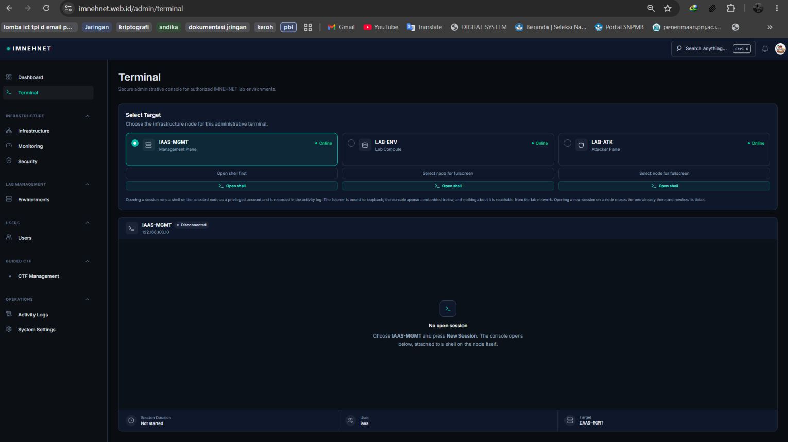
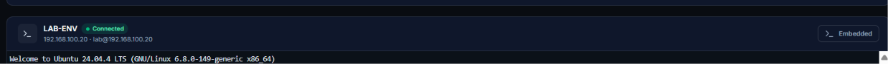

# Admin Terminal — Dokumentasi Implementasi Webportal IMNEHNET

**Penanggung jawab:** Septihadi Malik — Portal Developer  
**Tahap:** 03 — Admin Panel  
**Sumber:** Repository `Alief1150/imnehnet-iac`, branch `main` (audit 23 November 2026)  
**Status: Implementasi terverifikasi pada source final; bukti end-to-end dan screenshot menyusul.

## 1. Deskripsi dan fungsi modul

Halaman Admin Terminal menyediakan pemilihan target node, pembukaan/penutupan sesi administratif, dan tampilan browser terminal hanya ketika sesi valid tersedia.

Modul dibuat dengan **Filament/Livewire PHP** untuk state, pengambilan data, otorisasi dan aksi backend, serta **Blade** untuk presentasi dan interaksi `wire:click`/`wire:poll`. Kode di bawah merupakan baris dari source asli dengan **komentar tambahan untuk penjelasan**, bukan file lengkap yang dapat langsung ditempel.

## 2. Kode penting: PHP, Blade, variabel dan alurnya

### 2.1 Terminal.php

```php
// PENJELASAN: State node pilihan dapat dipertahankan melalui URL.
    #[Url(as: 'target')]
    public string $selectedAdminTarget = 'iaas-mgmt';

    /**
     * Open a shell on the selected node.
     *
     * Every refusal is turned into a message on the page rather than an exception,
     * because the refusals are the expected cases here: an unprivileged role, a node
     * that will not answer, a slot that is already in use. A stack trace for any of
     * those tells an operator nothing they can act on.
     */
    public function openAdminSession(): void
    {
```

**Kode asli:** [Terminal.php — baris 67–79](https://github.com/Alief1150/imnehnet-iac/blob/main/webportal/app/Filament/Pages/Terminal.php#L67-L79).

**Fungsi dan alasan:** State node pilihan dapat dipertahankan melalui URL. Method/properti PHP memproses data di server. Nama variabel pada cuplikan perlu dibaca bersama class dan service yang dipanggil.

### 2.2 terminal-admin.blade.php

```blade
{{-- PENJELASAN: Blade membaca daftar target, sesi dan alamat terminal dari PHP. --}}
    @php
        $targets = collect($this->adminTargets());
        $selected = $targets->firstWhere('key', $this->selectedAdminTarget) ?? $targets->first();
        $session = $this->adminSession();
        $state = $this->adminSessionState();
        $url = $this->adminUrl();
        $embedUrl = $this->adminEmbedUrl();
        $frameSrc = $this->adminEmbedFrameSrc();
        $browserAccess = (bool) config('infrastructure.terminal.browser_access_enabled');
    @endphp

    <div class="space-y-5">
        <section class="rounded-xl border border-gray-200 bg-white shadow-sm dark:border-white/10 dark:bg-gray-900">
```

**Kode asli:** [terminal-admin.blade.php — baris 13–25](https://github.com/Alief1150/imnehnet-iac/blob/main/webportal/resources/views/filament/pages/terminal-admin.blade.php#L13-L25).

**Fungsi dan alasan:** Blade membaca daftar target, sesi dan alamat terminal dari PHP. Elemen Blade bertanggung jawab menampilkan UI atau mengirim event ke method Livewire; keputusan akses dan efek sistem tetap berada di PHP.

### 2.3 terminal-admin.blade.php

```blade
{{-- PENJELASAN: Tombol Open memanggil Livewire, bukan membuka shell langsung. --}}
                             depends on an earlier selection round trip having applied. --}}
                        <button type="button" wire:click="openAdminSessionFor('{{ $target['key'] }}')"
                                wire:key="admin-terminal-open-{{ $target['key'] }}"
                                wire:loading.attr="disabled"
                                title="Open a shell on {{ $target['name'] }} now"
                                class="mt-1.5 inline-flex h-7 w-full items-center justify-center gap-1.5 rounded-lg border border-teal-600/30 bg-teal-600/10 px-3 text-[11px] font-semibold text-teal-700 hover:bg-teal-600/20 disabled:opacity-60 dark:text-teal-300 dark:hover:bg-teal-500/20">
                            {!! \App\Support\Lucide::html('terminal') !!}
                            Open shell
                        </button>

                        @if ($this->hasAdminSession($target['key']))
                            <button type="button" wire:click="closeAdminSessionFor('{{ $target['key'] }}')"
                                    wire:key="admin-terminal-close-{{ $target['key'] }}"
```

**Kode asli:** [terminal-admin.blade.php — baris 95–107](https://github.com/Alief1150/imnehnet-iac/blob/main/webportal/resources/views/filament/pages/terminal-admin.blade.php#L95-L107).

**Fungsi dan alasan:** Tombol Open memanggil Livewire, bukan membuka shell langsung. Elemen Blade bertanggung jawab menampilkan UI atau mengirim event ke method Livewire; keputusan akses dan efek sistem tetap berada di PHP.

### 2.4 Terminal.php

```php
// PENJELASAN: Handler PHP menyiapkan pembukaan sesi dan pemeriksaan target.
     */
    public function openAdminSessionFor(string $node): void
    {
        $allowed = collect($this->adminTargets())->pluck('key');

        if (! $allowed->contains($node)) {
            $this->deny();

            return;
        }

        $this->selectedAdminTarget = $node;

```

**Kode asli:** [Terminal.php — baris 90–102](https://github.com/Alief1150/imnehnet-iac/blob/main/webportal/app/Filament/Pages/Terminal.php#L90-L102).

**Fungsi dan alasan:** Handler PHP menyiapkan pembukaan sesi dan pemeriksaan target. Method/properti PHP memproses data di server. Nama variabel pada cuplikan perlu dibaca bersama class dan service yang dipanggil.

### 2.5 Terminal.php

```php
// PENJELASAN: Sumber iframe ditentukan berdasarkan sesi backend.
     */
    public function adminEmbedFrameSrc(): ?string
    {
        $url = $this->adminEmbedUrl();

        if ($url === null) {
            return null;
        }

        return $url.'?'.http_build_query(AdminTerminalService::terminalPreferences());
    }

    /**
```

**Kode asli:** [Terminal.php — baris 317–329](https://github.com/Alief1150/imnehnet-iac/blob/main/webportal/app/Filament/Pages/Terminal.php#L317-L329).

**Fungsi dan alasan:** Sumber iframe ditentukan berdasarkan sesi backend. Method/properti PHP memproses data di server. Nama variabel pada cuplikan perlu dibaca bersama class dan service yang dipanggil.

## 3. Alur penggunaan

1. Administrator masuk ke panel **Admin** dengan akun yang memiliki izin.
2. Halaman Filament memuat data yang diperlukan dari service atau model.
3. Blade menampilkan nilai/status; tombol dan filter mengirim event Livewire jika tersedia.
4. Server memverifikasi permintaan dan mengembalikan hasil; status operasi harus diperiksa melalui data aktual.

## 4. Screenshot yang dibutuhkan

Upload ke folder `jobdesc/Portal-Developer/images/03-admin/02-terminal/`:



*Gambar 1. Terminal: terminal overview.*


*Gambar 2. Terminal: terminal target.*


*Gambar 3. Terminal: terminal session.*



*Gambar 4. Terminal: terminal status.*

## 5. Pengujian dan batasan

| Pengujian | Ekspektasi | Status |
|---|---|---|
| Login Admin lalu buka modul | Halaman dan komponen muncul tanpa error | Belum dilampirkan |
| Akses oleh akun tanpa izin | Akses dibatasi sesuai role | Belum dilampirkan |
| Cek isi kartu/tabel/status | Nilai sesuai data backend; tidak dikarang | Belum dilampirkan |
| Coba tombol/filter pada data uji sah | Alur dan validasi backend berjalan sesuai aturan | Belum dilampirkan |

**Catatan:** jangan memodifikasi infrastruktur atau membuka sesi nyata hanya untuk screenshot. Source final telah disinkronkan ke GitHub main pada commit b3370b5; perilaku runtime tetap memerlukan bukti uji.

## 6. Kesimpulan

Struktur dan alur utama **Terminal** telah dijelaskan dengan 5 cuplikan source tertaut. Screenshot dan bukti pengujian masih perlu dilengkapi untuk menyatakan dokumentasi final.


---

## Pembaruan Audit Source Final — 23 November 2026

**Basis versi:** commit [`b3370b5`](https://github.com/Alief1150/imnehnet-iac/commit/b3370b58f5cda76e6b982cc788a1cf42ef75ecdf) (`feat(portal): joh nggateli`). Contoh berikut adalah cuplikan source terbaru; penjelasan ditempatkan di luar kode agar tidak disalahartikan sebagai baris asli.

### Implementasi yang diverifikasi melalui source

Open shell: tombol Blade mengirim key node via Livewire; node divalidasi, dipilih, lalu openAdminSessionOn memanggil AdminTerminalService dan menangani notifikasi/error.

```php
    public function openAdminSessionFor(string $node): void
    {
        $allowed = collect($this->adminTargets())->pluck('key');

        if (! $allowed->contains($node)) {
            $this->deny();

            return;
        }

        $this->selectedAdminTarget = $node;

        $this->openAdminSessionOn($node);
    }

    /**
     * Open a shell on a node key the caller has already decided.
```

**[Buka kode asli — app/Filament/Pages/Terminal.php, baris 91–107](https://github.com/Alief1150/imnehnet-iac/blob/main/webportal/app/Filament/Pages/Terminal.php#L91-L107)**

**Status implementasi:** TERSEDIA DALAM SOURCE `main`. **Status pengujian:** keberadaan kode dan koneksi halaman tidak cukup untuk menyatakan seluruh skenario PASS; pengujian role, interaksi, error path, dan screenshot dinyatakan **perlu bukti hasil uji** bila belum dilampirkan. Dengan demikian tabel pengujian terdahulu adalah daftar verifikasi, bukan bukti kegagalan fitur.
