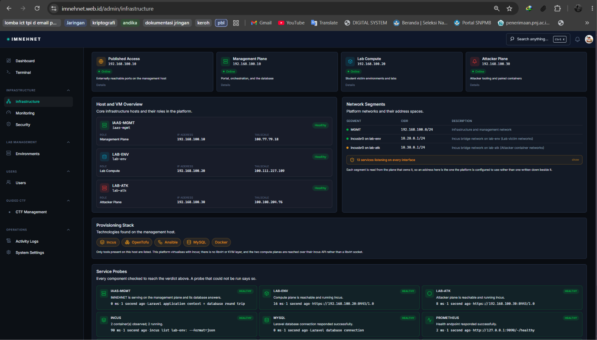
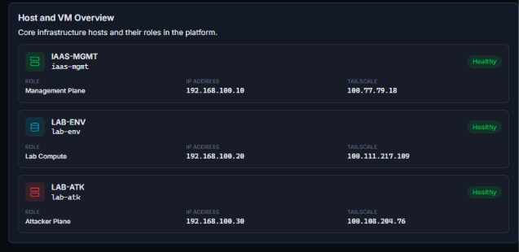
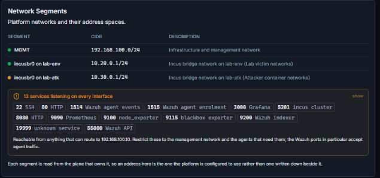
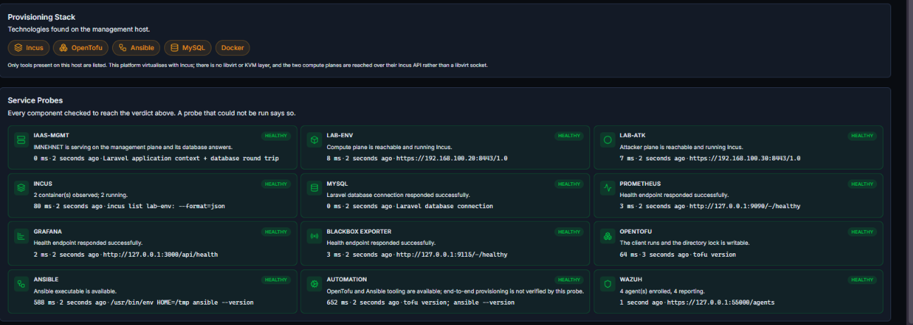

# Admin Infrastructure — Dokumentasi Implementasi Webportal IMNEHNET

**Penanggung jawab:** Septihadi Malik — Portal Developer  
**Tahap:** 03 — Admin Panel  
**Sumber:** Repository `Alief1150/imnehnet-iac`, branch `main` (audit 23 November 2026)  
**Status: Implementasi terverifikasi pada source final; bukti end-to-end dan screenshot menyusul.

## 1. Deskripsi dan fungsi modul

Admin Infrastructure menampilkan topologi management/compute/attacker plane, daftar host dan VM, network segments, provisioning stack, serta service probes.

Modul dibuat dengan **Filament/Livewire PHP** untuk state, pengambilan data, otorisasi dan aksi backend, serta **Blade** untuk presentasi dan interaksi `wire:click`/`wire:poll`. Kode di bawah merupakan baris dari source asli dengan **komentar tambahan untuk penjelasan**, bukan file lengkap yang dapat langsung ditempel.

## 2. Kode penting: PHP, Blade, variabel dan alurnya

### 2.1 Infrastructure.php

```php
// PENJELASAN: Data health memakai InfrastructureStatusService agar hasil konsisten.
     */
    public function statusSummary(): array
    {
        return app(InfrastructureStatusService::class)->summary();
    }

    /**
     * The planes, hosts, network segments and provisioning stack.
     *
     * Collected here rather than passed to the view as data so that the service stays the
     * only place that knows how any of it is measured. The template holds no constants:
     * a page whose job is to describe this installation must not carry its own
     * description of it as a literal, because the installation changes and the literal
```

**Kode asli:** [Infrastructure.php — baris 54–66](https://github.com/Alief1150/imnehnet-iac/blob/main/webportal/app/Filament/Pages/Infrastructure.php#L54-L66).

**Fungsi dan alasan:** Data health memakai InfrastructureStatusService agar hasil konsisten. Method/properti PHP memproses data di server. Nama variabel pada cuplikan perlu dibaca bersama class dan service yang dipanggil.

### 2.2 Infrastructure.php

```php
// PENJELASAN: Topologi disusun InfrastructureTopologyService.
     */
    public function topology(): array
    {
        return app(InfrastructureTopologyService::class)->topology();
    }

    /**
     * When the figures above were read.
     *
     * Stated rather than implied. A topology page with no timestamp reads as current even
     * though it was assembled from probes that each have their own age, and an operator
     * comparing a plane card to a `ping` needs to know which is older.
     *
```

**Kode asli:** [Infrastructure.php — baris 70–82](https://github.com/Alief1150/imnehnet-iac/blob/main/webportal/app/Filament/Pages/Infrastructure.php#L70-L82).

**Fungsi dan alasan:** Topologi disusun InfrastructureTopologyService. Method/properti PHP memproses data di server. Nama variabel pada cuplikan perlu dibaca bersama class dan service yang dipanggil.

### 2.3 infrastructure.blade.php

```blade
{{-- PENJELASAN: Polling Livewire memperbarui tampilan secara berkala. --}}
    --}}
    <div wire:poll.15s>
    @php
        $topology = $this->topology();
        $planes = $topology['planes'] ?? [];
        $hosts = $topology['hosts'] ?? [];
        $segments = $topology['segments'] ?? [];
        $stack = $topology['stack'] ?? [];
    @endphp

    {{-- ── plane cards ────────────────────────────────────────────────────────
         Four across, always.

```

**Kode asli:** [infrastructure.blade.php — baris 37–49](https://github.com/Alief1150/imnehnet-iac/blob/main/webportal/resources/views/filament/pages/infrastructure.blade.php#L37-L49).

**Fungsi dan alasan:** Polling Livewire memperbarui tampilan secara berkala. Elemen Blade bertanggung jawab menampilkan UI atau mengirim event ke method Livewire; keputusan akses dan efek sistem tetap berada di PHP.

### 2.4 infrastructure.blade.php

```blade
{{-- PENJELASAN: Blade mengulang data untuk kartu plane. --}}
    <div class="grid grid-cols-1 gap-3 sm:grid-cols-2 md:grid-cols-4">
        @foreach ($planes as $plane)
            <article class="card border border-base-content/10 shadow-sm">
                {{-- Tighter than the card component's default padding. Four across leaves
                     each card roughly 260 pixels, and the default padding spends a third
                     of that on nothing. --}}
                <div class="card-body gap-2 p-4">
                    {{-- Icon, name, status. That is the whole row in the design, and it is
                         the part a reader scans. --}}
                    <div class="flex items-center gap-2.5">
                        <span @class([
                            'flex size-9 shrink-0 items-center justify-center rounded-lg',
                            'bg-success/15 text-success' => $plane['tone'] === 'success',
```

**Kode asli:** [infrastructure.blade.php — baris 62–74](https://github.com/Alief1150/imnehnet-iac/blob/main/webportal/resources/views/filament/pages/infrastructure.blade.php#L62-L74).

**Fungsi dan alasan:** Blade mengulang data untuk kartu plane. Elemen Blade bertanggung jawab menampilkan UI atau mengirim event ke method Livewire; keputusan akses dan efek sistem tetap berada di PHP.

### 2.5 infrastructure.blade.php

```blade
{{-- PENJELASAN: Hasil probe ditampilkan berdasarkan status yang dikembalikan service. --}}
            <div class="grid gap-2 sm:grid-cols-2 xl:grid-cols-3">
                @foreach (collect($this->statusSummary()) as $key => $service)
                    @php
                        $tone = match ($service['status']) {
                            'healthy' => 'success',
                            'degraded' => 'warning',
                            'offline', 'down' => 'error',
                            default => 'muted',
                        };
                    @endphp

                    {{-- Icons are Lucide, resolved from the generated set. The widget this
                         replaced asked for Heroicons, which this project does not ship, so
```

**Kode asli:** [infrastructure.blade.php — baris 392–404](https://github.com/Alief1150/imnehnet-iac/blob/main/webportal/resources/views/filament/pages/infrastructure.blade.php#L392-L404).

**Fungsi dan alasan:** Hasil probe ditampilkan berdasarkan status yang dikembalikan service. Elemen Blade bertanggung jawab menampilkan UI atau mengirim event ke method Livewire; keputusan akses dan efek sistem tetap berada di PHP.

### 2.6 InfrastructureStatusService.php

```php
// PENJELASAN: Cache lima detik mengurangi beban probing berulang.
    {
        return Cache::remember(
            'infrastructure.status.summary',
            now()->addSeconds(5),
            fn (): array => $this->probeSummary(),
        );
    }

    /**
     * @return array<string, array<string, mixed>>
     */
    private function probeSummary(): array
    {
```

**Kode asli:** [InfrastructureStatusService.php — baris 25–37](https://github.com/Alief1150/imnehnet-iac/blob/main/webportal/app/Services/InfrastructureStatusService.php#L25-L37).

**Fungsi dan alasan:** Cache lima detik mengurangi beban probing berulang. Method/properti PHP memproses data di server. Nama variabel pada cuplikan perlu dibaca bersama class dan service yang dipanggil.

## 3. Alur penggunaan

1. Administrator masuk ke panel **Admin** dengan akun yang memiliki izin.
2. Halaman Filament memuat data yang diperlukan dari service atau model.
3. Blade menampilkan nilai/status; tombol dan filter mengirim event Livewire jika tersedia.
4. Server memverifikasi permintaan dan mengembalikan hasil; status operasi harus diperiksa melalui data aktual.

## 4. Screenshot yang dibutuhkan

Upload ke folder `jobdesc/Portal-Developer/images/03-admin/03-infrastructure/`:



*Gambar 1. Infrastructure: infrastructure overview.*



*Gambar 2. Infrastructure: host topology.*



*Gambar 3. Infrastructure: network segments.*



*Gambar 4. Infrastructure: service probes.*

## 5. Pengujian dan batasan


### Hasil Pengujian Implementasi Admin — PASS (23 November 2026)

**Server:** `iaas-mgmt` · **Project:** `/home/iaas/projects/webportal-iaas` · **Metode:** verifikasi PHP read-only terhadap Laravel GET routes, class/method, Blade, binding `wire:click`/`wire:submit`, deklarasi aksi Filament Resource, dan indikasi validasi/otorisasi/pemanggilan service.

**Hasil pada modul infrastructure: PASS.** Seluruh **10 dari 10 modul Admin PASS**, dengan **146 pemeriksaan PASS dan 0 FAIL** pada script *Admin Panel Deep Verification V2*, dieksekusi **23 November 2026 pukul 05:04:41** (waktu tercetak di terminal server). Angka 146 merupakan **total lintas 10 modul**, bukan 146 pengujian khusus modul ini.

**Makna hasil:** halaman, class, method dan relasi UI–handler yang diperiksa tersedia. Sinyal seperti `authorization-check`, `validation` dan `service-reference` adalah hasil pembacaan source, **bukan** eksekusi seluruh cabang logika.

**Batas pembuktian:** belum dilakukan klik browser end-to-end, perubahan database, eksekusi action lifecycle lab, pembuatan sesi terminal, atau penyimpanan konfigurasi. Perilaku runtime tidak dinyatakan PASS dari pemeriksaan statis saja.
## 6. Kesimpulan

Struktur dan alur utama **Infrastructure** telah dijelaskan dengan 6 cuplikan source tertaut. Hasil verifikasi implementasi di IAAS-MGMT sudah tercatat PASS; bukti screenshot dan uji fungsional browser merupakan kategori bukti terpisah.


---
